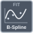

<!-- Generated by tools/export_studio_help.py; edit the reviewed source metadata, then regenerate. -->
# B-Spline Fit

[Mathematics functions](../../mathematics/index.md) · [All functions](../../index.md)

Fits a parametric B-spline, with distinct XY and nD variants. Both fitted coordinates can change. nD observations occupy rows [n,D]. Degree3, control_points10 and centripetal parameterization2 are defaults. GS uses clamped uniform knots and Cox/de Boor bases. Variants: xy, nd.

## Product execution profiles

The shared index declares native examples for this object; see [the examples below](b_spline_fit.md#examples) and [document profiles and evidence boundaries](../../../reference/studio-draft-examples.md). Older binding/help statements retained below can lag those product profiles. They do not establish or deny the separately measured native profiles. An example declaration alone is not an execution result or admission of every overload.

Résumé français de l’aide Studio

**B-Spline Fit**

Texte historique de l’aide conservé ci-dessous. Des exemples natifs distincts sont déclarés pour cet objet ; consultez les profils et preuves datés, sans déduire une compatibilité universelle de ce texte.

B-spline paramétrique XY ou nD ; les points nD sont les lignes [n,D] et les deux coordonnées XY peuvent changer. Variantes : xy, nd.

## Studio authoring profile

Contract status: **partial**. The connector below describes Studio authoring; execution availability is stated separately.

## IN — inputs

| Displayed terminal / internal ID | Accepted / resolved type | Studio connection | Unwired input default | Meaning |
| --- | --- | --- | --- | --- |
| # of control points `control_points` | `i32` | Optional | Not specified | — |
| Y `y` | `array<f64>` | Required | Not specified | — |
| X `x` | `array<f64>` | Required | Not specified | — |
| Weight `weight` | `array<f64>` | Optional | Not specified | — |
| degree `degree` | `i32` | Optional | Not specified | — |
| parameter selection `parameter_selection` | `u16` | Optional | Not specified | — |

A default is shown only for an input with an explicitly documented value. Preview/default *types* do not imply unwired operand values. If helper and binding flags differ, both are labelled.

## OUT — outputs

| Displayed terminal / internal ID | Accepted / resolved type | Studio connection | Unwired input default | Meaning |
| --- | --- | --- | --- | --- |
| Best BSpline Fit Y `best_fit_y` | `array<f64>` | Recommended | — | — |
| Best BSpline Fit X `best_fit_x` | `array<f64>` | Recommended | — | — |
| error `error` | `i32` | Recommended | — | — |
| residue `residue` | `f64` | Recommended | — | — |

A default is shown only for an input with an explicitly documented value. Preview/default *types* do not imply unwired operand values. If helper and binding flags differ, both are labelled.

## Types and Compatibility

The notes below retain the reviewed help's original NI and Studio scopes. An NI overload is not a claim of Studio runtime support; the authoring profile and execution limits remain separate.

Retained binding and help statements

These are source declarations, not the current measured product-execution assessment. Compare historical limitations with the separately dated native profiles above.

Real DBL, ranks and exact structured model schemas; diagnostic is I32 or error cluster according to the selected signature.

Real DBL Arrays only (vectors rank1, matrices rank2); numeric promotions are explicit and may round large integers. No complex-to-real coercion, scalar lifting, broadcasting or private Matrix substitution. Model/error/constraint records and native references keep exact schemas. Declared availability is separate from complete-graph target admission and execution proof. Available variants: xy, nd.

Notes de types et de compatibilité de l’aide Studio

Les mentions NI et Studio gardent leur portée d’origine. Une variante NI ne constitue pas une déclaration de prise en charge par le runtime Studio ; consultez les profils et limites d’exécution de cette fiche.

DBL réel, rangs et structures exacts ; diagnostic I32 ou cluster suivant la variante.

- Type resolution: `custom_resolver`; result expression: `resolve:frog.studio.fitting.type-resolution@1`.
- Implicit coercion: permitted by this profile.
- Arrays: accepted; lifting policy: `none`.
- Shape rule: `fitting_variant_exact_rank_and_observation_parameter_shapes`.
- Scalar lifting: no.
- Broadcasting: no.

**Input count:** 6; this contract does not enable variadic inputs.

Port order: `control_points` → `y` → `x` → `weight` → `degree` → `parameter_selection`.

## Execution and limits

**Public FROG / target Runtime:** declared available within the scope below.

Scope: `requires_explicit_target_capability`.

Implementation: `frog.studio.math.fitting.b_spline_fit.xy.owned.v1`.

Required provider: `frog.studio.math.fitting.owned@1`.

Each selected variant has its own exact public native operation identity and signature. A strict model callback must be admitted and compiled through the same prepared native graph; no historical Highlight or text substitution fallback.

Connector type defaults and persistence aliases

| Direction | ID | Preview/default type | Connection policy | Cardinality | Legacy port IDs |
| --- | --- | --- | --- | --- | --- |
| INPUT | `control_points` | `i32` | `numeric_implicit` | `single` | — |
| INPUT | `y` | `array<f64>` | `numeric_array_implicit` | `single` | — |
| INPUT | `x` | `array<f64>` | `numeric_array_implicit` | `single` | — |
| INPUT | `weight` | `array<f64>` | `numeric_array_implicit` | `single` | — |
| INPUT | `degree` | `i32` | `numeric_implicit` | `single` | — |
| INPUT | `parameter_selection` | `u16` | `numeric_implicit` | `single` | — |
| OUTPUT | `best_fit_y` | `array<f64>` | `exact` | `single` | — |
| OUTPUT | `best_fit_x` | `array<f64>` | `exact` | `single` | — |
| OUTPUT | `error` | `i32` | `exact` | `single` | — |
| OUTPUT | `residue` | `f64` | `exact` | `single` | — |

## Examples

These are real `.frog` documents from the same index used by Studio. Backend names and expected results describe the examples; they are not execution certificates.

- [B-Spline Fit](../../../examples/math.fitting.b_spline_fit.worked.md) — Fit the line y = 1 + 2x with four spline control points. The sampled fitted ordinates reproduce the line. (`execution`, `studio-draft`).

## Identity and references

- Catalogue ID: `math.fitting.b_spline_fit`.
- Parent palette: [Fitting](../../mathematics/fitting.md).
- Profile: `frog.studio.polymorphic.math.fitting.b_spline_fit.v1`.
- Definition: `frog.studio.math.fitting.b_spline_fit`.
- [NI API reference](https://www.ni.com/docs/en-US/bundle/labview-api-ref/page/vi-lib/analysis/6fits-llb/1d-b-spline-fit-vi.html).
- [NI API reference](https://www.ni.com/docs/en-US/bundle/labview-api-ref/page/vi-lib/analysis/6fits-llb/nd-b-spline-fit-vi.html).

NI links are reference sources for the connector model; Studio support is limited to the profile above. [Reference provenance and notation](../../index.md#provenance-and-notation).
