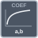

<!-- Generated by tools/export_studio_help.py; edit the reviewed source metadata, then regenerate. -->
# Log Fit Coef

[Mathematics functions](../../mathematics/index.md) · [All functions](../../index.md)

Estimates amplitude and multiplicative scale in amplitude*log_base(scale*x), not slope/intercept under different labels. Default base e; nonidentifiable zero amplitude is diagnosed. Variants: default.

Résumé français de l’aide Studio

**Log Fit Coef**

Estime amplitude et scale multiplicatif du logarithme ; base e par défaut. Variantes : default.

## Studio authoring profile

Contract status: **partial**. The connector below describes Studio authoring; execution availability is stated separately.

## IN — inputs

| Displayed terminal / internal ID | Accepted / resolved type | Studio connection | Unwired input default | Meaning |
| --- | --- | --- | --- | --- |
| base `base` | `f64` | Optional | Not specified | — |
| Y `y` | `array<f64>` | Required | Not specified | — |
| X `x` | `array<f64>` | Required | Not specified | — |
| Weight `weight` | `array<f64>` | Optional | Not specified | — |
| tolerance `tolerance` | `f64` | Optional | Not specified | — |
| method `method` | `u16` | Optional | Not specified | — |

A default is shown only for an input with an explicitly documented value. Preview/default *types* do not imply unwired operand values. If helper and binding flags differ, both are labelled.

## OUT — outputs

| Displayed terminal / internal ID | Accepted / resolved type | Studio connection | Unwired input default | Meaning |
| --- | --- | --- | --- | --- |
| amplitude `amplitude` | `f64` | Recommended | — | — |
| scale `scale` | `f64` | Recommended | — | — |
| error `error` | `i32` | Recommended | — | — |

A default is shown only for an input with an explicitly documented value. Preview/default *types* do not imply unwired operand values. If helper and binding flags differ, both are labelled.

## Types and Compatibility

The notes below retain the reviewed help's original NI and Studio scopes. An NI overload is not a claim of Studio runtime support; the authoring profile and execution limits remain separate.

Real DBL, ranks and exact structured model schemas; diagnostic is I32 or error cluster according to the selected signature.

Real DBL Arrays only (vectors rank1, matrices rank2); numeric promotions are explicit and may round large integers. No complex-to-real coercion, scalar lifting, broadcasting or private Matrix substitution. Model/error/constraint records and native references keep exact schemas. Declared availability is separate from complete-graph target admission and execution proof. Available variants: default.

Notes de types et de compatibilité de l’aide Studio

Les mentions NI et Studio gardent leur portée d’origine. Une variante NI ne constitue pas une déclaration de prise en charge par le runtime Studio ; consultez les profils et limites d’exécution de cette fiche.

DBL réel, rangs et structures exacts ; diagnostic I32 ou cluster suivant la variante.

- Type resolution: `custom_resolver`; result expression: `resolve:frog.studio.fitting.type-resolution@1`.
- Implicit coercion: permitted by this profile.
- Arrays: accepted; lifting policy: `none`.
- Shape rule: `fitting_variant_exact_rank_and_observation_parameter_shapes`.
- Scalar lifting: no.
- Broadcasting: no.

**Input count:** 6; this contract does not enable variadic inputs.

Port order: `base` → `y` → `x` → `weight` → `tolerance` → `method`.

## Execution and limits

**Public FROG / target Runtime:** declared available within the scope below.

Scope: `requires_explicit_target_capability`.

Implementation: `frog.studio.math.fitting.logarithm_fit_coefficients.owned.v1`.

Required provider: `frog.studio.math.fitting.owned@1`.

Each selected variant has its own exact public native operation identity and signature. A strict model callback must be admitted and compiled through the same prepared native graph; no historical Highlight or text substitution fallback.

Connector type defaults and persistence aliases

| Direction | ID | Preview/default type | Connection policy | Cardinality | Legacy port IDs |
| --- | --- | --- | --- | --- | --- |
| INPUT | `base` | `f64` | `numeric_implicit` | `single` | — |
| INPUT | `y` | `array<f64>` | `numeric_array_implicit` | `single` | — |
| INPUT | `x` | `array<f64>` | `numeric_array_implicit` | `single` | — |
| INPUT | `weight` | `array<f64>` | `numeric_array_implicit` | `single` | — |
| INPUT | `tolerance` | `f64` | `numeric_implicit` | `single` | — |
| INPUT | `method` | `u16` | `numeric_implicit` | `single` | — |
| OUTPUT | `amplitude` | `f64` | `exact` | `single` | — |
| OUTPUT | `scale` | `f64` | `exact` | `single` | — |
| OUTPUT | `error` | `i32` | `exact` | `single` | — |

## Examples

No example for this object is currently declared in the shared index. [Browse the available examples](../../../examples/index.md).

## Identity and references

- Catalogue ID: `math.fitting.logarithm_fit_coefficients`.
- Parent palette: [Advanced Curve Fitting](../../mathematics/fitting/advanced_curve_fitting.md).
- Profile: `frog.studio.polymorphic.math.fitting.logarithm_fit_coefficients.v1`.
- Definition: `frog.studio.math.fitting.logarithm_fit_coefficients`.
- [NI API reference](https://www.ni.com/docs/en-US/bundle/labview-api-ref/page/vi-lib/analysis/6fits-llb/logarithm-fit-coefficients-vi.html).

NI links are reference sources for the connector model; Studio support is limited to the profile above. [Reference provenance and notation](../../index.md#provenance-and-notation).
