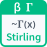

<!-- Generated by tools/export_studio_help.py; edit the reviewed source metadata, then regenerate. -->
# Stirling

[Mathematics functions](../../mathematics/index.md) · [All functions](../../index.md)

First Stirling term for Gamma at r=abs(x)&gt;0: sqrt(2*pi)*r^(r-1/2)*exp(-r), evaluated in log space. FROG stirling_leading_v1 is an approximation whose NI truncation was not verified. Formula: exp((r-0.5)*ln(r)-r+0.5*ln(2*pi)), r=abs(x). Example: Stirling(1)=0.9221370088957891.

## Product execution profiles

The shared index declares native examples for this object; see [the examples below](stirling_leading.md#examples) and [document profiles and evidence boundaries](../../../reference/studio-draft-examples.md). Older binding/help statements retained below can lag those product profiles. They do not establish or deny the separately measured native profiles. An example declaration alone is not an execution result or admission of every overload.

Résumé français de l’aide Studio

**Stirling**

Texte historique de l’aide conservé ci-dessous. Des exemples natifs distincts sont déclarés pour cet objet ; consultez les profils et preuves datés, sans déduire une compatibilité universelle de ce texte.

Premier terme de Stirling pour Gamma en r=abs(x)&gt;0 : sqrt(2*pi)*r^(r-1/2)*exp(-r), calculé en logarithmes. Approximation FROG stirling_leading_v1 ; troncature NI non vérifiée. Formule : exp((r-0.5)*ln(r)-r+0.5*ln(2*pi)), r=abs(x). Exemple : Stirling(1)=0.9221370088957891. [Types] x:f64 -&gt; value:f64. Socle scalaire uniquement. Promotion visible des entrées numériques réelles vers f64 ; n est un i32 exact. Toutes les sorties sont f64. Sans tableaux, clusters, complexes, conversion angulaire ou broadcasting. Diagnostics FROG SINGULAR, DOMAIN, NONFINITE_INPUT, OVERFLOW, UNDERFLOW, NUMERICAL_FAILURE via le canal commun, sans terminal d’erreur. Sous-normaux représentables conservés. Seules les bornes Gamma P/Q acceptent +Infinity. Connecteurs et conventions documentés de LabVIEW classique ; signatures NXG et parité numérique NI non vérifiées. FROG définit le profil versionné, le premier terme de Stirling et l’association forme/borne. Profil frog_gamma_proposed_v1.

## Studio authoring profile

Contract status: **partial**. The connector below describes Studio authoring; execution availability is stated separately.

Retained binding and help description

This is the source declaration, not the current measured product-execution assessment.

First Stirling term for Gamma at r=abs(x)&gt;0: sqrt(2*pi)*r^(r-1/2)*exp(-r), evaluated in log space. FROG stirling_leading_v1 is an approximation whose NI truncation was not verified. Formula: exp((r-0.5)*ln(r)-r+0.5*ln(2*pi)), r=abs(x). Example: Stirling(1)=0.9221370088957891. Scalar baseline only. Real numeric inputs promote visibly to f64; n must be exact i32. Every output is f64. No arrays, clusters, complex arguments, angle conversion or broadcasting. FROG diagnostics SINGULAR, DOMAIN, NONFINITE_INPUT, OVERFLOW, UNDERFLOW, NUMERICAL_FAILURE use the common engine channel; no error terminal. Preserve representable subnormals. Only Gamma P/Q limits accept +Infinity. Classic LabVIEW scalar connectors and documented conventions; not verified NXG signatures or measured NI runtime parity. FROG owns the versioned numerical profile, Stirling first term and explicit shape/limit mapping. Numeric profile frog_gamma_proposed_v1.

x:f64 -&gt; value:f64. Scalar baseline only. Real numeric inputs promote visibly to f64; n must be exact i32. Every output is f64. No arrays, clusters, complex arguments, angle conversion or broadcasting. FROG diagnostics SINGULAR, DOMAIN, NONFINITE_INPUT, OVERFLOW, UNDERFLOW, NUMERICAL_FAILURE use the common engine channel; no error terminal. Preserve representable subnormals. Only Gamma P/Q limits accept +Infinity. Classic LabVIEW scalar connectors and documented conventions; not verified NXG signatures or measured NI runtime parity. FROG owns the versioned numerical profile, Stirling first term and explicit shape/limit mapping. Profile frog_gamma_proposed_v1.

## IN — inputs

| Displayed terminal / internal ID | Accepted / resolved type | Studio connection | Unwired input default | Meaning |
| --- | --- | --- | --- | --- |
| x `x` | `f64` | Required | Not specified | — |

A default is shown only for an input with an explicitly documented value. Preview/default *types* do not imply unwired operand values. If helper and binding flags differ, both are labelled.

## OUT — outputs

| Displayed terminal / internal ID | Accepted / resolved type | Studio connection | Unwired input default | Meaning |
| --- | --- | --- | --- | --- |
| approximation `value` | `f64` | Recommended | — | — |

A default is shown only for an input with an explicitly documented value. Preview/default *types* do not imply unwired operand values. If helper and binding flags differ, both are labelled.

## Types and connection rules

Scalar baseline only. Real numeric inputs promote visibly to f64; n must be exact i32. Every output is f64. No arrays, clusters, complex arguments, angle conversion or broadcasting.

- Type resolution: `custom_resolver`; result expression: `resolve:frog.studio.gamma.type-resolution@1`.
- Implicit coercion: permitted by this profile.
- Arrays: not accepted; lifting policy: `none`.
- Shape rule: `scalar_only`.
- Scalar lifting: no.
- Broadcasting: no.

**Input count:** 1; this contract does not enable variadic inputs.

Port order: `x`.

## Execution and limits

**Public FROG / target Runtime:** not declared available by this authoring contract.

Generic authoring metadata does not imply universal target support. The selected native provider must advertise and execute this exact signature.

Retained authoring-contract limitations

These declarations belong to the binding snapshot. Compare them with the separately admitted native profiles and dated measurements linked above; they are not a current denial of those product profiles.

**Authoring/target contract limits:**

- Scalar baseline only.
- Universal target capability is not implied by the authoring profile.

Connector type defaults and persistence aliases

| Direction | ID | Preview/default type | Connection policy | Cardinality | Legacy port IDs |
| --- | --- | --- | --- | --- | --- |
| INPUT | `x` | `f64` | `numeric_implicit` | `single` | — |
| OUTPUT | `value` | `f64` | `exact` | `single` | — |

## Examples

These are real `.frog` documents from the same index used by Studio. Backend names and expected results describe the examples; they are not execution certificates.

- [Stirling — reference 1](../../../examples/math.gamma.stirling_leading.reference_1.md) — First Stirling term for Gamma at r=abs(x)&gt;0: sqrt(2*pi)*r^(r-1/2)*exp(-r), evaluated in log space. (`execution`, `studio-draft`).
- [Stirling — reference 2](../../../examples/math.gamma.stirling_leading.reference_2.md) — First Stirling term for Gamma at r=abs(x)&gt;0: sqrt(2*pi)*r^(r-1/2)*exp(-r), evaluated in log space. (`execution`, `studio-draft`).
- [Stirling — reference 3](../../../examples/math.gamma.stirling_leading.reference_3.md) — First Stirling term for Gamma at r=abs(x)&gt;0: sqrt(2*pi)*r^(r-1/2)*exp(-r), evaluated in log space. (`execution`, `studio-draft`).

## Identity and references

- Catalogue ID: `math.gamma.stirling_leading`.
- Parent palette: [Gamma Functions](../../mathematics/elementary/gamma_functions.md).
- Profile: `frog.studio.palette.math.gamma.stirling_leading.v1`.
- Definition: `frog.studio.math.gamma.stirling_leading`.
- [NI API reference](https://www.ni.com/docs/en-US/bundle/labview-api-ref/page/vi-lib/gmath/specialfunctions-llb/stirling-s-formula-vi.html).

NI links are reference sources for the connector model; Studio support is limited to the profile above. [Reference provenance and notation](../../index.md#provenance-and-notation).
