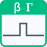

<!-- Generated by tools/export_studio_help.py; edit the reviewed source metadata, then regenerate. -->
# Spike

[Mathematics functions](../../mathematics/index.md) · [All functions](../../index.md)

Returns 1 for 0≤x&lt;1 and 0 elsewhere; a nonperiodic unit rectangular pulse. Input x; output spike(x). Spike(±0)=1; Spike(1)=0; Spike(±Infinity)=+0. NaN produces NaN. Example: Spike(0.25)=1; Spike(1)=0.

## Product execution profiles

The shared index declares native examples for this object; see [the examples below](spike.md#examples) and [document profiles and evidence boundaries](../../../reference/studio-draft-examples.md). Older binding/help statements retained below can lag those product profiles. They do not establish or deny the separately measured native profiles. An example declaration alone is not an execution result or admission of every overload.

Résumé français de l’aide Studio

**Créneau unitaire**

Texte historique de l’aide conservé ci-dessous. Des exemples natifs distincts sont déclarés pour cet objet ; consultez les profils et preuves datés, sans déduire une compatibilité universelle de ce texte.

Renvoie 1 sur 0≤x&lt;1 et 0 ailleurs ; créneau unitaire non périodique. Entrée x ; sortie spike(x). Spike(±0)=1 ; Spike(1)=0 ; Spike(±∞)=+0. NaN produit NaN. Exemple : Spike(0,25)=1 ; Spike(1)=0. [Types] Réel, tableau ou cluster entièrement numérique réel ; la précision F32/F64 est conservée et les entiers sont convertis en F64. NaN se propage. Entrée x requise ; aucun état ni horloge. NI documente le scalaire DBL dans LabVIEW classique ; les surcharges et règles IEEE sont des extensions FROG, sans surcharge NXG vérifiée.

## Studio authoring profile

Contract status: **partial**. The connector below describes Studio authoring; execution availability is stated separately.

Retained binding and help description

This is the source declaration, not the current measured product-execution assessment.

Returns 1 for 0≤x&lt;1 and 0 elsewhere; a nonperiodic unit rectangular pulse. Spike(±0)=1; Spike(1)=0; Spike(±Infinity)=+0. NaN produces NaN. FROG extension: real F32/F64 scalars retain their precision; signed and unsigned integer leaves convert to F64 before calculation, so values above 2^53 may round before interval classification. Apply element by element to arrays of rank 1 through 16 and recursively real numeric clusters, preserving dimensions, typed empty arrays, ordered field identities and names. Complex, Boolean, Enum, String, Path, Variant, reference, nonnumeric cluster, fixed-point, extended precision and Matrix inputs are rejected. Input x is required; the F64 editor preview supplies no implicit zero. Outputs remain numeric, never Boolean. NI classic LabVIEW documentation establishes only the scalar DBL connector and mathematical definition. The numeric-tree overloads, IEEE rules and integer promotions are FROG extensions. No detailed NXG signature or overload was verified, and no bit-for-bit LabVIEW equivalence is claimed. Local Highlight calculation uses frog.studio.gating.spike.

Real scalar, array or real-numeric cluster; F32/F64 precision is retained and integers produce F64 after conversion. NaN propagates. One required input x; no clock or stored state. NI documents scalar DBL in classic LabVIEW; overloads and IEEE rules are FROG extensions, with no verified NXG overload.

## IN — inputs

| Displayed terminal / internal ID | Accepted / resolved type | Studio connection | Unwired input default | Meaning |
| --- | --- | --- | --- | --- |
| x `x` | `T:numeric_tree` | Required | Not specified | — |

A default is shown only for an input with an explicitly documented value. Preview/default *types* do not imply unwired operand values. If helper and binding flags differ, both are labelled.

## OUT — outputs

| Displayed terminal / internal ID | Accepted / resolved type | Studio connection | Unwired input default | Meaning |
| --- | --- | --- | --- | --- |
| spike(x) `result` | `T:numeric_tree` | Recommended | — | — |

A default is shown only for an input with an explicitly documented value. Preview/default *types* do not imply unwired operand values. If helper and binding flags differ, both are labelled.

## Types and connection rules

FROG extension: real F32/F64 scalars retain their precision; signed and unsigned integer leaves convert to F64 before calculation, so values above 2^53 may round before interval classification. Apply element by element to arrays of rank 1 through 16 and recursively real numeric clusters, preserving dimensions, typed empty arrays, ordered field identities and names. Complex, Boolean, Enum, String, Path, Variant, reference, nonnumeric cluster, fixed-point, extended precision and Matrix inputs are rejected. Input x is required; the F64 editor preview supplies no implicit zero. Outputs remain numeric, never Boolean.

- Type resolution: `custom_resolver`; result expression: `resolve:frog.studio.gating.type-resolution@1`.
- Implicit coercion: permitted by this profile.
- Arrays: accepted; lifting policy: `element_wise_same_shape_with_scalar_lift`.
- Shape rule: `preserve_rank_dimensions_typed_empty_arrays_and_ordered_cluster_fields`.
- Scalar lifting: no.
- Broadcasting: no.

**Input count:** 1; this contract does not enable variadic inputs.

Port order: `x`.

## Execution and limits

**Public FROG / target Runtime:** not declared available by this authoring contract.

No universal target Runtime provider is declared for all numeric-tree overloads. Native scalar capability is separate from the local recursive evaluator.

Retained authoring-contract limitations

These declarations belong to the binding snapshot. Compare them with the separately admitted native profiles and dated measurements linked above; they are not a current denial of those product profiles.

**Authoring/target contract limits:**

- Complex, Boolean, Enum, reference, nonnumeric, Matrix, fixed-point and extended-precision operands are outside this real numeric profile.
- The scalar native target does not supply recursive aggregate or f32 execution.
- NI reference is classic LabVIEW scalar DBL; FROG overloads and IEEE conventions are not a verified NXG contract.

Connector type defaults and persistence aliases

| Direction | ID | Preview/default type | Connection policy | Cardinality | Legacy port IDs |
| --- | --- | --- | --- | --- | --- |
| INPUT | `x` | `f64` | `any_explicit` | `single` | — |
| OUTPUT | `result` | `f64` | `exact` | `single` | — |

## Examples

These are real `.frog` documents from the same index used by Studio. Backend names and expected results describe the examples; they are not execution certificates.

- [Spike — piecewise 0](../../../examples/math.gating.spike.piecewise_0.md) — Returns 1 for 0≤x&lt;1 and 0 elsewhere; a nonperiodic unit rectangular pulse. (`execution`, `studio-draft`).
- [Spike — piecewise 1](../../../examples/math.gating.spike.piecewise_1.md) — Returns 1 for 0≤x&lt;1 and 0 elsewhere; a nonperiodic unit rectangular pulse. (`execution`, `studio-draft`).
- [Spike — piecewise 2](../../../examples/math.gating.spike.piecewise_2.md) — Returns 1 for 0≤x&lt;1 and 0 elsewhere; a nonperiodic unit rectangular pulse. (`execution`, `studio-draft`).
- [Spike — piecewise 3](../../../examples/math.gating.spike.piecewise_3.md) — Returns 1 for 0≤x&lt;1 and 0 elsewhere; a nonperiodic unit rectangular pulse. (`execution`, `studio-draft`).

## Identity and references

- Catalogue ID: `math.gating.spike`.
- Parent palette: [Gating Functions](../../mathematics/elementary/gating.md).
- Profile: `frog.studio.polymorphic.math.gating.spike.v1`.
- Definition: `frog.studio.math.gating.spike`.
- [NI API reference](https://www.ni.com/docs/en-US/bundle/labview-api-ref/page/vi-lib/gmath/function-llb/spike-function-vi.html).
- [NI API reference](https://www.ni.com/docs/en-US/bundle/labview-api-ref/page/menus/categories/mathematics/elementary/gating-functions-mnu.html).

NI links are reference sources for the connector model; Studio support is limited to the profile above. [Reference provenance and notation](../../index.md#provenance-and-notation).
