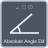

<!-- Generated by tools/export_studio_help.py; edit the reviewed source metadata, then regenerate. -->
# Absolute Angle Difference

[Mathematics functions](../../mathematics/index.md) · [All functions](../../index.md)

GS circular minimum absolute difference in [0,half-turn], not raw subtraction; NI exact periodicity not certified. NI I32 units 0 rad/rad, 1 rad/deg, 2 deg/deg, 3 deg/rad. U16 range 0 none, 1 signed (default), 2 positive. GS endpoint choices (-half-turn,half-turn] and [0,full-turn). Finite DBL only; array operands have equal lengths.

## Studio authoring profile

Contract status: **partial**. The connector below describes Studio authoring; execution availability is stated separately.

## IN — inputs

| Displayed terminal / internal ID | Accepted / resolved type | Studio connection | Unwired input default | Meaning |
| --- | --- | --- | --- | --- |
| a `a` | `f64` | Required | Not specified | — |
| b `b` | `f64` | Required | Not specified | — |
| angle units `angle_units` | `i32` | Optional | Not specified | — |

A default is shown only for an input with an explicitly documented value. Preview/default *types* do not imply unwired operand values. If helper and binding flags differ, both are labelled.

## OUT — outputs

| Displayed terminal / internal ID | Accepted / resolved type | Studio connection | Unwired input default | Meaning |
| --- | --- | --- | --- | --- |
| angle out `angle_out` | `f64` | Optional | — | — |
| error `error` | `i32` | Optional | — | — |

A default is shown only for an input with an explicitly documented value. Preview/default *types* do not imply unwired operand values. If helper and binding flags differ, both are labelled.

## Types and connection rules

GS circular minimum absolute difference in [0,half-turn], not raw subtraction; NI exact periodicity not certified. NI I32 units 0 rad/rad, 1 rad/deg, 2 deg/deg, 3 deg/rad. U16 range 0 none, 1 signed (default), 2 positive. GS endpoint choices (-half-turn,half-turn] and [0,full-turn). Finite DBL only; array operands have equal lengths.

- Type resolution: `custom_resolver`; result expression: `resolve:frog.studio.geometry.type-resolution@1`.
- Implicit coercion: permitted by this profile.
- Arrays: accepted; lifting policy: `none`.
- Shape rule: `geometry_variant_exact_ranks_equal_coordinate_lengths_no_broadcasting`.
- Scalar lifting: no.
- Broadcasting: no.

**Input count:** 3; this contract does not enable variadic inputs.

Port order: `a` → `b` → `angle_units`.

## Execution and limits

**Public FROG / target Runtime:** declared available within the scope below.

Scope: `requires_explicit_target_capability`.

Implementation: `frog.studio.math.geometry.absolute_angle_difference.scalar.owned.v1`.

Required provider: `frog.studio.math.geometry.owned@1`.

Exact selected variant; native JIT Run only. AOT is explicitly unqualified, never inferred from source implementation.

Connector type defaults and persistence aliases

| Direction | ID | Preview/default type | Connection policy | Cardinality | Legacy port IDs |
| --- | --- | --- | --- | --- | --- |
| INPUT | `a` | `f64` | `numeric_implicit` | `single` | — |
| INPUT | `b` | `f64` | `numeric_implicit` | `single` | — |
| INPUT | `angle_units` | `i32` | `numeric_implicit` | `single` | — |
| OUTPUT | `angle_out` | `f64` | `exact` | `single` | — |
| OUTPUT | `error` | `i32` | `exact` | `single` | — |

## Examples

No example for this object is currently declared in the shared index. [Browse the available examples](../../../examples/index.md).

## Identity and references

- Catalogue ID: `math.geometry.absolute_angle_difference`.
- Parent palette: [Angle](../../mathematics/geometry/angle.md).
- Profile: `frog.studio.math.geometry.owned.v1`.
- Definition: `frog.studio.math.geometry.absolute_angle_difference.scalar.owned.v1`.
- [NI API reference](https://www.ni.com/docs/en-US/bundle/labview-api-ref/page/menus/categories/mathematics/angeometry-mnu.html).

NI links are reference sources for the connector model; Studio support is limited to the profile above. [Reference provenance and notation](../../index.md#provenance-and-notation).
