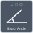

<!-- Generated by tools/export_studio_help.py; edit the reviewed source metadata, then regenerate. -->
# Bisect Angle

[Mathematics functions](../../mathematics/index.md) · [All functions](../../index.md)

GS default CCW arc bisector; shortest_arc selects the minor arc. Equal endpoints have zero span; antipodal tie follows CCW. NI I32 units 0 rad/rad, 1 rad/deg, 2 deg/deg, 3 deg/rad. U16 range 0 none, 1 signed (default), 2 positive. GS endpoint choices (-half-turn,half-turn] and [0,full-turn). Finite DBL only; array operands have equal lengths.

## Product execution profiles

The shared index declares native examples for this object; see [the examples below](bisect_angle.md#examples) and [document profiles and evidence boundaries](../../../reference/studio-draft-examples.md). Older binding/help statements retained below can lag those product profiles. They do not establish or deny the separately measured native profiles. An example declaration alone is not an execution result or admission of every overload.

Résumé français de l’aide Studio

**Bissectrice d’un angle**

Texte historique de l’aide conservé ci-dessous. Des exemples natifs distincts sont déclarés pour cet objet ; consultez les profils et preuves datés, sans déduire une compatibilité universelle de ce texte.

Par défaut, GS prend la bissectrice de l’arc antihoraire ; shortest_arc sélectionne l’arc mineur. Des extrémités égales définissent une étendue nulle ; le cas antipodal est départagé dans le sens antihoraire. Unités NI I32 : 0 rad/rad, 1 rad/deg, 2 deg/deg, 3 deg/rad. Intervalle U16 : 0 aucun, 1 signé (par défaut), 2 positif. Choix explicites GS des extrémités : (-demi-tour,demi-tour] et [0,tour complet). DBL finis uniquement ; les tableaux opérandes ont la même longueur.

## Studio authoring profile

Contract status: **partial**. The connector below describes Studio authoring; execution availability is stated separately.

Retained binding and help description

This is the source declaration, not the current measured product-execution assessment.

## IN — inputs

| Displayed terminal / internal ID | Accepted / resolved type | Studio connection | Unwired input default | Meaning |
| --- | --- | --- | --- | --- |
| start `start` | `f64` | Required | Not specified | — |
| end `end` | `f64` | Required | Not specified | — |
| angle units `angle_units` | `i32` | Optional | Not specified | — |
| angle range `angle_range` | `u16` | Optional | Not specified | — |
| shortest arc `shortest_arc` | `bool` | Optional | Not specified | — |

A default is shown only for an input with an explicitly documented value. Preview/default *types* do not imply unwired operand values. If helper and binding flags differ, both are labelled.

## OUT — outputs

| Displayed terminal / internal ID | Accepted / resolved type | Studio connection | Unwired input default | Meaning |
| --- | --- | --- | --- | --- |
| angle out `angle_out` | `f64` | Optional | — | — |
| error `error` | `i32` | Optional | — | — |

A default is shown only for an input with an explicitly documented value. Preview/default *types* do not imply unwired operand values. If helper and binding flags differ, both are labelled.

## Types and connection rules

GS default CCW arc bisector; shortest_arc selects the minor arc. Equal endpoints have zero span; antipodal tie follows CCW. NI I32 units 0 rad/rad, 1 rad/deg, 2 deg/deg, 3 deg/rad. U16 range 0 none, 1 signed (default), 2 positive. GS endpoint choices (-half-turn,half-turn] and [0,full-turn). Finite DBL only; array operands have equal lengths.

- Type resolution: `custom_resolver`; result expression: `resolve:frog.studio.geometry.type-resolution@1`.
- Implicit coercion: permitted by this profile.
- Arrays: accepted; lifting policy: `none`.
- Shape rule: `geometry_variant_exact_ranks_equal_coordinate_lengths_no_broadcasting`.
- Scalar lifting: no.
- Broadcasting: no.

**Input count:** 5; this contract does not enable variadic inputs.

Port order: `start` → `end` → `angle_units` → `angle_range` → `shortest_arc`.

## Execution and limits

**Public FROG / target Runtime:** declared available within the scope below.

Scope: `requires_explicit_target_capability`.

Implementation: `frog.studio.math.geometry.bisect_angle.scalar.owned.v1`.

Required provider: `frog.studio.math.geometry.owned@1`.

Exact selected variant; native JIT Run only. AOT is explicitly unqualified, never inferred from source implementation.

Connector type defaults and persistence aliases

| Direction | ID | Preview/default type | Connection policy | Cardinality | Legacy port IDs |
| --- | --- | --- | --- | --- | --- |
| INPUT | `start` | `f64` | `numeric_implicit` | `single` | — |
| INPUT | `end` | `f64` | `numeric_implicit` | `single` | — |
| INPUT | `angle_units` | `i32` | `numeric_implicit` | `single` | — |
| INPUT | `angle_range` | `u16` | `numeric_implicit` | `single` | — |
| INPUT | `shortest_arc` | `bool` | `exact` | `single` | — |
| OUTPUT | `angle_out` | `f64` | `exact` | `single` | — |
| OUTPUT | `error` | `i32` | `exact` | `single` | — |

## Examples

These are real `.frog` documents from the same index used by Studio. Backend names and expected results describe the examples; they are not execution certificates.

- [Bisect Angle](../../../examples/math.geometry.bisect_angle.worked.md) — With angle_units = 2, angle_range = 1, shortest_arc = false, start = 10, end = 350, Run displays angle_out = 180.0, error = 0. (`execution`, `studio-draft`).

## Identity and references

- Catalogue ID: `math.geometry.bisect_angle`.
- Parent palette: [Angle](../../mathematics/geometry/angle.md).
- Profile: `frog.studio.math.geometry.owned.v1`.
- Definition: `frog.studio.math.geometry.bisect_angle.scalar.owned.v1`.
- [NI API reference](https://www.ni.com/docs/en-US/bundle/labview-api-ref/page/menus/categories/mathematics/angeometry-mnu.html).

NI links are reference sources for the connector model; Studio support is limited to the profile above. [Reference provenance and notation](../../index.md#provenance-and-notation).
