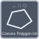

<!-- Generated by tools/export_studio_help.py; edit the reviewed source metadata, then regenerate. -->
# Convex Polygon Intersection

[Mathematics functions](../../mathematics/index.md) · [All functions](../../index.md)

Actual convex intersection coordinates; empty, point and segment results retained. Both input orientations accepted, nonconvex polygons refused rather than replaced by their hull.

## Studio authoring profile

Contract status: **partial**. The connector below describes Studio authoring; execution availability is stated separately.

## IN — inputs

| Displayed terminal / internal ID | Accepted / resolved type | Studio connection | Unwired input default | Meaning |
| --- | --- | --- | --- | --- |
| x1 `x1` | `array<f64>` | Required | Not specified | — |
| y1 `y1` | `array<f64>` | Required | Not specified | — |
| x2 `x2` | `array<f64>` | Required | Not specified | — |
| y2 `y2` | `array<f64>` | Required | Not specified | — |

A default is shown only for an input with an explicitly documented value. Preview/default *types* do not imply unwired operand values. If helper and binding flags differ, both are labelled.

## OUT — outputs

| Displayed terminal / internal ID | Accepted / resolved type | Studio connection | Unwired input default | Meaning |
| --- | --- | --- | --- | --- |
| intersection x `intersection_x` | `array<f64>` | Optional | — | — |
| intersection y `intersection_y` | `array<f64>` | Optional | — | — |
| error `error` | `i32` | Optional | — | — |

A default is shown only for an input with an explicitly documented value. Preview/default *types* do not imply unwired operand values. If helper and binding flags differ, both are labelled.

## Types and connection rules

Actual convex intersection coordinates; empty, point and segment results retained. Both input orientations accepted, nonconvex polygons refused rather than replaced by their hull.

- Type resolution: `custom_resolver`; result expression: `resolve:frog.studio.geometry.type-resolution@1`.
- Implicit coercion: permitted by this profile.
- Arrays: accepted; lifting policy: `none`.
- Shape rule: `geometry_variant_exact_ranks_equal_coordinate_lengths_no_broadcasting`.
- Scalar lifting: no.
- Broadcasting: no.

**Input count:** 4; this contract does not enable variadic inputs.

Port order: `x1` → `y1` → `x2` → `y2`.

## Execution and limits

**Public FROG / target Runtime:** declared available within the scope below.

Scope: `requires_explicit_target_capability`.

Implementation: `frog.studio.math.geometry.convex_polygon_intersection.default.owned.v1`.

Required provider: `frog.studio.math.geometry.owned@1`.

Exact selected variant; native JIT Run only. AOT is explicitly unqualified, never inferred from source implementation.

Connector type defaults and persistence aliases

| Direction | ID | Preview/default type | Connection policy | Cardinality | Legacy port IDs |
| --- | --- | --- | --- | --- | --- |
| INPUT | `x1` | `array<f64>` | `numeric_array_implicit` | `single` | — |
| INPUT | `y1` | `array<f64>` | `numeric_array_implicit` | `single` | — |
| INPUT | `x2` | `array<f64>` | `numeric_array_implicit` | `single` | — |
| INPUT | `y2` | `array<f64>` | `numeric_array_implicit` | `single` | — |
| OUTPUT | `intersection_x` | `array<f64>` | `exact` | `single` | — |
| OUTPUT | `intersection_y` | `array<f64>` | `exact` | `single` | — |
| OUTPUT | `error` | `i32` | `exact` | `single` | — |

## Examples

No example for this object is currently declared in the shared index. [Browse the available examples](../../../examples/index.md).

## Identity and references

- Catalogue ID: `math.geometry.convex_polygon_intersection`.
- Parent palette: [Computational Geometry](../../mathematics/geometry/computational_geometry.md).
- Profile: `frog.studio.math.geometry.owned.v1`.
- Definition: `frog.studio.math.geometry.convex_polygon_intersection.default.owned.v1`.
- [NI API reference](https://www.ni.com/docs/en-US/bundle/labview-api-ref/page/menus/categories/mathematics/angeometry-mnu.html).

NI links are reference sources for the connector model; Studio support is limited to the profile above. [Reference provenance and notation](../../index.md#provenance-and-notation).
