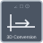

<!-- Generated by tools/export_studio_help.py; edit the reviewed source metadata, then regenerate. -->
# 3D Coordinate Conversion

[Mathematics functions](../../mathematics/index.md) · [All functions](../../index.md)

NI conversion codes 0 Cartesian/spherical, 1 spherical/Cartesian, 2 Cartesian/cylindrical, 3 cylindrical/Cartesian, 4 spherical/cylindrical, 5 cylindrical/spherical. Radians, phi polar from +Z; undefined azimuth is zero, negative radius refused; spherical polar input must be in [0,pi].

## Studio authoring profile

Contract status: **partial**. The connector below describes Studio authoring; execution availability is stated separately.

## IN — inputs

| Displayed terminal / internal ID | Accepted / resolved type | Studio connection | Unwired input default | Meaning |
| --- | --- | --- | --- | --- |
| axis1 `axis1` | `f64` | Required | Not specified | — |
| axis2 `axis2` | `f64` | Required | Not specified | — |
| axis3 `axis3` | `f64` | Required | Not specified | — |
| conversion type `conversion_type` | `u16` | Optional | Not specified | — |

A default is shown only for an input with an explicitly documented value. Preview/default *types* do not imply unwired operand values. If helper and binding flags differ, both are labelled.

## OUT — outputs

| Displayed terminal / internal ID | Accepted / resolved type | Studio connection | Unwired input default | Meaning |
| --- | --- | --- | --- | --- |
| axis1 out `axis1_out` | `f64` | Optional | — | — |
| axis2 out `axis2_out` | `f64` | Optional | — | — |
| axis3 out `axis3_out` | `f64` | Optional | — | — |
| error `error` | `i32` | Optional | — | — |

A default is shown only for an input with an explicitly documented value. Preview/default *types* do not imply unwired operand values. If helper and binding flags differ, both are labelled.

## Types and connection rules

NI conversion codes 0 Cartesian/spherical, 1 spherical/Cartesian, 2 Cartesian/cylindrical, 3 cylindrical/Cartesian, 4 spherical/cylindrical, 5 cylindrical/spherical. Radians, phi polar from +Z; undefined azimuth is zero, negative radius refused; spherical polar input must be in [0,pi].

- Type resolution: `custom_resolver`; result expression: `resolve:frog.studio.geometry.type-resolution@1`.
- Implicit coercion: permitted by this profile.
- Arrays: accepted; lifting policy: `none`.
- Shape rule: `geometry_variant_exact_ranks_equal_coordinate_lengths_no_broadcasting`.
- Scalar lifting: no.
- Broadcasting: no.

**Input count:** 4; this contract does not enable variadic inputs.

Port order: `axis1` → `axis2` → `axis3` → `conversion_type`.

## Execution and limits

**Public FROG / target Runtime:** declared available within the scope below.

Scope: `requires_explicit_target_capability`.

Implementation: `frog.studio.math.geometry.coordinate_conversion_3d.scalar.owned.v1`.

Required provider: `frog.studio.math.geometry.owned@1`.

Exact selected variant; native JIT Run only. AOT is explicitly unqualified, never inferred from source implementation.

Connector type defaults and persistence aliases

| Direction | ID | Preview/default type | Connection policy | Cardinality | Legacy port IDs |
| --- | --- | --- | --- | --- | --- |
| INPUT | `axis1` | `f64` | `numeric_implicit` | `single` | — |
| INPUT | `axis2` | `f64` | `numeric_implicit` | `single` | — |
| INPUT | `axis3` | `f64` | `numeric_implicit` | `single` | — |
| INPUT | `conversion_type` | `u16` | `numeric_implicit` | `single` | — |
| OUTPUT | `axis1_out` | `f64` | `exact` | `single` | — |
| OUTPUT | `axis2_out` | `f64` | `exact` | `single` | — |
| OUTPUT | `axis3_out` | `f64` | `exact` | `single` | — |
| OUTPUT | `error` | `i32` | `exact` | `single` | — |

## Examples

No example for this object is currently declared in the shared index. [Browse the available examples](../../../examples/index.md).

## Identity and references

- Catalogue ID: `math.geometry.coordinate_conversion_3d`.
- Parent palette: [Geometry](../../mathematics/geometry.md).
- Profile: `frog.studio.math.geometry.owned.v1`.
- Definition: `frog.studio.math.geometry.coordinate_conversion_3d.scalar.owned.v1`.
- [NI API reference](https://www.ni.com/docs/en-US/bundle/labview-api-ref/page/menus/categories/mathematics/angeometry-mnu.html).

NI links are reference sources for the connector model; Studio support is limited to the profile above. [Reference provenance and notation](../../index.md#provenance-and-notation).
