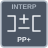

<!-- Generated by tools/export_studio_help.py; edit the reviewed source metadata, then regenerate. -->
# Create Interpolating Polynomial

[Mathematics functions](../../mathematics/index.md) · [All functions](../../index.md)

Constructs a piecewise polynomial from supplied ordered breaks and coefficients, without fitting new coefficients or imposing continuity. Real DBL vectors/matrices; explicit real numeric promotion, no complex-to-real conversion, scalar lifting or broadcasting. PP uses ascending local powers as an explicit GS convention. Available variants: default.

## Product execution profiles

The shared index declares native examples for this object; see [the examples below](create_interpolating_polynomial.md#examples) and [document profiles and evidence boundaries](../../../reference/studio-draft-examples.md). Older binding/help statements retained below can lag those product profiles. They do not establish or deny the separately measured native profiles. An example declaration alone is not an execution result or admission of every overload.

Résumé français de l’aide Studio

**Create Interpolating Polynomial**

Texte historique de l’aide conservé ci-dessous. Des exemples natifs distincts sont déclarés pour cet objet ; consultez les profils et preuves datés, sans déduire une compatibilité universelle de ce texte.

Assemble un polynôme par morceaux depuis ses ruptures et ses coefficients typés.

## Studio authoring profile

Contract status: **partial**. The connector below describes Studio authoring; execution availability is stated separately.

## IN — inputs

| Displayed terminal / internal ID | Accepted / resolved type | Studio connection | Unwired input default | Meaning |
| --- | --- | --- | --- | --- |
| x locations `x_locations` | `array<f64>` | Required | Not specified | — |
| coefficients `coefficients` | `array<f64,rank=2>` | Required | Not specified | — |

A default is shown only for an input with an explicitly documented value. Preview/default *types* do not imply unwired operand values. If helper and binding flags differ, both are labelled.

## OUT — outputs

| Displayed terminal / internal ID | Accepted / resolved type | Studio connection | Unwired input default | Meaning |
| --- | --- | --- | --- | --- |
| piecewise polynomial `piecewise_polynomial` | `cluster<x_locations:array<f64>,coefficients:array<f64,rank=2>>` | Recommended | — | — |
| error `error` | `i32` | Recommended | — | — |

A default is shown only for an input with an explicitly documented value. Preview/default *types* do not imply unwired operand values. If helper and binding flags differ, both are labelled.

## Types and Compatibility

The notes below retain the reviewed help's original NI and Studio scopes. An NI overload is not a claim of Studio runtime support; the authoring profile and execution limits remain separate.

Retained binding and help statements

These are source declarations, not the current measured product-execution assessment. Compare historical limitations with the separately dated native profiles above.

Real DBL vectors/matrices, exact I32/U16/Boolean options and typed piecewise-polynomial records; native GS profile.

Notes de types et de compatibilité de l’aide Studio

Les mentions NI et Studio gardent leur portée d’origine. Une variante NI ne constitue pas une déclaration de prise en charge par le runtime Studio ; consultez les profils et limites d’exécution de cette fiche.

Vecteurs/matrices DBL réels, options I32/U16/booléennes et polynômes par morceaux typés ; profil natif GS.

- Type resolution: `custom_resolver`; result expression: `resolve:frog.studio.interpolation.type-resolution@1`.
- Implicit coercion: permitted by this profile.
- Arrays: accepted; lifting policy: `none`.
- Shape rule: `interpolation_variant_exact_ranks_and_observation_query_shapes`.
- Scalar lifting: no.
- Broadcasting: no.

**Input count:** 2; this contract does not enable variadic inputs.

Port order: `x_locations` → `coefficients`.

## Execution and limits

**Public FROG / target Runtime:** declared available within the scope below.

Scope: `requires_explicit_target_capability`.

Implementation: `frog.studio.math.interpolation.create_interpolating_polynomial.owned.v1`.

Required provider: `frog.studio.math.interpolation.owned@1`.

Declared per selected exact native variant. Complete-graph admission and attributed runtime execution are separate; malformed data receives mathematical diagnostics rather than a document-corruption classification.

Connector type defaults and persistence aliases

| Direction | ID | Preview/default type | Connection policy | Cardinality | Legacy port IDs |
| --- | --- | --- | --- | --- | --- |
| INPUT | `x_locations` | `array<f64>` | `numeric_array_implicit` | `single` | — |
| INPUT | `coefficients` | `array<f64,rank=2>` | `numeric_array_implicit` | `single` | — |
| OUTPUT | `piecewise_polynomial` | `cluster<x_locations:array<f64>,coefficients:array<f64,rank=2>>` | `exact` | `single` | — |
| OUTPUT | `error` | `i32` | `exact` | `single` | — |

## Examples

These are real `.frog` documents from the same index used by Studio. Backend names and expected results describe the examples; they are not execution certificates.

- [Create Interpolating Polynomial](../../../examples/math.interpolation.create_interpolating_polynomial.worked.md) — Build a one-piece polynomial representation on \[0,2\] with coefficients \[2,3\]. Read back the breakpoints and the full coefficient matrix. (`execution`, `studio-draft`).

## Identity and references

- Catalogue ID: `math.interpolation.create_interpolating_polynomial`.
- Parent palette: [Interpolation &amp; Extrapolation](../../mathematics/interpolation_extrapolation.md).
- Profile: `frog.studio.polymorphic.math.interpolation.create_interpolating_polynomial.v1`.
- Definition: `frog.studio.math.interpolation.create_interpolating_polynomial`.
- [NI API reference](https://www.ni.com/docs/en-US/bundle/labview-api-ref/page/vi-lib/gmath/interp-llb/create-interpolating-polynomial-vi.html).

NI links are reference sources for the connector model; Studio support is limited to the profile above. [Reference provenance and notation](../../index.md#provenance-and-notation).
