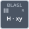

<!-- Generated by tools/export_studio_help.py; edit the reviewed source metadata, then regenerate. -->
# drotm

[Mathematics functions](../../../mathematics/index.md) · [All functions](../../../index.md)

Applies the modified Givens matrix H to paired components. H is a rank-two 2x2 Array and the flag is a separate I32; provider PARAM[5] stays private. DBL/CDB instance domains and full Array ranks are explicit; permitted narrower numeric inputs are promoted visibly. A real-only port never discards an imaginary part. No broadcasting or implicit Matrix conversion. Outputs own their data; error is I32, without automatic popup. BLAS1 selected count is L==0 ? 0 : 1+floor((L-1)/abs(inc)); negative traversal starts at physical L-1. DDOT/ZDOTU/ZDOTC: equal physical lengths AND equal selected counts (NI equal length plus explicit GS count check). COPY/AXPY: n=count(x), destination y must provide at least n selected slots, retain full y and all unselected/tail slots. SWAP/ROT/DROTM: equal selected counts; physical lengths may differ; retain all unselected slots. No min truncation. NI exposes H 2x2 and flag separately; PARAM[5] is provider-private. GS paired selections have equal count; physical extents may differ and all unselected slots survive. Optional unwired defaults: x_inc=1, y_inc=1.

## Product execution profiles

The shared index declares native examples for this object; see [the examples below](drotm.md#examples) and [document profiles and evidence boundaries](../../../../reference/studio-draft-examples.md). Older binding/help statements retained below can lag those product profiles. They do not establish or deny the separately measured native profiles. An example declaration alone is not an execution result or admission of every overload.

Résumé français de l’aide Studio

**drotm**

Texte historique de l’aide conservé ci-dessous. Des exemples natifs distincts sont déclarés pour cet objet ; consultez les profils et preuves datés, sans déduire une compatibilité universelle de ce texte.

Applique la transformation de Givens modifiée H : matrice 2×2 et flag I32 séparé. Valeurs facultatives non câblées : x_inc=1, y_inc=1.

## Studio authoring profile

Contract status: **partial**. The connector below describes Studio authoring; execution availability is stated separately.

## IN — inputs

| Displayed terminal / internal ID | Accepted / resolved type | Studio connection | Unwired input default | Meaning |
| --- | --- | --- | --- | --- |
| x `x` | `array<f64>` | Required | Not specified | — |
| y `y` | `array<f64>` | Required | Not specified | — |
| Rotation Matrix `rotation_matrix` | `array<f64,rank=2>` | Required | Not specified | — |
| Rotation Matrix flag `rotation_matrix_flag` | `i32` | Required | Not specified | — |
| xInc `x_inc` | `i32` | Optional | Not specified | — |
| yInc `y_inc` | `i32` | Optional | Not specified | — |

A default is shown only for an input with an explicitly documented value. Preview/default *types* do not imply unwired operand values. If helper and binding flags differ, both are labelled.

## OUT — outputs

| Displayed terminal / internal ID | Accepted / resolved type | Studio connection | Unwired input default | Meaning |
| --- | --- | --- | --- | --- |
| x out `x_out` | `array<f64>` | Recommended | — | — |
| y out `y_out` | `array<f64>` | Recommended | — | — |
| error `error` | `i32` | Recommended | — | — |

A default is shown only for an input with an explicitly documented value. Preview/default *types* do not imply unwired operand values. If helper and binding flags differ, both are labelled.

## Types and Compatibility

The notes below retain the reviewed help's original NI and Studio scopes. An NI overload is not a claim of Studio runtime support; the authoring profile and execution limits remain separate.

Retained binding and help statements

These are source declarations, not the current measured product-execution assessment. Compare historical limitations with the separately dated native profiles above.

Notes de types et de compatibilité de l’aide Studio

Les mentions NI et Studio gardent leur portée d’origine. Une variante NI ne constitue pas une déclaration de prise en charge par le runtime Studio ; consultez les profils et limites d’exécution de cette fiche.

DBL/CDB suivant l’instance ; vecteurs rang 1, matrices rang 2. Promotions numériques explicites, aucune perte silencieuse de partie imaginaire. Diagnostic I32.

- Type resolution: `custom_resolver`; result expression: `resolve:frog.studio.blas.type-resolution@1`.
- Implicit coercion: permitted by this profile.
- Arrays: accepted; lifting policy: `none`.
- Shape rule: `explicit_blas_vector_matrix_ranks_and_contractual_leading_blocks`.
- Scalar lifting: no.
- Broadcasting: no.

**Input count:** 6; this contract does not enable variadic inputs.

Port order: `x` → `y` → `rotation_matrix` → `rotation_matrix_flag` → `x_inc` → `y_inc`.

## Execution and limits

**Public FROG / target Runtime:** declared available within the scope below.

Scope: `requires_explicit_target_capability`.

Implementation: `frog.studio.math.linear_algebra.blas.drotm.owned.v1`.

Required provider: `frog.studio.blas.native@1`.

Declared native provider capability; admission and execution require the complete graph, exact provider dependencies and compatible BLAS options.

Connector type defaults and persistence aliases

| Direction | ID | Preview/default type | Connection policy | Cardinality | Legacy port IDs |
| --- | --- | --- | --- | --- | --- |
| INPUT | `x` | `array<f64>` | `numeric_array_implicit` | `single` | — |
| INPUT | `y` | `array<f64>` | `numeric_array_implicit` | `single` | — |
| INPUT | `rotation_matrix` | `array<f64,rank=2>` | `numeric_array_implicit` | `single` | — |
| INPUT | `rotation_matrix_flag` | `i32` | `numeric_implicit` | `single` | — |
| INPUT | `x_inc` | `i32` | `numeric_implicit` | `single` | — |
| INPUT | `y_inc` | `i32` | `numeric_implicit` | `single` | — |
| OUTPUT | `x_out` | `array<f64>` | `exact` | `single` | — |
| OUTPUT | `y_out` | `array<f64>` | `exact` | `single` | — |
| OUTPUT | `error` | `i32` | `exact` | `single` | — |

## Examples

These are real `.frog` documents from the same index used by Studio. Backend names and expected results describe the examples; they are not execution certificates.

- [drotm](../../../../examples/math.linear_algebra.blas.drotm.worked.md) — Use the expanded modified Givens matrix for (3,4) to rotate the vector. The two components become 6.25 and 0. (`execution`, `studio-draft`).

## Identity and references

- Catalogue ID: `math.linear_algebra.blas.drotm`.
- Parent palette: [BLAS](../../../mathematics/linear_algebra/blas.md).
- Profile: `frog.studio.polymorphic.math.linear_algebra.blas.drotm.v1`.
- Definition: `frog.studio.math.linear_algebra.blas.drotm`.
- [NI API reference](https://www.ni.com/docs/en-US/bundle/labview-api-ref/page/vi-lib/analysis/blas-llb/drotm-fast-givens-rotation-dbl-vi.html).

NI links are reference sources for the connector model; Studio support is limited to the profile above. [Reference provenance and notation](../../../index.md#provenance-and-notation).
