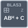

<!-- Generated by tools/export_studio_help.py; edit the reviewed source metadata, then regenerate. -->
# zher2k

[Mathematics functions](../../../mathematics/index.md) · [All functions](../../../index.md)

Updates only the chosen C triangle using alpha*A*B^H + conj(alpha)*B*A^H + beta*C, or its adjoint form. Alpha CDB, beta DBL. N/H supported; T is rejected. DBL/CDB instance domains and full Array ranks are explicit; permitted narrower numeric inputs are promoted visibly. A real-only port never discards an imaginary part. No broadcasting or implicit Matrix conversion. Outputs own their data; error is I32, without automatic popup. N0/H1 only; NI enum T2 exists but its mathematical adaptation is not documented, so GS refuses T2 rather than changing it to H. Optional unwired defaults: c=zero_square_rows_op_a, alpha=1, beta=1, operation=0, matrix_c_type=3.

Résumé français de l’aide Studio

**zher2k**

Mise à jour hermitienne de rang 2k ; alpha complexe, beta réel. N/H admis, T refusé. Valeurs facultatives non câblées : c=zero_square_rows_op_a, alpha=1, beta=1, operation=0, matrix_c_type=3.

## Studio authoring profile

Contract status: **partial**. The connector below describes Studio authoring; execution availability is stated separately.

## IN — inputs

| Displayed terminal / internal ID | Accepted / resolved type | Studio connection | Unwired input default | Meaning |
| --- | --- | --- | --- | --- |
| A `a` | `array<c64,rank=2>` | Required | Not specified | — |
| B `b` | `array<c64,rank=2>` | Required | Not specified | — |
| C `c` | `array<c64,rank=2>` | Optional | Not specified | — |
| alpha `alpha` | `c64` | Optional | Not specified | — |
| beta `beta` | `f64` | Optional | Not specified | — |
| operation `operation` | `i32` | Optional | Not specified | — |
| matrix c type `matrix_c_type` | `i32` | Optional | Not specified | — |

A default is shown only for an input with an explicitly documented value. Preview/default *types* do not imply unwired operand values. If helper and binding flags differ, both are labelled.

## OUT — outputs

| Displayed terminal / internal ID | Accepted / resolved type | Studio connection | Unwired input default | Meaning |
| --- | --- | --- | --- | --- |
| result `result` | `array<c64,rank=2>` | Recommended | — | — |
| error `error` | `i32` | Recommended | — | — |

A default is shown only for an input with an explicitly documented value. Preview/default *types* do not imply unwired operand values. If helper and binding flags differ, both are labelled.

## Types and Compatibility

The notes below retain the reviewed help's original NI and Studio scopes. An NI overload is not a claim of Studio runtime support; the authoring profile and execution limits remain separate.

Notes de types et de compatibilité de l’aide Studio

Les mentions NI et Studio gardent leur portée d’origine. Une variante NI ne constitue pas une déclaration de prise en charge par le runtime Studio ; consultez les profils et limites d’exécution de cette fiche.

DBL/CDB suivant l’instance ; vecteurs rang 1, matrices rang 2. Promotions numériques explicites, aucune perte silencieuse de partie imaginaire. Diagnostic I32.

- Type resolution: `custom_resolver`; result expression: `resolve:frog.studio.blas.type-resolution@1`.
- Implicit coercion: permitted by this profile.
- Arrays: accepted; lifting policy: `none`.
- Shape rule: `explicit_blas_vector_matrix_ranks_and_contractual_leading_blocks`.
- Scalar lifting: no.
- Broadcasting: no.

**Input count:** 7; this contract does not enable variadic inputs.

Port order: `a` → `b` → `c` → `alpha` → `beta` → `operation` → `matrix_c_type`.

## Execution and limits

**Public FROG / target Runtime:** declared available within the scope below.

Scope: `requires_explicit_target_capability`.

Implementation: `frog.studio.math.linear_algebra.blas.zher2k.owned.v1`.

Required provider: `frog.studio.blas.native@1`.

Declared native provider capability; admission and execution require the complete graph, exact provider dependencies and compatible BLAS options.

Connector type defaults and persistence aliases

| Direction | ID | Preview/default type | Connection policy | Cardinality | Legacy port IDs |
| --- | --- | --- | --- | --- | --- |
| INPUT | `a` | `array<c64,rank=2>` | `numeric_array_implicit` | `single` | — |
| INPUT | `b` | `array<c64,rank=2>` | `numeric_array_implicit` | `single` | — |
| INPUT | `c` | `array<c64,rank=2>` | `numeric_array_implicit` | `single` | — |
| INPUT | `alpha` | `c64` | `numeric_implicit` | `single` | — |
| INPUT | `beta` | `f64` | `numeric_implicit` | `single` | — |
| INPUT | `operation` | `i32` | `numeric_implicit` | `single` | — |
| INPUT | `matrix_c_type` | `i32` | `numeric_implicit` | `single` | — |
| OUTPUT | `result` | `array<c64,rank=2>` | `exact` | `single` | — |
| OUTPUT | `error` | `i32` | `exact` | `single` | — |

## Examples

No example for this object is currently declared in the shared index. [Browse the available examples](../../../../examples/index.md).

## Identity and references

- Catalogue ID: `math.linear_algebra.blas.zher2k`.
- Parent palette: [BLAS](../../../mathematics/linear_algebra/blas.md).
- Profile: `frog.studio.polymorphic.math.linear_algebra.blas.zher2k.v1`.
- Definition: `frog.studio.math.linear_algebra.blas.zher2k`.
- [NI API reference](https://www.ni.com/docs/en-US/bundle/labview-api-ref/page/vi-lib/analysis/blas-llb/zher2k-hermitian-matrix-rank-2k-update-cdb-vi.html).

NI links are reference sources for the connector model; Studio support is limited to the profile above. [Reference provenance and notation](../../../index.md#provenance-and-notation).
