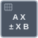

<!-- Generated by tools/export_studio_help.py; edit the reviewed source metadata, then regenerate. -->
# Sylvester Eqs

[Mathematics functions](../../mathematics/index.md) · [All functions](../../index.md)

Solves op(A)*X plus/minus X*op(B)=scale*C. operation_a/b U16 0 normal,1 transpose (adjoint for complex); sign 0 plus,1 minus. matrix_type 0 general,3 upper triangular (NI default). Returns X, scale, perturbed, error; residuals must use scale*C. Inputs calculate in DBL/CDB with explicit numeric promotion; 64-bit integers above 2^53 may round. No broadcasting, no private Matrix reinterpretation. error is I32 and never an automatic dialog. Optional unwired defaults: operation_a=0, operation_b=0, sign=0, matrix_type=3.

Résumé français de l’aide Studio

**Sylvester Eqs**

Résout op(A)·X ± X·op(B)=scale·C. Opération 0 normale, 1 transposée (adjointe complexe) ; signe 0 plus, 1 moins. Renvoie X, scale et perturbed. Valeurs facultatives non câblées : operation_a=0, operation_b=0, sign=0, matrix_type=3.

## Studio authoring profile

Contract status: **partial**. The connector below describes Studio authoring; execution availability is stated separately.

## IN — inputs

| Displayed terminal / internal ID | Accepted / resolved type | Studio connection | Unwired input default | Meaning |
| --- | --- | --- | --- | --- |
| A `a` | `array<T:numeric,rank=2>` | Required | Not specified | — |
| B `b` | `array<T:numeric,rank=2>` | Required | Not specified | — |
| C `c` | `array<T:numeric,rank=2>` | Required | Not specified | — |
| operation A `operation_a` | `u16` | Optional | Not specified | — |
| operation B `operation_b` | `u16` | Optional | Not specified | — |
| sign `sign` | `u16` | Optional | Not specified | — |
| matrix type `matrix_type` | `i32` | Optional | Not specified | — |

A default is shown only for an input with an explicitly documented value. Preview/default *types* do not imply unwired operand values. If helper and binding flags differ, both are labelled.

## OUT — outputs

| Displayed terminal / internal ID | Accepted / resolved type | Studio connection | Unwired input default | Meaning |
| --- | --- | --- | --- | --- |
| Sylvester Eqs `result` | `array<T:numeric,rank=2>` | Recommended | — | — |
| scale `scale` | `f64` | Recommended | — | — |
| perturbed `perturbed` | `bool` | Recommended | — | — |
| error `error` | `i32` | Recommended | — | — |

A default is shown only for an input with an explicitly documented value. Preview/default *types* do not imply unwired operand values. If helper and binding flags differ, both are labelled.

## Types and Compatibility

The notes below retain the reviewed help's original NI and Studio scopes. An NI overload is not a claim of Studio runtime support; the authoring profile and execution limits remain separate.

Notes de types et de compatibilité de l’aide Studio

Les mentions NI et Studio gardent leur portée d’origine. Une variante NI ne constitue pas une déclaration de prise en charge par le runtime Studio ; consultez les profils et limites d’exécution de cette fiche.

Tableaux numériques réels ou complexes, rangs conservés ; calcul DBL/CDB explicite, diagnostic I32.

- Type resolution: `custom_resolver`; result expression: `resolve:frog.studio.linear-algebra.type-resolution@1`.
- Implicit coercion: permitted by this profile.
- Arrays: accepted; lifting policy: `none`.
- Shape rule: `matrix_or_vector_operation_rank_preserved_by_declared_signature`.
- Scalar lifting: no.
- Broadcasting: no.

**Input count:** 7; this contract does not enable variadic inputs.

Port order: `a` → `b` → `c` → `operation_a` → `operation_b` → `sign` → `matrix_type`.

## Execution and limits

**Public FROG / target Runtime:** declared available within the scope below.

Scope: `requires_explicit_target_capability`.

Implementation: `frog.studio.math.linear_algebra.sylvester_equations.owned.v1`.

Required provider: `frog.studio.linear-algebra.native@1`.

Declared native provider capability; actual admission, compilation and execution require the complete typed graph and its explicit provider dependencies.

Connector type defaults and persistence aliases

| Direction | ID | Preview/default type | Connection policy | Cardinality | Legacy port IDs |
| --- | --- | --- | --- | --- | --- |
| INPUT | `a` | `array<f64,rank=2>` | `numeric_array_implicit` | `single` | — |
| INPUT | `b` | `array<f64,rank=2>` | `numeric_array_implicit` | `single` | — |
| INPUT | `c` | `array<f64,rank=2>` | `numeric_array_implicit` | `single` | — |
| INPUT | `operation_a` | `u16` | `numeric_implicit` | `single` | — |
| INPUT | `operation_b` | `u16` | `numeric_implicit` | `single` | — |
| INPUT | `sign` | `u16` | `numeric_implicit` | `single` | — |
| INPUT | `matrix_type` | `i32` | `numeric_implicit` | `single` | — |
| OUTPUT | `result` | `array<f64,rank=2>` | `exact` | `single` | — |
| OUTPUT | `scale` | `f64` | `exact` | `single` | — |
| OUTPUT | `perturbed` | `bool` | `exact` | `single` | — |
| OUTPUT | `error` | `i32` | `exact` | `single` | — |

## Examples

No example for this object is currently declared in the shared index. [Browse the available examples](../../../examples/index.md).

## Identity and references

- Catalogue ID: `math.linear_algebra.sylvester_equations`.
- Parent palette: [Linear Algebra](../../mathematics/linear_algebra.md).
- Profile: `frog.studio.polymorphic.math.linear_algebra.sylvester_equations.v1`.
- Definition: `frog.studio.math.linear_algebra.sylvester_equations`.
- [NI API reference](https://www.ni.com/docs/en-US/bundle/labview-api-ref/page/vi-lib/analysis/7linalg-llb/real-sylvester-equations-vi.html).

NI links are reference sources for the connector model; Studio support is limited to the profile above. [Reference provenance and notation](../../index.md#provenance-and-notation).
