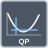

<!-- Generated by tools/export_studio_help.py; edit the reviewed source metadata, then regenerate. -->
# Quadratic Programming

[Mathematics functions](../../../mathematics/index.md) · [All functions](../../../index.md)

Minimizes a convex quadratic objective subject to linear equalities, inequalities and parameter bounds.

## Product execution profiles

The shared index declares native examples for this object; see [the examples below](ip.md#examples) and [document profiles and evidence boundaries](../../../../reference/studio-draft-examples.md). Older binding/help statements retained below can lag those product profiles. They do not establish or deny the separately measured native profiles. An example declaration alone is not an execution result or admission of every overload.

Résumé français de l’aide Studio

**Programmation quadratique, point intérieur**

Texte historique de l’aide conservé ci-dessous. Des exemples natifs distincts sont déclarés pour cet objet ; consultez les profils et preuves datés, sans déduire une compatibilité universelle de ce texte.

Minimise un objectif quadratique convexe sous égalités et inégalités linéaires et bornes sur les paramètres.

## Studio authoring profile

Contract status: **partial**. The connector below describes Studio authoring; execution availability is stated separately.

Retained binding and help description

This is the source declaration, not the current measured product-execution assessment.

## IN — inputs

| Displayed terminal / internal ID | Accepted / resolved type | Studio connection | Unwired input default | Meaning |
| --- | --- | --- | --- | --- |
| start `start` | `array<f64>` | Optional | Not specified | — |
| objective function `objective` | `cluster<Q:array<f64,rank=2>,c:array<f64>>` | Required | Not specified | — |
| parameter bounds `bounds` | `cluster<minimum:array<f64>,maximum:array<f64>>` | Optional | Not specified | — |
| equality constraints `equalities` | `cluster<A:array<f64,rank=2>,b:array<f64>>` | Optional | Not specified | — |
| error in (no error) `error_in` | `cluster<status:bool,code:i32,source:string>` | Optional | Not specified | — |
| inequality constraints `inequalities` | `cluster<D:array<f64,rank=2>,minimum:array<f64>,maximum:array<f64>>` | Optional | Not specified | — |
| stopping criteria `criteria` | `cluster<function_tolerance:f64,parameter_tolerance:f64,gradient_tolerance:f64,max_iterations:i32,max_function_calls:i32,max_time:f64>` | Optional | Not specified | — |

A default is shown only for an input with an explicitly documented value. Preview/default *types* do not imply unwired operand values. If helper and binding flags differ, both are labelled.

## OUT — outputs

| Displayed terminal / internal ID | Accepted / resolved type | Studio connection | Unwired input default | Meaning |
| --- | --- | --- | --- | --- |
| minimum `minimum` | `array<f64>` | Optional | — | — |
| f(minimum) `cost` | `f64` | Optional | — | — |
| Lagrangian multipliers `multipliers` | `array<f64>` | Optional | — | — |
| error out `error_out` | `cluster<status:bool,code:i32,source:string>` | Optional | — | — |

A default is shown only for an input with an explicitly documented value. Preview/default *types* do not imply unwired operand values. If helper and binding flags differ, both are labelled.

## Types and connection rules

Minimizes a convex quadratic objective subject to linear equalities, inequalities and parameter bounds.

- Type resolution: `fixed`; result expression: `array<f64>`.
- Implicit coercion: not enabled by this resolver; individual port policies remain explicit.
- Arrays: accepted; lifting policy: `none`.
- Shape rule: `exact_real_dbl_rank_and_structured_constraint_signature`.
- Scalar lifting: no.
- Broadcasting: no.

**Input count:** 7; this contract does not enable variadic inputs.

Port order: `start` → `objective` → `bounds` → `equalities` → `error_in` → `inequalities` → `criteria`.

## Execution and limits

**Public FROG / target Runtime:** declared available within the scope below.

Scope: `requires_explicit_target_capability`.

Implementation: `frog.studio.math.optimization.qp.ip`.

Required provider: `frog.studio.math.optimization.owned@1`.

Exact owned native service; target admission and end-to-end qualification remain separately attributed.

Connector type defaults and persistence aliases

| Direction | ID | Preview/default type | Connection policy | Cardinality | Legacy port IDs |
| --- | --- | --- | --- | --- | --- |
| INPUT | `start` | `array<f64>` | `exact` | `single` | — |
| INPUT | `objective` | `cluster<Q:array<f64,rank=2>,c:array<f64>>` | `exact` | `single` | — |
| INPUT | `bounds` | `cluster<minimum:array<f64>,maximum:array<f64>>` | `exact` | `single` | — |
| INPUT | `equalities` | `cluster<A:array<f64,rank=2>,b:array<f64>>` | `exact` | `single` | — |
| INPUT | `error_in` | `cluster<status:bool,code:i32,source:string>` | `exact` | `single` | — |
| INPUT | `inequalities` | `cluster<D:array<f64,rank=2>,minimum:array<f64>,maximum:array<f64>>` | `exact` | `single` | — |
| INPUT | `criteria` | `cluster<function_tolerance:f64,parameter_tolerance:f64,gradient_tolerance:f64,max_iterations:i32,max_function_calls:i32,max_time:f64>` | `exact` | `single` | — |
| OUTPUT | `minimum` | `array<f64>` | `exact` | `single` | — |
| OUTPUT | `cost` | `f64` | `exact` | `single` | — |
| OUTPUT | `multipliers` | `array<f64>` | `exact` | `single` | — |
| OUTPUT | `error_out` | `cluster<status:bool,code:i32,source:string>` | `exact` | `single` | — |

## Examples

These are real `.frog` documents from the same index used by Studio. Backend names and expected results describe the examples; they are not execution certificates.

- [Minimiser un coût quadratique par points intérieurs](../../../../examples/math.optimization.qp.ip.worked.md) — Examiner les bornes et le point de départ. Le terme quadratique et le terme linéaire décrivent x² − 4x. (`execution`, `studio-draft`).

## Identity and references

- Catalogue ID: `math.optimization.qp.ip`.
- Parent palette: [Optimization](../../../mathematics/optimization.md).
- Profile: `frog.studio.palette.math.optimization.qp.ip.v1`.
- Definition: `frog.studio.math.optimization.qp.ip`.
- [NI API reference](https://www.ni.com/docs/en-US/bundle/labview-api-ref/page/vi-lib/gmath/numericaloptimization/quadratic-programming-ip-vi.html).

NI links are reference sources for the connector model; Studio support is limited to the profile above. [Reference provenance and notation](../../../index.md#provenance-and-notation).
