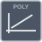

<!-- Generated by tools/export_studio_help.py; edit the reviewed source metadata, then regenerate. -->
# Lin. Evaluation

[Mathematics functions](../../mathematics/index.md) · [All functions](../../index.md)

Linear Evaluation. Y=a*X+b, preserving actual rank 1 or 2. Real and complex numeric arrays are admitted; this does not perform regression. Coefficients are ascending powers. DBL/CDB promotion is explicit; input arrays are immutable. Empty coefficient vectors are errors unless explicitly documented.

## Product execution profiles

The shared index declares native examples for this object; see [the examples below](linear_evaluate.md#examples) and [document profiles and evidence boundaries](../../../reference/studio-draft-examples.md). Older binding/help statements retained below can lag those product profiles. They do not establish or deny the separately measured native profiles. An example declaration alone is not an execution result or admission of every overload.

Résumé français de l’aide Studio

**Évaluation linéaire**

Texte historique de l’aide conservé ci-dessous. Des exemples natifs distincts sont déclarés pour cet objet ; consultez les profils et preuves datés, sans déduire une compatibilité universelle de ce texte.

Calcule Y=a*X+b en conservant le rang réel 1 ou 2. Les tableaux numériques réels et complexes sont admis ; cette opération n’effectue pas de régression. Les coefficients suivent les puissances croissantes. La promotion DBL/CDB est explicite ; les tableaux d’entrée restent immuables. Les vecteurs de coefficients vides sont des erreurs, sauf indication explicite.

## Studio authoring profile

Contract status: **partial**. The connector below describes Studio authoring; execution availability is stated separately.

Retained binding and help description

This is the source declaration, not the current measured product-execution assessment.

## IN — inputs

| Displayed terminal / internal ID | Accepted / resolved type | Studio connection | Unwired input default | Meaning |
| --- | --- | --- | --- | --- |
| x `x` | `array<f64>` | Required | Not specified | — |
| a `a` | `f64` | Optional | Not specified | — |
| b `b` | `f64` | Optional | Not specified | — |

A default is shown only for an input with an explicitly documented value. Preview/default *types* do not imply unwired operand values. If helper and binding flags differ, both are labelled.

## OUT — outputs

| Displayed terminal / internal ID | Accepted / resolved type | Studio connection | Unwired input default | Meaning |
| --- | --- | --- | --- | --- |
| result `result` | `array<f64>` | Recommended | — | — |
| error `error` | `i32` | Recommended | — | — |

A default is shown only for an input with an explicitly documented value. Preview/default *types* do not imply unwired operand values. If helper and binding flags differ, both are labelled.

## Types and connection rules

Linear Evaluation. Y=a*X+b, preserving actual rank 1 or 2. Real and complex numeric arrays are admitted; this does not perform regression. Coefficients are ascending powers. DBL/CDB promotion is explicit; input arrays are immutable. Empty coefficient vectors are errors unless explicitly documented.

- Type resolution: `custom_resolver`; result expression: `resolve:frog.studio.polynomial.type-resolution@1`.
- Implicit coercion: permitted by this profile.
- Arrays: accepted; lifting policy: `none`.
- Shape rule: `polynomial_declared_rank_and_point_shape`.
- Scalar lifting: no.
- Broadcasting: no.

**Input count:** 3; this contract does not enable variadic inputs.

Port order: `x` → `a` → `b`.

## Execution and limits

**Public FROG / target Runtime:** declared available within the scope below.

Scope: `requires_explicit_target_capability`.

Implementation: `frog.studio.math.polynomial.linear_evaluate.owned.v1`.

Required provider: `frog.studio.linear-algebra.native@1`.

Declared native provider capability; actual admission, compilation and execution require the complete typed graph and its explicit provider dependencies.

Connector type defaults and persistence aliases

| Direction | ID | Preview/default type | Connection policy | Cardinality | Legacy port IDs |
| --- | --- | --- | --- | --- | --- |
| INPUT | `x` | `array<f64>` | `numeric_array_implicit` | `single` | — |
| INPUT | `a` | `f64` | `numeric_implicit` | `single` | — |
| INPUT | `b` | `f64` | `numeric_implicit` | `single` | — |
| OUTPUT | `result` | `array<f64>` | `exact` | `single` | — |
| OUTPUT | `error` | `i32` | `exact` | `single` | — |

## Examples

These are real `.frog` documents from the same index used by Studio. Backend names and expected results describe the examples; they are not execution certificates.

- [Lin. Evaluation](../../../examples/math.polynomial.linear_evaluate.worked.md) — With x = \[-1, 0, 4\], a = 2, b = -3, Run displays result = \[-5, -3, 5\], error = 0. (`execution`, `studio-draft`).

## Identity and references

- Catalogue ID: `math.polynomial.linear_evaluate`.
- Parent palette: [Polynomial](../../mathematics/polynomial.md).
- Profile: `frog.studio.polymorphic.math.polynomial.linear_evaluate.v1`.
- Definition: `frog.studio.math.polynomial.linear_evaluate`.
- [NI API reference](https://www.ni.com/docs/en-US/bundle/labview-api-ref/page/menus/categories/mathematics/anpolynomial-mnu.html).

NI links are reference sources for the connector model; Studio support is limited to the profile above. [Reference provenance and notation](../../index.md#provenance-and-notation).
