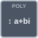

<!-- Generated by tools/export_studio_help.py; edit the reviewed source metadata, then regenerate. -->
# Sort Complex Numbers

[Mathematics functions](../../mathematics/index.md) · [All functions](../../index.md)

Sort Complex Numbers. Stable complex sort. order 0 ascending, 1 descending. method 0 real/imaginary, 1 magnitude/real/imaginary, 2 magnitude/phase in [-pi,pi]. Indices refer to the original array. Coefficients are ascending powers. DBL/CDB promotion is explicit; input arrays are immutable. Empty coefficient vectors are errors unless explicitly documented.

## Studio authoring profile

Contract status: **partial**. The connector below describes Studio authoring; execution availability is stated separately.

## IN — inputs

| Displayed terminal / internal ID | Accepted / resolved type | Studio connection | Unwired input default | Meaning |
| --- | --- | --- | --- | --- |
| numbers `numbers` | `array<c64>` | Required | Not specified | — |
| order `order` | `u16` | Optional | Not specified | — |
| method `method` | `u16` | Optional | Not specified | — |

A default is shown only for an input with an explicitly documented value. Preview/default *types* do not imply unwired operand values. If helper and binding flags differ, both are labelled.

## OUT — outputs

| Displayed terminal / internal ID | Accepted / resolved type | Studio connection | Unwired input default | Meaning |
| --- | --- | --- | --- | --- |
| result `result` | `array<c64>` | Recommended | — | — |
| indices `indices` | `array<i32>` | Recommended | — | — |
| error `error` | `i32` | Recommended | — | — |

A default is shown only for an input with an explicitly documented value. Preview/default *types* do not imply unwired operand values. If helper and binding flags differ, both are labelled.

## Types and connection rules

Sort Complex Numbers. Stable complex sort. order 0 ascending, 1 descending. method 0 real/imaginary, 1 magnitude/real/imaginary, 2 magnitude/phase in [-pi,pi]. Indices refer to the original array. Coefficients are ascending powers. DBL/CDB promotion is explicit; input arrays are immutable. Empty coefficient vectors are errors unless explicitly documented.

- Type resolution: `custom_resolver`; result expression: `resolve:frog.studio.polynomial.type-resolution@1`.
- Implicit coercion: permitted by this profile.
- Arrays: accepted; lifting policy: `none`.
- Shape rule: `polynomial_declared_rank_and_point_shape`.
- Scalar lifting: no.
- Broadcasting: no.

**Input count:** 3; this contract does not enable variadic inputs.

Port order: `numbers` → `order` → `method`.

## Execution and limits

**Public FROG / target Runtime:** declared available within the scope below.

Scope: `requires_explicit_target_capability`.

Implementation: `frog.studio.math.polynomial.sort_complex.owned.v1`.

Required provider: `frog.studio.linear-algebra.native@1`.

Declared native provider capability; actual admission, compilation and execution require the complete typed graph and its explicit provider dependencies.

Connector type defaults and persistence aliases

| Direction | ID | Preview/default type | Connection policy | Cardinality | Legacy port IDs |
| --- | --- | --- | --- | --- | --- |
| INPUT | `numbers` | `array<c64>` | `numeric_array_implicit` | `single` | — |
| INPUT | `order` | `u16` | `numeric_implicit` | `single` | — |
| INPUT | `method` | `u16` | `numeric_implicit` | `single` | — |
| OUTPUT | `result` | `array<c64>` | `exact` | `single` | — |
| OUTPUT | `indices` | `array<i32>` | `exact` | `single` | — |
| OUTPUT | `error` | `i32` | `exact` | `single` | — |

## Examples

No example for this object is currently declared in the shared index. [Browse the available examples](../../../examples/index.md).

## Identity and references

- Catalogue ID: `math.polynomial.sort_complex`.
- Parent palette: [Polynomial](../../mathematics/polynomial.md).
- Profile: `frog.studio.polymorphic.math.polynomial.sort_complex.v1`.
- Definition: `frog.studio.math.polynomial.sort_complex`.
- [NI API reference](https://www.ni.com/docs/en-US/bundle/labview-api-ref/page/menus/categories/mathematics/anpolynomial-mnu.html).

NI links are reference sources for the connector model; Studio support is limited to the profile above. [Reference provenance and notation](../../index.md#provenance-and-notation).
