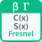

<!-- Generated by tools/export_studio_help.py; edit the reviewed source metadata, then regenerate. -->
# Fresnel

[Mathematics functions](../../../mathematics/index.md) · [All functions](../../../index.md)

Computes normalized integrals of cos(pi*t*t/2) and sin(pi*t*t/2). Two outputs: cosine_integral C(x) above sine_integral S(x). C(1)=0.7798934003768228; S(1)=0.4382591473903548. Required x:f64, no default. ni_documented_real_v1 uses q=abs(x), never abs(result); the separate standard_real_v1 kernel uses signed x. NI-G documentation, not measured NI/NXG parity. See Detailed Help for domains, limits and FROG extensions.

## Product execution profiles

The shared index declares native examples for this object; see [the examples below](fresnel.md#examples) and [document profiles and evidence boundaries](../../../../reference/studio-draft-examples.md). Older binding/help statements retained below can lag those product profiles. They do not establish or deny the separately measured native profiles. An example declaration alone is not an execution result or admission of every overload.

Résumé français de l’aide Studio

**Fresnel**

Texte historique de l’aide conservé ci-dessous. Des exemples natifs distincts sont déclarés pour cet objet ; consultez les profils et preuves datés, sans déduire une compatibilité universelle de ce texte.

Calcule les intégrales normalisées de cos(pi*t²/2) et sin(pi*t²/2). Deux sorties : cosine_integral C(x) en haut, sine_integral S(x) en dessous. C(1)=0,7798934003768228 ; S(1)=0,4382591473903548. x:f64 obligatoire, sans défaut. ni_documented_real_v1 utilise q=abs(x), jamais abs(résultat) ; noyau standard_real_v1 avec x signé. Documentation NI-G, parité NI/NXG non mesurée. Domaines, limites et extensions FROG dans Detailed Help.

## Studio authoring profile

Contract status: **partial**. The connector below describes Studio authoring; execution availability is stated separately.

Retained binding and help description

This is the source declaration, not the current measured product-execution assessment.

Evaluates normalized C(q)=integral(0,q,cos(pi*t*t/2),dt) and S(q)=integral(0,q,sin(pi*t*t/2),dt). Separate cosine_integral C(x) output is above sine_integral S(x). C(1)=0.7798934003768228; S(1)=0.4382591473903548. C(0)=S(0)=+0; positive infinity gives C=S=0.5. Standard C and S are odd. No complex/array pair output and no Si/Ci integral. Large finite phase corrections are retained when representable. Profile ni_documented_real_v1 evaluates every function at q=abs(x), including inverse domains after transformation; never applies abs to a result. Separate standard_real_v1 mathematical kernel keeps signed x and odd-function signed zero. The adapter is not globally invertible: documentary ErfC(Inverse ErfC(1.5)) is about 0.5. Profiles and version 1 are fixed by the distinct stable definition identity; no profile menu or silent change to existing operators. Required x:f64 with no default; one real result:f64, except Fresnel: cosine_integral C(x) above sine_integral S(x). FROG Highlight extension through NumericTreeMath preserves real numeric array rank/dimensions, typed empties and ordered cluster fields, promoting f32/integer leaves to f64; Fresnel produces two separate containers of the same shape. Bool, String, Path, references, error clusters, complex and Matrix are rejected. Native compiled provider is scalar f64 only; aggregates require an explicit target capability. FROG diagnostics use the existing numerical channel with no error-cluster terminals: nan_input, limit, domain, singularity, overflow, underflow, nonconvergence. Propagate NaN to every output; preserve representable subnormals, signed limiting infinities and standard odd-function signed zero. The documentary adapter maps -0 to +0. Inverse ErfC(1) is +0. Invalid real domains produce NaN with a diagnostic.

## IN — inputs

| Displayed terminal / internal ID | Accepted / resolved type | Studio connection | Unwired input default | Meaning |
| --- | --- | --- | --- | --- |
| x `x` | `f64` | Required | Not specified | — |

A default is shown only for an input with an explicitly documented value. Preview/default *types* do not imply unwired operand values. If helper and binding flags differ, both are labelled.

## OUT — outputs

| Displayed terminal / internal ID | Accepted / resolved type | Studio connection | Unwired input default | Meaning |
| --- | --- | --- | --- | --- |
| C(x) `cosine_integral` | `f64` | Recommended | — | — |
| S(x) `sine_integral` | `f64` | Recommended | — | — |

A default is shown only for an input with an explicitly documented value. Preview/default *types* do not imply unwired operand values. If helper and binding flags differ, both are labelled.

## Types and connection rules

Required x:f64 with no default; one real result:f64, except Fresnel: cosine_integral C(x) above sine_integral S(x). FROG Highlight extension through NumericTreeMath preserves real numeric array rank/dimensions, typed empties and ordered cluster fields, promoting f32/integer leaves to f64; Fresnel produces two separate containers of the same shape. Bool, String, Path, references, error clusters, complex and Matrix are rejected. Native compiled provider is scalar f64 only; aggregates require an explicit target capability.

- Type resolution: `custom_resolver`; result expression: `resolve:frog.studio.error-functions.type-resolution@1`.
- Implicit coercion: permitted by this profile.
- Arrays: accepted; lifting policy: `element_wise_same_shape_with_scalar_lift`.
- Shape rule: `preserve_x_rank_dimensions_and_ordered_fields; separate_same_shape_C_and_S_for_Fresnel`.
- Scalar lifting: no.
- Broadcasting: no.

**Input count:** 1; this contract does not enable variadic inputs.

Port order: `x`.

## Execution and limits

**Public FROG / target Runtime:** not declared available by this authoring contract.

Generic authoring metadata does not imply universal target support. The selected native provider must advertise and execute this exact signature.

Retained authoring-contract limitations

These declarations belong to the binding snapshot. Compare them with the separately admitted native profiles and dated measurements linked above; they are not a current denial of those product profiles.

**Authoring/target contract limits:**

- Classic LabVIEW NI-G scalar connector documentation; NI/CVI confirms normalized Fresnel equations. Standard mathematical definitions from NIST DLMF. No measured NI runtime parity and no verified NXG graphical signatures.
- Native compiled provider is scalar f64 only; target availability requires the exact signature.

Connector type defaults and persistence aliases

| Direction | ID | Preview/default type | Connection policy | Cardinality | Legacy port IDs |
| --- | --- | --- | --- | --- | --- |
| INPUT | `x` | `f64` | `any_explicit` | `single` | — |
| OUTPUT | `cosine_integral` | `f64` | `exact` | `single` | — |
| OUTPUT | `sine_integral` | `f64` | `exact` | `single` | — |

## Examples

These are real `.frog` documents from the same index used by Studio. Backend names and expected results describe the examples; they are not execution certificates.

- [Fresnel — reference 1](../../../../examples/math.special.error_functions.fresnel.reference_1.md) — Evaluates normalized C(q)=integral(0,q,cos(pi*t*t/2),dt) and S(q)=integral(0,q,sin(pi*t*t/2),dt). (`execution`, `studio-draft`).
- [Fresnel — reference 2](../../../../examples/math.special.error_functions.fresnel.reference_2.md) — Evaluates normalized C(q)=integral(0,q,cos(pi*t*t/2),dt) and S(q)=integral(0,q,sin(pi*t*t/2),dt). (`execution`, `studio-draft`).
- [Fresnel — reference 3](../../../../examples/math.special.error_functions.fresnel.reference_3.md) — Evaluates normalized C(q)=integral(0,q,cos(pi*t*t/2),dt) and S(q)=integral(0,q,sin(pi*t*t/2),dt). (`execution`, `studio-draft`).

## Identity and references

- Catalogue ID: `math.special.error_functions.fresnel`.
- Parent palette: [Error Functions](../../../mathematics/elementary/error_functions.md).
- Profile: `frog.studio.palette.math.special.error_functions.fresnel.v1`.
- Definition: `frog.studio.math.special.error_functions.fresnel`.
- [NI API reference](https://www.ni.com/docs/en-US/bundle/labview-api-ref/page/vi-lib/gmath/specialfunctions-llb/fresnel-integrals-vi.html).

NI links are reference sources for the connector model; Studio support is limited to the profile above. [Reference provenance and notation](../../../index.md#provenance-and-notation).
