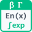

<!-- Generated by tools/export_studio_help.py; edit the reviewed source metadata, then regenerate. -->
# Exponential Integral

[Mathematics functions](../../../mathematics/index.md) · [All functions](../../../index.md)

Evaluates E_n(q)=integral(1,infinity,exp(-q*t)/t^n,dt), q=abs(x), with required integer n&gt;=0 and no default order. E0(q)=exp(-q)/q; E0(0) and E1(0) are +Infinity with singularity; En(0)=1/(n-1) for n&gt;=2. E1(710) remains a representable subnormal.

## Product execution profiles

The shared index declares native examples for this object; see [the examples below](expn.md#examples) and [document profiles and evidence boundaries](../../../../reference/studio-draft-examples.md). Older binding/help statements retained below can lag those product profiles. They do not establish or deny the separately measured native profiles. An example declaration alone is not an execution result or admission of every overload.

Résumé français de l’aide Studio

Texte historique de l’aide conservé ci-dessous. Des exemples natifs distincts sont déclarés pour cet objet ; consultez les profils et preuves datés, sans déduire une compatibilité universelle de ce texte.

Évalue E_n(q), q=abs(x), avec ordre entier n&gt;=0 obligatoire et sans défaut. E0(q)=exp(-q)/q ; E0(0) et E1(0) donnent +Infinity avec singularity ; En(0)=1/(n-1) pour n&gt;=2. E1(710) conserve son sous-normal. [Types] x:f64; n:i32 obligatoire, scalaire commun, sans défaut ni troncature → result:f64. Extension FROG locale NumericTreeMath sur x tableaux/clusters numériques réels : rang, dimensions et champs ordonnés conservés ; promotion f32/entiers vers f64. Backend natif scalaire uniquement. Profil ni_documented_real_v1 : Si garde x signé ; En/Ci/Dilogarithm/Shi/Chi appliquent abs(x). Shi mathématique est impaire mais le nœud applique abs(x). D(q)=-Li2(1-q). Diagnostics séparés sans terminal d’erreur, sous-normaux conservés, calcul échelonné de Shi/Chi(717). Documentation NI-G et équation NI/CVI ; parité NI non mesurée.

## Studio authoring profile

Contract status: **partial**. The connector below describes Studio authoring; execution availability is stated separately.

Retained binding and help description

This is the source declaration, not the current measured product-execution assessment.

Evaluates E_n(q)=integral(1,infinity,exp(-q*t)/t^n,dt), q=abs(x), with required integer n&gt;=0 and no default order. E0(q)=exp(-q)/q; E0(0) and E1(0) are +Infinity with singularity; En(0)=1/(n-1) for n&gt;=2. E1(710) remains a representable subnormal. Profile ni_documented_real_v1: Si uses signed x; En, Ci, Dilogarithm, Shi and Chi use q=abs(x). Standard Shi is odd, but the documented node adapter applies abs(x). En is E_n, not Ei; D(q)=-Li2(1-q), not Li2(q) or positive Spence. NI parity has not been measured. NI scalar real double baseline: x:f64, required scalar n:i32 for En, result:f64. FROG local Highlight extension through common NumericTreeMath maps real numeric x Arrays/Clusters while preserving rank, dimensions, typed empties and ordered field identities; n remains one required scalar i32 common to every x leaf. Real f32/integer x leaves promote visibly to f64, possibly rounding integers beyond 2^53. No implicit floating n conversion, truncation, absolute n, Boolean, String, Path, complex, Matrix or dimensional broadcasting. Native compiled provider is scalar only; aggregates fail explicitly. FROG numeric diagnostics use the existing channel without error terminals: nan_input, limit, domain, singularity, overflow, underflow, nonconvergence. Preserve typed NaN failures, signed zero, documented limiting infinities and representable subnormals. Scaled Shi/Chi evaluation avoids premature intermediate exp overflow at x=717.

NI scalar real double baseline: x:f64, required scalar n:i32 for En, result:f64. FROG local Highlight extension through common NumericTreeMath maps real numeric x Arrays/Clusters while preserving rank, dimensions, typed empties and ordered field identities; n remains one required scalar i32 common to every x leaf. Real f32/integer x leaves promote visibly to f64, possibly rounding integers beyond 2^53. No implicit floating n conversion, truncation, absolute n, Boolean, String, Path, complex, Matrix or dimensional broadcasting. Native compiled provider is scalar only; aggregates fail explicitly. Profile ni_documented_real_v1: Si uses signed x; En, Ci, Dilogarithm, Shi and Chi use q=abs(x). Standard Shi is odd, but the documented node adapter applies abs(x). En is E_n, not Ei; D(q)=-Li2(1-q), not Li2(q) or positive Spence. NI parity has not been measured. FROG numeric diagnostics use the existing channel without error terminals: nan_input, limit, domain, singularity, overflow, underflow, nonconvergence. Preserve typed NaN failures, signed zero, documented limiting infinities and representable subnormals. Scaled Shi/Chi evaluation avoids premature intermediate exp overflow at x=717.

## IN — inputs

| Displayed terminal / internal ID | Accepted / resolved type | Studio connection | Unwired input default | Meaning |
| --- | --- | --- | --- | --- |
| x `x` | `f64` | Required | Not specified | — |
| n `n` | `i32` | Required | Not specified | — |

A default is shown only for an input with an explicitly documented value. Preview/default *types* do not imply unwired operand values. If helper and binding flags differ, both are labelled.

## OUT — outputs

| Displayed terminal / internal ID | Accepted / resolved type | Studio connection | Unwired input default | Meaning |
| --- | --- | --- | --- | --- |
| En(x) `result` | `f64` | Recommended | — | — |

A default is shown only for an input with an explicitly documented value. Preview/default *types* do not imply unwired operand values. If helper and binding flags differ, both are labelled.

## Types and connection rules

NI scalar real double baseline: x:f64, required scalar n:i32 for En, result:f64. FROG local Highlight extension through common NumericTreeMath maps real numeric x Arrays/Clusters while preserving rank, dimensions, typed empties and ordered field identities; n remains one required scalar i32 common to every x leaf. Real f32/integer x leaves promote visibly to f64, possibly rounding integers beyond 2^53. No implicit floating n conversion, truncation, absolute n, Boolean, String, Path, complex, Matrix or dimensional broadcasting. Native compiled provider is scalar only; aggregates fail explicitly.

- Type resolution: `custom_resolver`; result expression: `resolve:frog.studio.exponential-integrals.type-resolution@1`.
- Implicit coercion: permitted by this profile.
- Arrays: accepted; lifting policy: `element_wise_same_shape_with_scalar_lift`.
- Shape rule: `preserve_x_rank_dimensions_and_ordered_fields; n_is_scalar_common`.
- Scalar lifting: no.
- Broadcasting: no.

**Input count:** 2; this contract does not enable variadic inputs.

Port order: `x` → `n`.

## Execution and limits

**Public FROG / target Runtime:** not declared available by this authoring contract.

Generic authoring metadata does not imply universal target support. The selected native provider must advertise and execute this exact signature.

Retained authoring-contract limitations

These declarations belong to the binding snapshot. Compare them with the separately admitted native profiles and dated measurements linked above; they are not a current denial of those product profiles.

**Authoring/target contract limits:**

- Classic LabVIEW NI-G scalar connector documentation, NI/CVI equation for D=-Li2(1-q), and primary mathematical definitions. No measured NI runtime parity or verified NXG graphical signatures.
- Native compiled provider is scalar only; target availability requires the exact signature.

Connector type defaults and persistence aliases

| Direction | ID | Preview/default type | Connection policy | Cardinality | Legacy port IDs |
| --- | --- | --- | --- | --- | --- |
| INPUT | `x` | `f64` | `any_explicit` | `single` | — |
| INPUT | `n` | `i32` | `exact` | `single` | — |
| OUTPUT | `result` | `f64` | `exact` | `single` | — |

## Examples

These are real `.frog` documents from the same index used by Studio. Backend names and expected results describe the examples; they are not execution certificates.

- [Exponential Integral — reference 1](../../../../examples/math.special.exponential_integrals.expn.reference_1.md) — Evaluates E_n(q)=integral(1,infinity,exp(-q*t)/t^n,dt), q=abs(x), with required integer n&gt;=0 and no default order. (`execution`, `studio-draft`).
- [Exponential Integral — reference 2](../../../../examples/math.special.exponential_integrals.expn.reference_2.md) — Evaluates E_n(q)=integral(1,infinity,exp(-q*t)/t^n,dt), q=abs(x), with required integer n&gt;=0 and no default order. (`execution`, `studio-draft`).
- [Exponential Integral — reference 3](../../../../examples/math.special.exponential_integrals.expn.reference_3.md) — Evaluates E_n(q)=integral(1,infinity,exp(-q*t)/t^n,dt), q=abs(x), with required integer n&gt;=0 and no default order. (`execution`, `studio-draft`).

## Identity and references

- Catalogue ID: `math.special.exponential_integrals.expn`.
- Parent palette: [Exponential Integrals](../../../mathematics/elementary/exponential_integrals.md).
- Profile: `frog.studio.palette.math.special.exponential_integrals.expn.v1`.
- Definition: `frog.studio.math.special.exponential_integrals.expn`.
- [NI API reference](https://www.ni.com/docs/en-US/bundle/labview-api-ref/page/vi-lib/gmath/specialfunctions-llb/exponential-integral-vi.html).

NI links are reference sources for the connector model; Studio support is limited to the profile above. [Reference provenance and notation](../../../index.md#provenance-and-notation).
