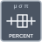

<!-- Generated by tools/export_studio_help.py; edit the reviewed source metadata, then regenerate. -->
# Percentiles

[Mathematics functions](../../mathematics/index.md) · [All functions](../../index.md)

Percent in[0,100], GS type7 interpolation h=(n-1)*p/100; no NI interpolation equivalence claimed. GS type-7 linear interpolation, percent scale 0..100, one shared sort per percentile vector.

Résumé français de l’aide Studio

**Percentiles**

Calcule un ou plusieurs percentiles, exprimés entre 0 et 100.

## Studio authoring profile

Contract status: **partial**. The connector below describes Studio authoring; execution availability is stated separately.

## IN — inputs

| Displayed terminal / internal ID | Accepted / resolved type | Studio connection | Unwired input default | Meaning |
| --- | --- | --- | --- | --- |
| X `x` | `array<f64>` | Required | Not specified | — |
| p (%) `p` | `f64` | Required | Not specified | — |

A default is shown only for an input with an explicitly documented value. Preview/default *types* do not imply unwired operand values. If helper and binding flags differ, both are labelled.

## OUT — outputs

| Displayed terminal / internal ID | Accepted / resolved type | Studio connection | Unwired input default | Meaning |
| --- | --- | --- | --- | --- |
| percentile `percentile` | `f64` | Recommended | — | — |
| error `error` | `i32` | Recommended | — | — |

A default is shown only for an input with an explicitly documented value. Preview/default *types* do not imply unwired operand values. If helper and binding flags differ, both are labelled.

## Types and connection rules

Percent in[0,100], GS type7 interpolation h=(n-1)*p/100; no NI interpolation equivalence claimed.

- Type resolution: `custom_resolver`; result expression: `resolve:frog.studio.statistics.type-resolution@1`.
- Implicit coercion: permitted by this profile.
- Arrays: accepted; lifting policy: `none`.
- Shape rule: `statistics_exact_selected_variant_rank_and_record_schema`.
- Scalar lifting: no.
- Broadcasting: no.

**Input count:** 2; this contract does not enable variadic inputs.

Port order: `x` → `p`.

## Execution and limits

**Public FROG / target Runtime:** declared available within the scope below.

Scope: `requires_explicit_target_capability`.

Implementation: `frog.studio.math.statistics.percentiles.scalar.owned.v1`.

Required provider: `frog.studio.math.statistics.owned@1`.

Per selected exact signature; complete-graph target admission, native execution and AOT qualification are separate. Source implementation is not a passing product test. GS type-7 linear interpolation, percent scale 0..100, one shared sort per percentile vector.

Connector type defaults and persistence aliases

| Direction | ID | Preview/default type | Connection policy | Cardinality | Legacy port IDs |
| --- | --- | --- | --- | --- | --- |
| INPUT | `x` | `array<f64>` | `numeric_array_implicit` | `single` | — |
| INPUT | `p` | `f64` | `numeric_implicit` | `single` | — |
| OUTPUT | `percentile` | `f64` | `exact` | `single` | — |
| OUTPUT | `error` | `i32` | `exact` | `single` | — |

## Examples

No example for this object is currently declared in the shared index. [Browse the available examples](../../../examples/index.md).

## Identity and references

- Catalogue ID: `math.statistics.percentiles`.
- Parent palette: [Probability &amp; Statistics](../../mathematics/probability_statistics.md).
- Profile: `frog.studio.polymorphic.math.statistics.percentiles.v1`.
- Definition: `frog.studio.math.statistics.percentiles`.
- [NI API reference](https://www.ni.com/docs/en-US/bundle/labview-api-ref/page/vi-lib/gmath/statdist-llb/st-percentiles-scalar-vi.html).
- [NI API reference](https://www.ni.com/docs/en-US/bundle/labview-api-ref/page/vi-lib/gmath/statdist-llb/st-percentiles-array-vi.html).

NI links are reference sources for the connector model; Studio support is limited to the profile above. [Reference provenance and notation](../../index.md#provenance-and-notation).
