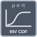

<!-- Generated by tools/export_studio_help.py; edit the reviewed source metadata, then regenerate. -->
# Continuous Inverse CDF

[Mathematics functions](../../../mathematics/index.md) · [All functions](../../../index.md)

Exact per-law NI connector types with explicit GS normalized IDs. Gamma uses shape=c,scale=b; Weibull uses scale=a,shape=b despite contradictory NI descriptions. Extreme Value is GS minimum orientation. Random state is per native instance/node; deterministic GS seed policy is not NI sequence identity.

Résumé français de l’aide Studio

**Continuous Inverse CDF**

Recherche le quantile correspondant à une probabilité pour la loi continue choisie.

## Studio authoring profile

Contract status: **partial**. The connector below describes Studio authoring; execution availability is stated separately.

## IN — inputs

| Displayed terminal / internal ID | Accepted / resolved type | Studio connection | Unwired input default | Meaning |
| --- | --- | --- | --- | --- |
| cdf(x) `probability` | `f64` | Required | Not specified | — |
| a `a` | `f64` | Required | Not specified | — |
| b `b` | `f64` | Required | Not specified | — |

A default is shown only for an input with an explicitly documented value. Preview/default *types* do not imply unwired operand values. If helper and binding flags differ, both are labelled.

## OUT — outputs

| Displayed terminal / internal ID | Accepted / resolved type | Studio connection | Unwired input default | Meaning |
| --- | --- | --- | --- | --- |
| x `quantile` | `f64` | Recommended | — | — |
| error `error` | `i32` | Recommended | — | — |

A default is shown only for an input with an explicitly documented value. Preview/default *types* do not imply unwired operand values. If helper and binding flags differ, both are labelled.

## Types and connection rules

Exact per-law NI connector types with explicit GS normalized IDs. Gamma uses shape=c,scale=b; Weibull uses scale=a,shape=b despite contradictory NI descriptions. Extreme Value is GS minimum orientation. Random state is per native instance/node; deterministic GS seed policy is not NI sequence identity.

- Type resolution: `custom_resolver`; result expression: `resolve:frog.studio.statistics.type-resolution@1`.
- Implicit coercion: permitted by this profile.
- Arrays: accepted; lifting policy: `none`.
- Shape rule: `statistics_exact_selected_variant_rank_and_record_schema`.
- Scalar lifting: no.
- Broadcasting: no.

**Input count:** 3; this contract does not enable variadic inputs.

Port order: `probability` → `a` → `b`.

## Execution and limits

**Public FROG / target Runtime:** declared available within the scope below.

Scope: `requires_explicit_target_capability`.

Implementation: `frog.studio.math.statistics.probability.continuous_inverse_cdf.beta.owned.v1`.

Required provider: `frog.studio.math.statistics.owned@1`.

Per selected exact signature; complete-graph target admission, native execution and AOT qualification are separate. Source implementation is not a passing product test.

Connector type defaults and persistence aliases

| Direction | ID | Preview/default type | Connection policy | Cardinality | Legacy port IDs |
| --- | --- | --- | --- | --- | --- |
| INPUT | `probability` | `f64` | `numeric_implicit` | `single` | — |
| INPUT | `a` | `f64` | `numeric_implicit` | `single` | — |
| INPUT | `b` | `f64` | `numeric_implicit` | `single` | — |
| OUTPUT | `quantile` | `f64` | `exact` | `single` | — |
| OUTPUT | `error` | `i32` | `exact` | `single` | — |

## Examples

No example for this object is currently declared in the shared index. [Browse the available examples](../../../../examples/index.md).

## Identity and references

- Catalogue ID: `math.statistics.probability.continuous_inverse_cdf`.
- Parent palette: [Probability](../../../mathematics/probability_statistics/probability.md).
- Profile: `frog.studio.polymorphic.math.statistics.probability.continuous_inverse_cdf.v1`.
- Definition: `frog.studio.math.statistics.probability.continuous_inverse_cdf`.
- [NI API reference](https://www.ni.com/docs/en-US/bundle/labview-api-ref/page/vi-lib/gmath/statdist-llb/beta-inverse-cdf-vi.html).
- [NI API reference](https://www.ni.com/docs/en-US/bundle/labview-api-ref/page/vi-lib/gmath/statdist-llb/cauchy-inverse-cdf-vi.html).
- [NI API reference](https://www.ni.com/docs/en-US/bundle/labview-api-ref/page/vi-lib/gmath/statdist-llb/chi-squared-inverse-cdf-vi.html).
- [NI API reference](https://www.ni.com/docs/en-US/bundle/labview-api-ref/page/vi-lib/gmath/statdist-llb/chi-squared-non-central-inverse-cdf-vi.html).
- [NI API reference](https://www.ni.com/docs/en-US/bundle/labview-api-ref/page/vi-lib/gmath/statdist-llb/exp-inverse-cdf-vi.html).
- [NI API reference](https://www.ni.com/docs/en-US/bundle/labview-api-ref/page/vi-lib/gmath/statdist-llb/extreme-value-inverse-cdf-vi.html).
- [NI API reference](https://www.ni.com/docs/en-US/bundle/labview-api-ref/page/vi-lib/gmath/statdist-llb/f-inverse-cdf-vi.html).
- [NI API reference](https://www.ni.com/docs/en-US/bundle/labview-api-ref/page/vi-lib/gmath/statdist-llb/gamma-inverse-cdf-vi.html).
- [NI API reference](https://www.ni.com/docs/en-US/bundle/labview-api-ref/page/vi-lib/gmath/statdist-llb/laplace-inverse-cdf-vi.html).
- [NI API reference](https://www.ni.com/docs/en-US/bundle/labview-api-ref/page/vi-lib/gmath/statdist-llb/logistic-inverse-cdf-vi.html).
- [NI API reference](https://www.ni.com/docs/en-US/bundle/labview-api-ref/page/vi-lib/gmath/statdist-llb/lognormal-inverse-cdf-vi.html).
- [NI API reference](https://www.ni.com/docs/en-US/bundle/labview-api-ref/page/vi-lib/gmath/statdist-llb/normal-inverse-cdf-vi.html).
- [NI API reference](https://www.ni.com/docs/en-US/bundle/labview-api-ref/page/vi-lib/gmath/statdist-llb/pareto-inverse-cdf-vi.html).
- [NI API reference](https://www.ni.com/docs/en-US/bundle/labview-api-ref/page/vi-lib/gmath/statdist-llb/rayleigh-inverse-cdf-vi.html).
- [NI API reference](https://www.ni.com/docs/en-US/bundle/labview-api-ref/page/vi-lib/gmath/statdist-llb/student-t-inverse-cdf-vi.html).
- [NI API reference](https://www.ni.com/docs/en-US/bundle/labview-api-ref/page/vi-lib/gmath/statdist-llb/triangular-inverse-cdf-vi.html).
- [NI API reference](https://www.ni.com/docs/en-US/bundle/labview-api-ref/page/vi-lib/gmath/statdist-llb/uniform-inverse-cdf-vi.html).
- [NI API reference](https://www.ni.com/docs/en-US/bundle/labview-api-ref/page/vi-lib/gmath/statdist-llb/weibull-inverse-cdf-vi.html).

NI links are reference sources for the connector model; Studio support is limited to the profile above. [Reference provenance and notation](../../../index.md#provenance-and-notation).
