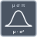

<!-- Generated by tools/export_studio_help.py; edit the reviewed source metadata, then regenerate. -->
# Continuous Moments

[Mathematics functions](../../../mathematics/index.md) · [All functions](../../../index.md)

Exact per-law NI connector types with explicit GS normalized IDs. Gamma uses shape=c,scale=b; Weibull uses scale=a,shape=b despite contradictory NI descriptions. Extreme Value is GS minimum orientation. Random state is per native instance/node; deterministic GS seed policy is not NI sequence identity.

## Product execution profiles

The shared index declares native examples for this object; see [the examples below](continuous_moments.md#examples) and [document profiles and evidence boundaries](../../../../reference/studio-draft-examples.md). Older binding/help statements retained below can lag those product profiles. They do not establish or deny the separately measured native profiles. An example declaration alone is not an execution result or admission of every overload.

Résumé français de l’aide Studio

**Continuous Moments**

Texte historique de l’aide conservé ci-dessous. Des exemples natifs distincts sont déclarés pour cet objet ; consultez les profils et preuves datés, sans déduire une compatibilité universelle de ce texte.

Calcule la moyenne et la variance théoriques de la loi continue choisie.

## Studio authoring profile

Contract status: **partial**. The connector below describes Studio authoring; execution availability is stated separately.

Retained binding and help description

This is the source declaration, not the current measured product-execution assessment.

## IN — inputs

| Displayed terminal / internal ID | Accepted / resolved type | Studio connection | Unwired input default | Meaning |
| --- | --- | --- | --- | --- |
| a `a` | `f64` | Required | Not specified | — |
| b `b` | `f64` | Required | Not specified | — |

A default is shown only for an input with an explicitly documented value. Preview/default *types* do not imply unwired operand values. If helper and binding flags differ, both are labelled.

## OUT — outputs

| Displayed terminal / internal ID | Accepted / resolved type | Studio connection | Unwired input default | Meaning |
| --- | --- | --- | --- | --- |
| mean `mean` | `f64` | Recommended | — | — |
| variance `variance` | `f64` | Recommended | — | — |
| error `error` | `i32` | Recommended | — | — |

A default is shown only for an input with an explicitly documented value. Preview/default *types* do not imply unwired operand values. If helper and binding flags differ, both are labelled.

## Types and connection rules

Exact per-law NI connector types with explicit GS normalized IDs. Gamma uses shape=c,scale=b; Weibull uses scale=a,shape=b despite contradictory NI descriptions. Extreme Value is GS minimum orientation. Random state is per native instance/node; deterministic GS seed policy is not NI sequence identity.

- Type resolution: `custom_resolver`; result expression: `resolve:frog.studio.statistics.type-resolution@1`.
- Implicit coercion: permitted by this profile.
- Arrays: accepted; lifting policy: `none`.
- Shape rule: `statistics_exact_selected_variant_rank_and_record_schema`.
- Scalar lifting: no.
- Broadcasting: no.

**Input count:** 2; this contract does not enable variadic inputs.

Port order: `a` → `b`.

## Execution and limits

**Public FROG / target Runtime:** declared available within the scope below.

Scope: `requires_explicit_target_capability`.

Implementation: `frog.studio.math.statistics.probability.continuous_moments.beta.owned.v1`.

Required provider: `frog.studio.math.statistics.owned@1`.

Per selected exact signature; complete-graph target admission, native execution and AOT qualification are separate. Source implementation is not a passing product test.

Connector type defaults and persistence aliases

| Direction | ID | Preview/default type | Connection policy | Cardinality | Legacy port IDs |
| --- | --- | --- | --- | --- | --- |
| INPUT | `a` | `f64` | `numeric_implicit` | `single` | — |
| INPUT | `b` | `f64` | `numeric_implicit` | `single` | — |
| OUTPUT | `mean` | `f64` | `exact` | `single` | — |
| OUTPUT | `variance` | `f64` | `exact` | `single` | — |
| OUTPUT | `error` | `i32` | `exact` | `single` | — |

## Examples

These are real `.frog` documents from the same index used by Studio. Backend names and expected results describe the examples; they are not execution certificates.

- [Continuous Moments](../../../../examples/math.statistics.probability.continuous_moments.worked.md) — With a = 2, b = 3, Run displays error = 0, mean = 0.4, variance = 0.04. (`execution`, `studio-draft`).

## Identity and references

- Catalogue ID: `math.statistics.probability.continuous_moments`.
- Parent palette: [Probability](../../../mathematics/probability_statistics/probability.md).
- Profile: `frog.studio.polymorphic.math.statistics.probability.continuous_moments.v1`.
- Definition: `frog.studio.math.statistics.probability.continuous_moments`.
- [NI API reference](https://www.ni.com/docs/en-US/bundle/labview-api-ref/page/vi-lib/gmath/statdist-llb/beta-moments-vi.html).
- [NI API reference](https://www.ni.com/docs/en-US/bundle/labview-api-ref/page/vi-lib/gmath/statdist-llb/chi-squared-moments-vi.html).
- [NI API reference](https://www.ni.com/docs/en-US/bundle/labview-api-ref/page/vi-lib/gmath/statdist-llb/chi-squared-non-central-moments-vi.html).
- [NI API reference](https://www.ni.com/docs/en-US/bundle/labview-api-ref/page/vi-lib/gmath/statdist-llb/exp-moments-vi.html).
- [NI API reference](https://www.ni.com/docs/en-US/bundle/labview-api-ref/page/vi-lib/gmath/statdist-llb/extreme-value-moments-vi.html).
- [NI API reference](https://www.ni.com/docs/en-US/bundle/labview-api-ref/page/vi-lib/gmath/statdist-llb/f-moments-vi.html).
- [NI API reference](https://www.ni.com/docs/en-US/bundle/labview-api-ref/page/vi-lib/gmath/statdist-llb/gamma-moments-vi.html).
- [NI API reference](https://www.ni.com/docs/en-US/bundle/labview-api-ref/page/vi-lib/gmath/statdist-llb/laplace-moments-vi.html).
- [NI API reference](https://www.ni.com/docs/en-US/bundle/labview-api-ref/page/vi-lib/gmath/statdist-llb/logistic-moments-vi.html).
- [NI API reference](https://www.ni.com/docs/en-US/bundle/labview-api-ref/page/vi-lib/gmath/statdist-llb/lognormal-moments-vi.html).
- [NI API reference](https://www.ni.com/docs/en-US/bundle/labview-api-ref/page/vi-lib/gmath/statdist-llb/normal-moments-vi.html).
- [NI API reference](https://www.ni.com/docs/en-US/bundle/labview-api-ref/page/vi-lib/gmath/statdist-llb/pareto-moments-vi.html).
- [NI API reference](https://www.ni.com/docs/en-US/bundle/labview-api-ref/page/vi-lib/gmath/statdist-llb/rayleigh-moments-vi.html).
- [NI API reference](https://www.ni.com/docs/en-US/bundle/labview-api-ref/page/vi-lib/gmath/statdist-llb/student-t-moments-vi.html).
- [NI API reference](https://www.ni.com/docs/en-US/bundle/labview-api-ref/page/vi-lib/gmath/statdist-llb/triangular-moments-vi.html).
- [NI API reference](https://www.ni.com/docs/en-US/bundle/labview-api-ref/page/vi-lib/gmath/statdist-llb/uniform-moments-vi.html).
- [NI API reference](https://www.ni.com/docs/en-US/bundle/labview-api-ref/page/vi-lib/gmath/statdist-llb/weibull-moments-vi.html).

NI links are reference sources for the connector model; Studio support is limited to the profile above. [Reference provenance and notation](../../../index.md#provenance-and-notation).
