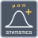

<!-- Generated by tools/export_studio_help.py; edit the reviewed source metadata, then regenerate. -->
# Statistics

[Mathematics functions](../../mathematics/index.md) · [All functions](../../index.md)

GS typed adaptation of NI dynamic signals; only the FIRST waveform is measured. Selected measure IDs persist, default mean; exact source timestamp retained. No UI-triggered calculation. Select output IDs in Configure Statistics. The first waveform/channel is used. GS uses population moments here; time outputs retain the exact Timestamp origin.

Résumé français de l’aide Studio

**Statistics**

Expose les mesures sélectionnées dans sa configuration et traite le premier signal reçu.

## Studio authoring profile

Contract status: **partial**. The connector below describes Studio authoring; execution availability is stated separately.

## IN — inputs

| Displayed terminal / internal ID | Accepted / resolved type | Studio connection | Unwired input default | Meaning |
| --- | --- | --- | --- | --- |
| Signals `signals` | `array<f64>` | Required | Not specified | — |
| error in `error_in` | `cluster<status:bool,code:i32,source:string>` | Optional | Not specified | — |

A default is shown only for an input with an explicitly documented value. Preview/default *types* do not imply unwired operand values. If helper and binding flags differ, both are labelled.

## OUT — outputs

| Displayed terminal / internal ID | Accepted / resolved type | Studio connection | Unwired input default | Meaning |
| --- | --- | --- | --- | --- |
| mean `mean` | `f64` | Recommended | — | — |
| median `median` | `f64` | Recommended | — | — |
| mode `mode` | `f64` | Recommended | — | — |
| sum `sum` | `f64` | Recommended | — | — |
| rms `rms` | `f64` | Recommended | — | — |
| std deviation `std_deviation` | `f64` | Recommended | — | — |
| variance `variance` | `f64` | Recommended | — | — |
| kurtosis `kurtosis` | `f64` | Recommended | — | — |
| skewness `skewness` | `f64` | Recommended | — | — |
| maximum `maximum` | `f64` | Recommended | — | — |
| minimum `minimum` | `f64` | Recommended | — | — |
| maximum time `maximum_time` | `timestamp` | Recommended | — | — |
| minimum time `minimum_time` | `timestamp` | Recommended | — | — |
| maximum index `maximum_index` | `i32` | Recommended | — | — |
| minimum index `minimum_index` | `i32` | Recommended | — | — |
| range `range` | `f64` | Recommended | — | — |
| first time `first_time` | `timestamp` | Recommended | — | — |
| last time `last_time` | `timestamp` | Recommended | — | — |
| first value `first_value` | `f64` | Recommended | — | — |
| last value `last_value` | `f64` | Recommended | — | — |
| samples `samples` | `i32` | Recommended | — | — |
| dt `dt` | `f64` | Recommended | — | — |
| error out `error_out` | `cluster<status:bool,code:i32,source:string>` | Recommended | — | — |

A default is shown only for an input with an explicitly documented value. Preview/default *types* do not imply unwired operand values. If helper and binding flags differ, both are labelled.

## Types and connection rules

GS typed adaptation of NI dynamic signals; only the FIRST waveform is measured. Selected measure IDs persist, default mean; exact source timestamp retained. No UI-triggered calculation.

- Type resolution: `custom_resolver`; result expression: `resolve:frog.studio.statistics.type-resolution@1`.
- Implicit coercion: permitted by this profile.
- Arrays: accepted; lifting policy: `none`.
- Shape rule: `statistics_exact_selected_variant_rank_and_record_schema`.
- Scalar lifting: no.
- Broadcasting: no.

**Input count:** 2; this contract does not enable variadic inputs.

Port order: `signals` → `error_in`.

## Execution and limits

**Public FROG / target Runtime:** declared available within the scope below.

Scope: `requires_explicit_target_capability`.

Implementation: `frog.studio.math.statistics.statistics_express.array.owned.v1`.

Required provider: `frog.studio.math.statistics.owned@1`.

Per selected exact signature; complete-graph target admission, native execution and AOT qualification are separate. Source implementation is not a passing product test. Select output IDs in Configure Statistics. The first waveform/channel is used. GS uses population moments here; time outputs retain the exact Timestamp origin.

Connector type defaults and persistence aliases

| Direction | ID | Preview/default type | Connection policy | Cardinality | Legacy port IDs |
| --- | --- | --- | --- | --- | --- |
| INPUT | `signals` | `array<f64>` | `numeric_array_implicit` | `single` | — |
| INPUT | `error_in` | `cluster<status:bool,code:i32,source:string>` | `exact` | `single` | — |
| OUTPUT | `mean` | `f64` | `exact` | `single` | — |
| OUTPUT | `median` | `f64` | `exact` | `single` | — |
| OUTPUT | `mode` | `f64` | `exact` | `single` | — |
| OUTPUT | `sum` | `f64` | `exact` | `single` | — |
| OUTPUT | `rms` | `f64` | `exact` | `single` | — |
| OUTPUT | `std_deviation` | `f64` | `exact` | `single` | — |
| OUTPUT | `variance` | `f64` | `exact` | `single` | — |
| OUTPUT | `kurtosis` | `f64` | `exact` | `single` | — |
| OUTPUT | `skewness` | `f64` | `exact` | `single` | — |
| OUTPUT | `maximum` | `f64` | `exact` | `single` | — |
| OUTPUT | `minimum` | `f64` | `exact` | `single` | — |
| OUTPUT | `maximum_time` | `timestamp` | `exact` | `single` | — |
| OUTPUT | `minimum_time` | `timestamp` | `exact` | `single` | — |
| OUTPUT | `maximum_index` | `i32` | `exact` | `single` | — |
| OUTPUT | `minimum_index` | `i32` | `exact` | `single` | — |
| OUTPUT | `range` | `f64` | `exact` | `single` | — |
| OUTPUT | `first_time` | `timestamp` | `exact` | `single` | — |
| OUTPUT | `last_time` | `timestamp` | `exact` | `single` | — |
| OUTPUT | `first_value` | `f64` | `exact` | `single` | — |
| OUTPUT | `last_value` | `f64` | `exact` | `single` | — |
| OUTPUT | `samples` | `i32` | `exact` | `single` | — |
| OUTPUT | `dt` | `f64` | `exact` | `single` | — |
| OUTPUT | `error_out` | `cluster<status:bool,code:i32,source:string>` | `exact` | `single` | — |

## Examples

No example for this object is currently declared in the shared index. [Browse the available examples](../../../examples/index.md).

## Identity and references

- Catalogue ID: `math.statistics.statistics_express`.
- Parent palette: [Probability &amp; Statistics](../../mathematics/probability_statistics.md).
- Profile: `frog.studio.polymorphic.math.statistics.statistics_express.v1`.
- Definition: `frog.studio.math.statistics.statistics_express`.
- [NI API reference](https://www.ni.com/docs/en-US/bundle/labview-api-ref/page/vi-lib/express/express-analysis/statisticsblock-llb/ex-inst-statistics-vi.html).

NI links are reference sources for the connector model; Studio support is limited to the profile above. [Reference provenance and notation](../../index.md#provenance-and-notation).
