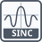

<!-- Generated by tools/export_studio_help.py; edit the reviewed source metadata, then regenerate. -->
# Sinc

[Mathematics functions](../../mathematics/index.md) · [All functions](../../index.md)

sin(x)/x; sinc(±0)=1. Unnormalized sin(x)/x with FROG continuous extension sinc(±0)=1. No implicit pi factor. A stable local kernel handles small arguments. Angles and real inverse results are radians; no implicit degree conversion. Real NaN propagates without value-dependent complex promotion.

## Product execution profiles

The shared index declares native examples for this object; see [the examples below](sinc.md#examples) and [document profiles and evidence boundaries](../../../reference/studio-draft-examples.md). Older binding/help statements retained below can lag those product profiles. They do not establish or deny the separately measured native profiles. An example declaration alone is not an execution result or admission of every overload.

Résumé français de l’aide Studio

**Sinus cardinal non normalisé**

Texte historique de l’aide conservé ci-dessous. Des exemples natifs distincts sont déclarés pour cet objet ; consultez les profils et preuves datés, sans déduire une compatibilité universelle de ce texte.

sin(x)/x; sinc(±0)=1. Sin(x)/x non normalisé, prolongé par FROG avec sinc(±0)=1. Aucun facteur pi implicite. Un noyau local stable traite les petits arguments. Angles et résultats réels inverses en radians, sans conversion implicite de degrés. NaN se propage sans promotion complexe dépendant de la valeur. [Types] F32/F64 et C32/C64 finis conservent leur précision ; les entiers deviennent F64 et peuvent s’arrondir au-delà de 2^53. Tableaux : rang, dimensions et vides typés conservés ; clusters entièrement numériques : champs ordonnés conservés. Aucun Boolean, String, référence, cluster mixte non numérique, virgule fixe, précision étendue, unité physique ou Matrix. Les entrées sont requises, sans zéro implicite.  Branches complexes principales ; un résultat complexe non fini produit un diagnostic de capacité du transport lexical à composantes finies. NI NXG documente les connecteurs ; les conventions indiquées sont FROG, sans équivalence bit à bit mesurée.

## Studio authoring profile

Contract status: **partial**. The connector below describes Studio authoring; execution availability is stated separately.

Retained binding and help description

This is the source declaration, not the current measured product-execution assessment.

sin(x)/x; sinc(±0)=1. Unnormalized sin(x)/x with FROG continuous extension sinc(±0)=1. No implicit pi factor. A stable local kernel handles small arguments. Angles and real inverse results are radians; no implicit degree conversion. Real NaN propagates without value-dependent complex promotion. F32/F64 and finite C32/C64 inputs retain their precision; integer leaves convert to F64 and values above 2^53 may round. Arrays preserve rank, dimensions and typed empties; numeric-only clusters preserve ordered fields. No Boolean, String, reference, mixed nonnumeric cluster, fixed-point, extended precision, physical-unit or Matrix overload. Required inputs have no implicit unwired value. Principal complex branches; non-finite complex results require unavailable finite-component lexical transport capability. Local Highlight provider: frog.studio.trigonometric.sinc.

F32/F64 and finite C32/C64 inputs retain their precision; integer leaves convert to F64 and values above 2^53 may round. Arrays preserve rank, dimensions and typed empties; numeric-only clusters preserve ordered fields. No Boolean, String, reference, mixed nonnumeric cluster, fixed-point, extended precision, physical-unit or Matrix overload. Required inputs have no implicit unwired value.  Principal complex branches; non-finite complex results require unavailable finite-component lexical transport capability. NI NXG documents the connectors; the named edge conventions are FROG, without a measured bit-equivalence claim.

## IN — inputs

| Displayed terminal / internal ID | Accepted / resolved type | Studio connection | Unwired input default | Meaning |
| --- | --- | --- | --- | --- |
| x `x` | `T:numeric_tree` | Required | Not specified | — |

A default is shown only for an input with an explicitly documented value. Preview/default *types* do not imply unwired operand values. If helper and binding flags differ, both are labelled.

## OUT — outputs

| Displayed terminal / internal ID | Accepted / resolved type | Studio connection | Unwired input default | Meaning |
| --- | --- | --- | --- | --- |
| sinc(x) `result` | `T:numeric_tree` | Recommended | — | — |

A default is shown only for an input with an explicitly documented value. Preview/default *types* do not imply unwired operand values. If helper and binding flags differ, both are labelled.

## Types and connection rules

F32/F64 and finite C32/C64 inputs retain their precision; integer leaves convert to F64 and values above 2^53 may round. Arrays preserve rank, dimensions and typed empties; numeric-only clusters preserve ordered fields. No Boolean, String, reference, mixed nonnumeric cluster, fixed-point, extended precision, physical-unit or Matrix overload. Required inputs have no implicit unwired value.

- Type resolution: `custom_resolver`; result expression: `resolve:frog.studio.trigonometric.type-resolution@1`.
- Implicit coercion: permitted by this profile.
- Arrays: accepted; lifting policy: `element_wise_same_shape_with_scalar_lift`.
- Shape rule: `preserve_rank_dimensions_typed_empty_arrays_and_ordered_cluster_fields`.
- Scalar lifting: no.
- Broadcasting: no.

**Input count:** 1; this contract does not enable variadic inputs.

Port order: `x`.

## Execution and limits

**Public FROG / target Runtime:** not declared available by this authoring contract.

Generic authoring metadata declares no universal target provider. Selected native target support is advertised separately for its exact scalar signatures.

Retained authoring-contract limitations

These declarations belong to the binding snapshot. Compare them with the separately admitted native profiles and dated measurements linked above; they are not a current denial of those product profiles.

**Authoring/target contract limits:**

- No analytic Matrix, extended precision, fixed-point or physical-unit overload.
- Principal complex branches; non-finite complex results require unavailable finite-component lexical transport capability.
- No universal Runtime provider is declared by this authoring profile.

Connector type defaults and persistence aliases

| Direction | ID | Preview/default type | Connection policy | Cardinality | Legacy port IDs |
| --- | --- | --- | --- | --- | --- |
| INPUT | `x` | `f64` | `any_explicit` | `single` | — |
| OUTPUT | `result` | `f64` | `exact` | `single` | — |

## Examples

These are real `.frog` documents from the same index used by Studio. Backend names and expected results describe the examples; they are not execution certificates.

- [Sinc — radian identity](../../../examples/math.trigonometric.sinc.radian_identity.md) — sin(x)/x; sinc(±0)=1. (`execution`, `studio-draft`).

## Identity and references

- Catalogue ID: `math.trigonometric.sinc`.
- Parent palette: [Trigonometric](../../mathematics/elementary/trigonometric.md).
- Profile: `frog.studio.polymorphic.math.trigonometric.sinc.v1`.
- Definition: `frog.studio.math.trigonometric.sinc`.
- [NI API reference](https://www.ni.com/docs/en-US/bundle/labview-nxg-nodes-api-ref/page/sinc.html).
- [NI API reference](https://www.ni.com/docs/en-US/bundle/labview-nxg-nodes-api-ref/page/trigonometric-nodes.html).

NI links are reference sources for the connector model; Studio support is limited to the profile above. [Reference provenance and notation](../../index.md#provenance-and-notation).
