<!-- Generated by tools/export_studio_help.py; edit the reviewed source metadata, then regenerate. -->
# Differential Equations

[Mathematics functions](index.md) · [All functions](../index.md)

Differential equations in Mathematics. The Ordinary and Partial subfolders are siblings. Partial uses the explicit FROG PDE coefficient profile. The Ordinary subfolder contains coupled real ODE solvers, constant-coefficient linear Numeric/Symbolic solutions and a residual DAE solver. This folder is outside Elementary.

Résumé français de l’aide Studio

**Équations différentielles**

Équations différentielles dans Mathematics. Ordinary et Partial sont deux sous-dossiers frères. Partial utilise le profil explicite de coefficients FROG. Le sous-dossier Ordinary contient les solveurs ODE réels couplés, les solutions linéaires à coefficients constants Numeric/Symbolic et un solveur DAE résiduel. Ce dossier est hors Elementary.

## Browse this palette

This entry opens a palette folder; it is not an executable dataflow function.

| Entry | Purpose |
| --- | --- |
| [Ordinary](differential_equations/ordinary.md) | Ordinary differential equations: coupled real numerical trajectories, constant-coefficient linear Numeric/Symbolic solutions and residual DAE. The supplied 00 icon belongs to this child of Differential Equations, outside Elementary. |
| [Partial](differential_equations/partial.md) | Partial differential equations; sibling after Ordinary. Six visible families,48 explicit instances. Documentary authoring profile_id=frog.studio.pde.proposed_v1; numerical Problem.profile=frog_pde_proposed_v1. FROG coefficient profile frog_pde_proposed_v1: L=-k*Laplacian+a, k&gt;0, without squaring k; no measured NI runtime parity or confirmed NXG signatures. Real f64 Arrays preserve rank and [time,y,x] order; no Matrix, scalar lifting or broadcasting. PDE is an immutable family-specific structural value, distinct from a callable reference and a scene reference. Exact instance identity is persisted and never inferred over an explicit choice. The shared authored Highlight worker executes the compiled C++ service; public Source/FIR LLVM aggregates remain explicitly unavailable, with no fallback or promised AOT provider. Errors, cancellation and resource limits never publish a plausible zero-valued success. |

## Examples

No example for this object is currently declared in the shared index. [Browse the available examples](../../examples/index.md).

## Identity and references

- Catalogue ID: `mathematics.differential_equations`.

NI links are reference sources for the connector model; Studio support is limited to the profile above. [Reference provenance and notation](../index.md#provenance-and-notation).
