<!-- Generated by tools/export_studio_help.py; edit the reviewed source metadata, then regenerate. -->
# Elementary

[Mathematics functions](index.md) · [All functions](../index.md)

Browse elementary mathematics. Exponential contains powers, roots, exponentials and logarithms; Hyperbolic contains twelve hyperbolic functions; Gating Functions contains Spike, periodic Square and Step; Discrete Math contains eight fixed-signature integer, combinatorial and continued-fraction functions; Bessel Functions contains twelve scalar Bessel, Hankel, Airy, Struve and Kelvin functions.

Résumé français de l’aide Studio

**Elementary**

Parcourir les fonctions mathématiques élémentaires. Exponential contient les puissances, racines, exponentielles et logarithmes ; Hyperbolic contient douze fonctions hyperboliques ; Gating Functions contient Spike, le créneau périodique Square et Step ; Discrete Math contient huit fonctions à signatures fixes pour les entiers, la combinatoire et les fractions continues ; Bessel Functions contient douze fonctions scalaires de Bessel, Hankel, Airy, Struve et Kelvin.

## Browse this palette

This entry opens a palette folder; it is not an executable dataflow function.

| Entry | Purpose |
| --- | --- |
| [Trigonometric](elementary/trigonometric.md) | Fifteen fixed-arity trigonometric functions in radians, with the original supplied icons. Inverse functions differ from reciprocals. Atan2 orders y,x; SinCos has separate sin,cos outputs; Sinc is unnormalized. FROG edge conventions are documented per function. |
| [Exponential](elementary/exponential.md) | Browse eleven exponential, power, root and logarithm functions. Numeric array lifting is distinct from Matrix algorithms, which are currently unavailable. |
| [Hyperbolic](elementary/hyperbolic.md) | Browse twelve hyperbolic functions and their principal inverses, in the supplied icon order. Every node has one required numeric input x and one output. No angle conversion or analytic Matrix overload. |
| [Gating Functions](elementary/gating.md) | Browse Spike, Square and Step: three pure numeric gating functions of one required argument x. Classic LabVIEW documents scalar DBL; FROG adds real numeric-tree overloads and explicit IEEE conventions. No verified NXG overload, time source, state or waveform output. |
| [Discrete Math](elementary/discrete.md) | GCD, LCM, Factorial, Prime Factor, Check Prime, Permute, Binomial Coefficient and Continued Fraction. Fixed typed signatures; arrays are whole values, not dynamically added terminals. NI reference: classic LabVIEW, not verified NXG. FROG specifies boundary cases and status codes. |
| [Bessel Functions](elementary/bessel_functions.md) | Twelve fixed scalar functions: cylindrical J/Y/H, modified I/K, spherical j/y/h, Airy Ai and Bi, ordinary Struve H, Kelvin be/ke. FROG profiles frog_bessel_v1 / ni_documented_abs_v1 evaluate r=\|x\|; this documentary NI adapter policy is not a mathematical evenness identity or measured NI parity. x is required; unwired order and type default to 0 (FROG choices). No degrees/radians conversion. Scalar NI baseline; FROG also applies scalar order/kind to real numeric x arrays/clusters, preserving dimensions, typed empties and fields. Real leaves promote to f64; result leaves are f64 or complex&lt;f64&gt;. Integer ports remain exact i32; no new broadcasting or complex arguments. Nonfinite input and singularities return NaN; overflow gives signed Infinity, underflow warns and subnormals are preserved. No error terminals. FROG diagnostic categories: SINGULAR, NONFINITE_INPUT, INVALID_KIND, OVERFLOW, UNDERFLOW, NUMERICAL_FAILURE; these are not NI codes. |
| [Gamma Functions](elementary/gamma_functions.md) | Seven palette entries and nine scalar signatures: Gamma and Beta offer explicit Complete (default) or Regularized Incomplete instances. Scalar baseline only. Real numeric inputs promote visibly to f64; n must be exact i32. Every output is f64. No arrays, clusters, complex arguments, angle conversion or broadcasting. Classic LabVIEW scalar connectors and documented conventions; not verified NXG signatures or measured NI runtime parity. FROG owns the versioned numerical profile, Stirling first term and explicit shape/limit mapping. The missing 00 directory resource uses the existing generic folder. |
| [Hypergeometric Functions](elementary/hypergeometric_functions.md) | Three fixed operators: Gauss 2F1, Kummer M=1F1 and Tricomi U. Profile hg_ni_documented_abs_real_v1 validates finite inputs then evaluates r=abs(x) only; a, b and c retain their signs. This FROG adaptation follows an unmeasured NI documentary remark. The separate mathematical kernel accepts signed x where defined; these functions are not mathematically even. For example standard M(1,1,-1)=exp(-1), whereas this node at x=-1 returns exp(1). NI scalar baseline: every required input and result is f64. FROG extension through common NumericTreeMath: real numeric Arrays/Clusters preserve rank, dimensions, typed empties and ordered field identities; compatible structured operands combine element by element and each whole scalar operand lifts across that structure. Real f32/integer leaves promote visibly to f64; all result leaves are f64. No implicit Boolean, String, Path, reference, complex, Matrix or NumPy broadcasting overload. Integer promotion may round beyond 2^53. No implicit unwired values. |
| [Elliptic Integrals](elementary/elliptic_integrals.md) | Legendre elliptic integrals: Elliptic 1 and Elliptic 2. Select Complete/Incomplete manually; new nodes use Incomplete with a=pi/2. k_input=m is the squared modulus, never squared again. |
| [Exponential Integrals](elementary/exponential_integrals.md) | Six fixed real integral functions after Elliptic Integrals. En has a required integer order; Si keeps signed x. Profile ni_documented_real_v1: Si uses signed x; En, Ci, Dilogarithm, Shi and Chi use q=abs(x). Standard Shi is odd, but the documented node adapter applies abs(x). En is E_n, not Ei; D(q)=-Li2(1-q), not Li2(q) or positive Spence. NI parity has not been measured. |
| [Error Functions](elementary/error_functions.md) | Seven mathematical special functions: Erf, ErfC, Scaled ErfC, Inverse Erf, Inverse ErfC, Fresnel and Dawson. ni_documented_real_v1 uses q=abs(x); standard_real_v1 is the signed mathematical kernel. These nodes use real numeric data. NI runtime parity and graphical NXG signatures have not been measured. |
| [Elliptic &amp; Parabolic Functions](elementary/elliptic_parabolic_functions.md) | Jacobi cn, dn, sn and amplitude phi; normalized parabolic cylinder Dv(x). ni_documented_real_v1 evaluates x through abs; standard_real_v1 keeps signed x. k is the parameter m; v is a real order. NI-G documentation; NI/NXG runtime parity unmeasured. |

## Examples

No example for this object is currently declared in the shared index. [Browse the available examples](../../examples/index.md).

## Identity and references

- Catalogue ID: `mathematics.elementary`.

NI links are reference sources for the connector model; Studio support is limited to the profile above. [Reference provenance and notation](../index.md#provenance-and-notation).
