<!-- Generated by tools/export_studio_help.py; edit the reviewed source metadata, then regenerate. -->
# Trigonometric

[Mathematics functions](../index.md) · [All functions](../../index.md)

Fifteen fixed-arity trigonometric functions in radians, with the original supplied icons. Inverse functions differ from reciprocals. Atan2 orders y,x; SinCos has separate sin,cos outputs; Sinc is unnormalized. FROG edge conventions are documented per function.

Résumé français de l’aide Studio

**Trigonométrie**

Quinze fonctions trigonométriques à arité fixe, en radians, avec les icônes originales. Les inverses fonctionnelles se distinguent des inverses multiplicatives. Atan2 reçoit y,x ; SinCos fournit sin,cos séparément ; Sinc n’est pas normalisé. Les conventions FROG sont détaillées par fonction.

## Browse this palette

This entry opens a palette folder; it is not an executable dataflow function.

| Entry | Purpose |
| --- | --- |
| [Sine](../../math/trigonometric/sin.md) | sin(x). Every finite real angle; sin(±0)=±0. Infinite real angles produce NaN. Angles and real inverse results are radians; no implicit degree conversion. Real NaN propagates without value-dependent complex promotion. |
| [Cosine](../../math/trigonometric/cos.md) | cos(x). Every finite real angle; cos(±0)=1. Infinite real angles produce NaN. Angles and real inverse results are radians; no implicit degree conversion. Real NaN propagates without value-dependent complex promotion. |
| [Tangent](../../math/trigonometric/tan.md) | tan(x). Poles at pi/2+k*pi. A finite represented angle near a pole is not clamped or replaced by infinity. Angles and real inverse results are radians; no implicit degree conversion. Real NaN propagates without value-dependent complex promotion. |
| [Cosecant](../../math/trigonometric/csc.md) | 1/sin(x). Poles where sin(x)=0; FROG defines csc(+0)=+Infinity and csc(-0)=-Infinity. Angles and real inverse results are radians; no implicit degree conversion. Real NaN propagates without value-dependent complex promotion. |
| [Secant](../../math/trigonometric/sec.md) | 1/cos(x). Poles where cos(x)=0. No angle threshold forces a represented near-pole input to infinity. Angles and real inverse results are radians; no implicit degree conversion. Real NaN propagates without value-dependent complex promotion. |
| [Cotangent](../../math/trigonometric/cot.md) | cos(x)/sin(x). Poles where sin(x)=0; FROG defines cot(+0)=+Infinity and cot(-0)=-Infinity. Angles and real inverse results are radians; no implicit degree conversion. Real NaN propagates without value-dependent complex promotion. |
| [Inverse Cosecant](../../math/trigonometric/acsc.md) | asin(1/x). Real domain \|x\|&gt;=1; invalid real inputs produce NaN. Principal inverse sine of the reciprocal. Angles and real inverse results are radians; no implicit degree conversion. Real NaN propagates without value-dependent complex promotion. |
| [Inverse Secant](../../math/trigonometric/asec.md) | acos(1/x). Real domain \|x\|&gt;=1; invalid real inputs produce NaN. Principal inverse cosine of the reciprocal. Angles and real inverse results are radians; no implicit degree conversion. Real NaN propagates without value-dependent complex promotion. |
| [Inverse Cotangent](../../math/trigonometric/acot.md) | atan(1/x). FROG principal convention atan(1/x): acot(-1)=-pi/4 and acot(±0)=±pi/2. This is not atan2(1,x); the negative NXG branch has not been measured. Angles and real inverse results are radians; no implicit degree conversion. Real NaN propagates without value-dependent complex promotion. |
| [Inverse Sine](../../math/trigonometric/asin.md) | asin(x). Real domain [-1,1], result [-pi/2,pi/2]. Invalid real inputs produce NaN without complex promotion. Angles and real inverse results are radians; no implicit degree conversion. Real NaN propagates without value-dependent complex promotion. |
| [Inverse Cosine](../../math/trigonometric/acos.md) | acos(x). Real domain [-1,1], result [0,pi]. Invalid real inputs produce NaN without complex promotion. Angles and real inverse results are radians; no implicit degree conversion. Real NaN propagates without value-dependent complex promotion. |
| [Inverse Tangent](../../math/trigonometric/atan.md) | atan(x). Principal real result in [-pi/2,pi/2], including limits at infinities. Signed zero is preserved. Angles and real inverse results are radians; no implicit degree conversion. Real NaN propagates without value-dependent complex promotion. |
| [Inverse Tangent (2 Input)](../../math/trigonometric/atan2.md) | atan2(y,x). Required inputs are ordered y,x; real result [-pi,pi]. FROG follows the selected C++ backend for axes, signed zero and infinities. At the numerical origin, with arguments (y,x): atan2(+0,+0)=+0; atan2(-0,+0)=-0; atan2(+0,-0)=+pi; atan2(-0,-0)=-pi. These are FROG IEEE conventions, not measured NXG results. Complex Atan2 is unavailable pending a validated complete NI definition. Angles and real inverse results are radians; no implicit degree conversion. Real NaN propagates without value-dependent complex promotion. |
| [Sine and Cosine](../../math/trigonometric/sincos.md) | sin(x), cos(x). Two distinct outputs sin,cos; each preserves the promoted input structure. Sinus is above cosine. Infinite real angles produce NaN on both outputs. Angles and real inverse results are radians; no implicit degree conversion. Real NaN propagates without value-dependent complex promotion. |
| [Sinc](../../math/trigonometric/sinc.md) | sin(x)/x; sinc(±0)=1. Unnormalized sin(x)/x with FROG continuous extension sinc(±0)=1. No implicit pi factor. A stable local kernel handles small arguments. Angles and real inverse results are radians; no implicit degree conversion. Real NaN propagates without value-dependent complex promotion. |

## Examples

No example for this object is currently declared in the shared index. [Browse the available examples](../../../examples/index.md).

## Identity and references

- Catalogue ID: `mathematics.elementary.trigonometric`.
- Parent palette: [Elementary](../elementary.md).
- [NI API reference](https://www.ni.com/docs/en-US/bundle/labview-nxg-nodes-api-ref/page/trigonometric-nodes.html).

NI links are reference sources for the connector model; Studio support is limited to the profile above. [Reference provenance and notation](../../index.md#provenance-and-notation).
