<!-- Generated by tools/export_studio_help.py; edit the reviewed source metadata, then regenerate. -->
# Fitting

[Mathematics functions](index.md) · [All functions](../index.md)

Browse thirteen fitting operations and the Advanced Curve Fitting subpalette.

Résumé français de l’aide Studio

**Fitting**

Ouvre treize fonctions d’ajustement et le sous-dossier Advanced Curve Fitting.

## Browse this palette

This entry opens a palette folder; it is not an executable dataflow function.

| Entry | Purpose |
| --- | --- |
| [Linear Fit](../math/fitting/linear_fit.md) | Fits a*x+b with weighted LS, LAR or Bisquare and actual parameter bounds; equal bounds fix a parameter. Residue is weighted mean squared error for LS/Bisquare and mean absolute residual for LAR. Variants: default. |
| [Exp Fit](../math/fitting/exponential_fit.md) | Fits a*exp(b*x)+c in observation space with actual bounds. Offset bounds default to zero; free them explicitly for a three-parameter fit. Damping is b, not a time constant. Variants: default. |
| [Power Fit](../math/fitting/power_fit.md) | Fits a*x^b+c with actual parameter bounds. Offset defaults fixed zero. Real power domain is checked without abs(X) substitution. Variants: default. |
| [Gauss Peak Fit](../math/fitting/gaussian_peak_fit.md) | Fits a*exp(-(x-center)^2/(2*standard_deviation^2))+offset. Amplitude is peak height, not area. Typed NaN initial guesses request automatic initialization; offset defaults fixed zero. Variants: default. |
| [Logarithm Fit](../math/fitting/logarithm_fit.md) | Fits amplitude*log_base(scale*x), with multiplicative scale and default base e. Scale is not the intercept of a log-linear intermediate model; invalid bases/domains and nonidentifiability are diagnosed. Variants: default. |
| [Polynomial Fit](../math/fitting/polynomial_fit.md) | Fits ascending coefficients c0+c1*x+...+cd*x^d with fixed coefficient constraints, weighted criterion and the selected algorithm. Degree defaults2; degree26 has the documented warning result, not silent success. Variants: default. |
| [Gen. Linear Fit](../math/fitting/general_linear_fit.md) | Fits Y=H*c, linear in the supplied H columns; no implicit intercept is added. Returns coefficients, fitted observations, optional curvature covariance and actual robust output weights. Variants: default. |
| [Cubic Spline Fit](../math/fitting/cubic_spline_fit.md) | Fits a natural cubic smoothing spline. Balance0 gives a least-squares line, balance1 interpolation. GS objective is p*sum(w*r^2)+(1-p)*integral(smoothness*(f second derivative)^2). Automatic p=1/(1+mean(deltaX)^3) is a GS choice, not NI-certified. Variants: default. |
| [B-Spline Fit](../math/fitting/b_spline_fit.md) | Fits a parametric B-spline, with distinct XY and nD variants. Both fitted coordinates can change. nD observations occupy rows [n,D]. Degree3, control_points10 and centripetal parameterization2 are defaults. GS uses clamped uniform knots and Cox/de Boor bases. Variants: xy, nd. |
| [Fit on a Sphere](../math/fitting/fitting_on_sphere.md) | Fits a 3D sphere by the documented algebraic squared-distance objective; center is one DBL vector of length3 and radius is DBL. Coplanar or otherwise nonidentifiable observations are diagnosed; no fabricated residue output. Variants: default. |
| [Nonlinear Curve Fit](../math/fitting/nonlinear_curve_fit.md) | Levenberg-Marquardt fit with distinct native FROG model-reference and structured-formula variants. Formula model contains model String, ordered parameter names and independent-variable name; ^ means power. Only function variant returns number_of_function_calls. Variants: function, formula. |
| [Constrained Nonlinear Curve Fit](../math/fitting/constrained_nonlinear_curve_fit.md) | Bounded nonlinear fit with distinct LM and trust-region dogleg variants. Bounds constrain optimization itself; equal limits fix a parameter. Criterion LS/LAR/Bisquare is independent of the algorithm choice. Variants: lm, trdl. |
| [Curve Fit](../math/fitting/curve_fit.md) | Configurable Curve Fit with six real model variants: linear, quadratic, spline, polynomial, general_linear and nonlinear formula. Reuses specialized numerical services; its connector and native identity follow the saved model. Polynomial defaults order5. Spline has no invented coefficient output. Variants: linear, quadratic, spline, polynomial, general_linear, nonlinear. |
| [Advanced Curve Fitting](fitting/advanced_curve_fitting.md) | Browse fifteen functions for outliers, goodness, confidence/prediction intervals and coefficient estimation. |

## Types and Compatibility

The notes below retain the reviewed help's original NI and Studio scopes. An NI overload is not a claim of Studio runtime support; the authoring profile and execution limits remain separate.

Real DBL data and exact selected model contracts; palette presence is separate from target admission.

Notes de types et de compatibilité de l’aide Studio

Les mentions NI et Studio gardent leur portée d’origine. Une variante NI ne constitue pas une déclaration de prise en charge par le runtime Studio ; consultez les profils et limites d’exécution de cette fiche.

Données DBL réelles et contrats exacts de la variante ; la présence dans la palette ne prouve pas l’admission par une cible.

## Examples

No example for this object is currently declared in the shared index. [Browse the available examples](../../examples/index.md).

## Identity and references

- Catalogue ID: `mathematics.fitting`.

NI links are reference sources for the connector model; Studio support is limited to the profile above. [Reference provenance and notation](../index.md#provenance-and-notation).
