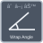

<!-- Generated by tools/export_studio_help.py; edit the reviewed source metadata, then regenerate. -->
# Angle

[Mathematics functions](../index.md) · [All functions](../../index.md)

Browse the Angle palette.

## Browse this palette

This entry opens a palette folder; it is not an executable dataflow function.

| Entry | Purpose |
| --- | --- |
| [Wrap Angle](../../math/geometry/wrap_angle.md) | Wraps after unit conversion. Positive range uses the documented floor rule; signed endpoint choice is explicit GS. NI I32 units 0 rad/rad, 1 rad/deg, 2 deg/deg, 3 deg/rad. U16 range 0 none, 1 signed (default), 2 positive. GS endpoint choices (-half-turn,half-turn] and [0,full-turn). Finite DBL only; array operands have equal lengths. |
| [Complementary Angle](../../math/geometry/complementary_angle.md) | Quarter-turn minus input; range None preserves negative complements; selected wrapping is explicit. NI I32 units 0 rad/rad, 1 rad/deg, 2 deg/deg, 3 deg/rad. U16 range 0 none, 1 signed (default), 2 positive. GS endpoint choices (-half-turn,half-turn] and [0,full-turn). Finite DBL only; array operands have equal lengths. |
| [Supplementary Angle](../../math/geometry/supplementary_angle.md) | Half-turn minus input; no absolute value; selected range actually applies. NI I32 units 0 rad/rad, 1 rad/deg, 2 deg/deg, 3 deg/rad. U16 range 0 none, 1 signed (default), 2 positive. GS endpoint choices (-half-turn,half-turn] and [0,full-turn). Finite DBL only; array operands have equal lengths. |
| [Angle Rotation](../../math/geometry/angle_rotation.md) | Active CCW angular addition then wrapping; distinct from passive coordinate rotation. NI I32 units 0 rad/rad, 1 rad/deg, 2 deg/deg, 3 deg/rad. U16 range 0 none, 1 signed (default), 2 positive. GS endpoint choices (-half-turn,half-turn] and [0,full-turn). Finite DBL only; array operands have equal lengths. |
| [Bisect Angle](../../math/geometry/bisect_angle.md) | GS default CCW arc bisector; shortest_arc selects the minor arc. Equal endpoints have zero span; antipodal tie follows CCW. NI I32 units 0 rad/rad, 1 rad/deg, 2 deg/deg, 3 deg/rad. U16 range 0 none, 1 signed (default), 2 positive. GS endpoint choices (-half-turn,half-turn] and [0,full-turn). Finite DBL only; array operands have equal lengths. |
| [Check for Included Angle](../../math/geometry/included_angle.md) | CCW closed interval; equal endpoints mean zero span. GS coercion chooses the nearest endpoint (ties start). NI I32 units 0 rad/rad, 1 rad/deg, 2 deg/deg, 3 deg/rad. U16 range 0 none, 1 signed (default), 2 positive. GS endpoint choices (-half-turn,half-turn] and [0,full-turn). Finite DBL only; array operands have equal lengths. |
| [Absolute Angle Difference](../../math/geometry/absolute_angle_difference.md) | GS circular minimum absolute difference in [0,half-turn], not raw subtraction; NI exact periodicity not certified. NI I32 units 0 rad/rad, 1 rad/deg, 2 deg/deg, 3 deg/rad. U16 range 0 none, 1 signed (default), 2 positive. GS endpoint choices (-half-turn,half-turn] and [0,full-turn). Finite DBL only; array operands have equal lengths. |

## Examples

No example for this object is currently declared in the shared index. [Browse the available examples](../../../examples/index.md).

## Identity and references

- Catalogue ID: `mathematics.geometry.angle`.
- Parent palette: [Geometry](../geometry.md).

NI links are reference sources for the connector model; Studio support is limited to the profile above. [Reference provenance and notation](../../index.md#provenance-and-notation).
