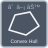

<!-- Generated by tools/export_studio_help.py; edit the reviewed source metadata, then regenerate. -->
# Computational Geometry

[Mathematics functions](../index.md) · [All functions](../../index.md)

Browse the Computational Geometry palette.

## Browse this palette

This entry opens a palette folder; it is not an executable dataflow function.

| Entry | Purpose |
| --- | --- |
| [Contour Line](../../math/geometry/contour_line.md) | GS structured polyline output: points [N,2], offsets of each curve plus final sentinel, one level/closed flag per curve. Marching squares with asymptotic saddle decider; nonfinite Z masks cells; optional strict monotonic axes. No bitmap. |
| [Polygon Area](../../math/geometry/polygon_area.md) | Signed shoelace area, positive CCW, simple polygon, optional repeated closing vertex; stable translated sums. Self intersections refused. |
| [Point in Polygon](../../math/geometry/point_in_polygon.md) | Simple concave polygon allowed. GS boundary is separately reported and included in inside; original vertex order is preserved. |
| [Polygon Centroid](../../math/geometry/polygon_centroid.md) | GS 0 uniform-area centroid, 1 vertex arithmetic mean. NI prose is contradictory; both choices explicit, not claimed NI-equivalent. Collinear polygon returns NaN coordinates and error 0, as NI documents. |
| [Delaunay Triangulation](../../math/geometry/delaunay_triangulation.md) | CCW triangle rows [n,3], zero-based original indices. Duplicate coordinates retain first original index. Deterministic cocircular diagonal; collinear input returns empty triangles. Bounded exact-sign predicates, no coordinate jitter. |
| [Voronoi Diagram](../../math/geometry/voronoi_diagram.md) | GS unbounded topology: vertices [N,2]; edges [M,2] with -1 open endpoint; directions [M,2]; original site-index pairs. kind 0 segment, 1 ray, 2 full line through first vertex. No hidden clipping box. |
| [Convex Hull](../../math/geometry/convex_hull.md) | Closed CCW hull of original zero-based indices, first repeated at end, lexicographic first vertex; duplicate coordinates choose first index, intermediate collinear points omitted. |
| [Convex Polygon Intersection](../../math/geometry/convex_polygon_intersection.md) | Actual convex intersection coordinates; empty, point and segment results retained. Both input orientations accepted, nonconvex polygons refused rather than replaced by their hull. |

## Examples

No example for this object is currently declared in the shared index. [Browse the available examples](../../../examples/index.md).

## Identity and references

- Catalogue ID: `mathematics.geometry.computational_geometry`.
- Parent palette: [Geometry](../geometry.md).

NI links are reference sources for the connector model; Studio support is limited to the profile above. [Reference provenance and notation](../../index.md#provenance-and-notation).
