<!-- Generated by tools/export_studio_help.py; edit the reviewed source metadata, then regenerate. -->
# Linear Algebra

[Mathematics functions](index.md) · [All functions](../index.md)

Linear Algebra provides 38 matrix/vector operations plus the shared Matrix folder and the BLAS folder.

Résumé français de l’aide Studio

**Linear Algebra**

Algèbre linéaire : 38 opérations matricielles et vectorielles, avec le dossier Matrix partagé et le dossier BLAS.

## Browse this palette

This entry opens a palette folder; it is not an executable dataflow function.

| Entry | Purpose |
| --- | --- |
| [Create Special Matrix](../math/linear_algebra/special_matrix.md) | Constructs identity, diagonal, Toeplitz and descending-power Vandermonde matrices. Modes 0..3; Toeplitz uses x for its first column and y for its first row with x[0] priority. Identity alone uses matrix_size. GS preview default size is 1; x/y default empty. Type models never add data. Inputs calculate in DBL/CDB with explicit numeric promotion; 64-bit integers above 2^53 may round. No broadcasting, no private Matrix reinterpretation. error is I32 and never an automatic dialog. Optional unwired defaults: x=[], y=[], matrix_type=0, matrix_size=1. |
| [Create Real Matrix From Eigenvalues](../math/linear_algebra/real_matrix_from_eigenvalues.md) | Builds a real companion matrix from a monic polynomial with the supplied roots: unit superdiagonal and final row of negated ascending coefficients. Non-real roots require conjugate partners with preserved multiplicities. Inputs calculate in DBL/CDB with explicit numeric promotion; 64-bit integers above 2^53 may round. No broadcasting, no private Matrix reinterpretation. error is I32 and never an automatic dialog. Optional unwired defaults: none. |
| [Matrix](../array/matrix.md) | Opens the Matrix repository. |
| [Solve Linear Eqs](../math/linear_algebra/solve_linear_equations.md) | Solves A*X=B with vector or matrix right-hand sides and preserved output rank. General mode 0 uses a rank-revealing least-squares/minimum-norm solve; mode 1 uses the positive-definite system, 2/3 lower/upper triangular. No inverse(A)*B substitution or silent method change. Inputs calculate in DBL/CDB with explicit numeric promotion; 64-bit integers above 2^53 may round. No broadcasting, no private Matrix reinterpretation. error is I32 and never an automatic dialog. Optional unwired defaults: matrix_type=0. |
| [Dot Product](../math/linear_algebra/dot_product.md) | Computes sum(x[i]*conj(y[i])). The SECOND operand is conjugated. Equal nonzero vector lengths are required; returns a scalar and numerical error code. Inputs calculate in DBL/CDB with explicit numeric promotion; 64-bit integers above 2^53 may round. No broadcasting, no private Matrix reinterpretation. error is I32 and never an automatic dialog. Optional unwired defaults: none. |
| [Outer Product](../math/linear_algebra/outer_product.md) | Computes x*y^T WITHOUT conjugation, with output dimensions len(x) by len(y). Empty vectors produce the corresponding empty matrix. Inputs calculate in DBL/CDB with explicit numeric promotion; 64-bit integers above 2^53 may round. No broadcasting, no private Matrix reinterpretation. error is I32 and never an automatic dialog. Optional unwired defaults: none. |
| [A x B](../math/linear_algebra/matrix_multiply.md) | Computes the matrix product A*B, never element-wise multiplication. Matrix/matrix, matrix/vector and vector/matrix variants preserve their declared output rank. Inner dimensions must agree; no broadcasting. Inputs calculate in DBL/CDB with explicit numeric promotion; 64-bit integers above 2^53 may round. No broadcasting, no private Matrix reinterpretation. error is I32 and never an automatic dialog. Optional unwired defaults: none. |
| [Kronecker Prod](../math/linear_algebra/kronecker_product.md) | Computes the block Kronecker product A tensor B, dimensions (m*p) by (n*q). Each A coefficient multiplies the complete B matrix; inner dimensions need not agree. Inputs calculate in DBL/CDB with explicit numeric promotion; 64-bit integers above 2^53 may round. No broadcasting, no private Matrix reinterpretation. error is I32 and never an automatic dialog. Optional unwired defaults: none. |
| [Subspaces Angle](../math/linear_algebra/subspaces_angle.md) | Returns the largest principal angle in radians between real column spaces, using orthonormal numerical-rank bases. Vectors are one-column spaces. This NI-compatible profile is real-only; null/rank-difference policy is a GS numerical decision, not a certified NI behavior. Inputs calculate in DBL/CDB with explicit numeric promotion; 64-bit integers above 2^53 may round. No broadcasting, no private Matrix reinterpretation. error is I32 and never an automatic dialog. Optional unwired defaults: none. |
| [Determinant](../math/linear_algebra/determinant.md) | Computes the determinant of a square matrix, preserving pivot parity and complex values. Matrix type 0 general, 1 positive definite, 2 lower triangular, 3 upper triangular. A singular determinant may validly be zero. Inputs calculate in DBL/CDB with explicit numeric promotion; 64-bit integers above 2^53 may round. No broadcasting, no private Matrix reinterpretation. error is I32 and never an automatic dialog. Optional unwired defaults: matrix_type=0. |
| [Vector Norm](../math/linear_algebra/vector_norm.md) | Vector norm with U16 modes 1 one-norm, 2 Euclidean default, 3 maximum modulus, 4 minimum modulus, 5 user exponent p. Complex entries use their modulus. Negative p is a generalized magnitude, not a mathematical norm; p=0 is invalid. Inputs calculate in DBL/CDB with explicit numeric promotion; 64-bit integers above 2^53 may round. No broadcasting, no private Matrix reinterpretation. error is I32 and never an automatic dialog. Optional unwired defaults: norm_type=2, p=-1. |
| [Matrix Norm](../math/linear_algebra/matrix_norm.md) | Matrix norm modes 0 spectral/two, 1 maximum column sum, 2 Frobenius, 3 maximum row sum. Accepts rectangular real or complex matrices; spectral and Frobenius norms are distinct. Inputs calculate in DBL/CDB with explicit numeric promotion; 64-bit integers above 2^53 may round. No broadcasting, no private Matrix reinterpretation. error is I32 and never an automatic dialog. Optional unwired defaults: norm_type=0. |
| [Matrix Rank](../math/linear_algebra/matrix_rank.md) | Counts singular values strictly greater than the absolute tolerance. Negative tolerance selects a scale-aware automatic cutoff. GS default is max(m,n)*epsilon*sigma_max; NI does not document that exact automatic formula. Inputs calculate in DBL/CDB with explicit numeric promotion; 64-bit integers above 2^53 may round. No broadcasting, no private Matrix reinterpretation. error is I32 and never an automatic dialog. Optional unwired defaults: tolerance=-1. |
| [Trace](../math/linear_algebra/trace.md) | Sums the principal diagonal through min(rows,columns), including rectangular and complex matrices. This is not the sum of all matrix entries. Inputs calculate in DBL/CDB with explicit numeric promotion; 64-bit integers above 2^53 may round. No broadcasting, no private Matrix reinterpretation. error is I32 and never an automatic dialog. Optional unwired defaults: none. |
| [Test Matrix Type](../math/linear_algebra/test_matrix_type.md) | Tests a matrix property without conversion. GS explicit codes: 0 diagonal, 1 lower triangular, 2 upper triangular, 3 symmetric, 4 Hermitian, 5 positive definite, 6 positive semidefinite. These codes are GS projection, not certified NI enum codes. Negative relative tolerance selects a scale-aware cutoff. Inputs calculate in DBL/CDB with explicit numeric promotion; 64-bit integers above 2^53 may round. No broadcasting, no private Matrix reinterpretation. error is I32 and never an automatic dialog. Optional unwired defaults: matrix_type=0, tolerance=-1. |
| [Condition Number](../math/linear_algebra/condition_number.md) | Computes the condition number, not its reciprocal. GS mode codes follow Matrix Norm: 0 two-norm, 1 one-norm, 2 Frobenius, 3 infinity. Only two-norm admits rectangular matrices. NI condition-mode codes are not individually certified. Inputs calculate in DBL/CDB with explicit numeric promotion; 64-bit integers above 2^53 may round. No broadcasting, no private Matrix reinterpretation. error is I32 and never an automatic dialog. Optional unwired defaults: norm_type=0. |
| [Inverse Matrix](../math/linear_algebra/inverse_matrix.md) | Inverts a nonsingular square real/complex matrix by factorized solves. Matrix type codes 0 general, 1 positive definite, 2 lower triangular, 3 upper triangular. Singular input is not replaced by a pseudoinverse. Inputs calculate in DBL/CDB with explicit numeric promotion; 64-bit integers above 2^53 may round. No broadcasting, no private Matrix reinterpretation. error is I32 and never an automatic dialog. Optional unwired defaults: matrix_type=0. |
| [PseudoInv](../math/linear_algebra/pseudoinverse.md) | Computes the Moore-Penrose pseudoinverse by SVD, output n by m. Values at or below the absolute tolerance are not inverted. Negative cutoff selects max(m,n)*epsilon*sigma_max (explicit GS automatic policy). Inputs calculate in DBL/CDB with explicit numeric promotion; 64-bit integers above 2^53 may round. No broadcasting, no private Matrix reinterpretation. error is I32 and never an automatic dialog. Optional unwired defaults: tolerance=-1. |
| [Transpose Matrix](../array/matrix/transpose.md) | Exchanges the rows and columns of a matrix. |
| [Matrix Sqrt](../math/linear_algebra/matrix_sqrt.md) | Computes a principal matrix square root, never element-wise roots. Output is statically CDB rank two even for real input; unsolvable/domain/nonconvergence cases produce an error. Retains all imaginary components. Inputs calculate in DBL/CDB with explicit numeric promotion; 64-bit integers above 2^53 may round. No broadcasting, no private Matrix reinterpretation. error is I32 and never an automatic dialog. Optional unwired defaults: none. |
| [Matrix Exp](../math/linear_algebra/matrix_exp.md) | Computes the matrix exponential with scaled matrix algorithms, never element-wise exp. Preserves real or complex element type; dimensions must be square. Inputs calculate in DBL/CDB with explicit numeric promotion; 64-bit integers above 2^53 may round. No broadcasting, no private Matrix reinterpretation. error is I32 and never an automatic dialog. Optional unwired defaults: none. |
| [Matrix Power](../math/linear_algebra/matrix_power.md) | Computes integer matrix powers with signed I32 n, default 1. Zero gives identity; negative exponents require invertibility. Uses exponentiation by squaring, never fractional scalar lifting. Inputs calculate in DBL/CDB with explicit numeric promotion; 64-bit integers above 2^53 may round. No broadcasting, no private Matrix reinterpretation. error is I32 and never an automatic dialog. Optional unwired defaults: n=1. |
| [Matrix Log](../math/linear_algebra/matrix_log.md) | Computes a matrix logarithm with statically complex CDB output, never element-wise ln. U16 option 0 general, 1 real-special; singular inputs have no finite logarithm. Branch/scaling outcomes are reported explicitly. Inputs calculate in DBL/CDB with explicit numeric promotion; 64-bit integers above 2^53 may round. No broadcasting, no private Matrix reinterpretation. error is I32 and never an automatic dialog. Optional unwired defaults: logarithm_option=0. |
| [LU](../math/linear_algebra/lu.md) | Pivoted factorization P*A=L*U. For m by n input and k=min(m,n), L is m by k, U k by n, and P is an I32 m by m permutation matrix. A singular partial factorization reports its diagnostic. Inputs calculate in DBL/CDB with explicit numeric promotion; 64-bit integers above 2^53 may round. No broadcasting, no private Matrix reinterpretation. error is I32 and never an automatic dialog. Optional unwired defaults: none. |
| [Cholesky](../math/linear_algebra/cholesky.md) | Upper-triangular Cholesky factor R satisfying A=R^H*R, with positive real diagonal. Only the upper triangle is read; non-positive-definite input produces an error. Inputs calculate in DBL/CDB with explicit numeric promotion; 64-bit integers above 2^53 may round. No broadcasting, no private Matrix reinterpretation. error is I32 and never an automatic dialog. Optional unwired defaults: none. |
| [Cholesky Update](../math/linear_algebra/cholesky_update.md) | Updates an existing upper Cholesky factor using x*x^H: method 0 additive update, 1 subtractive downdate. Invalid downdate reports a warning/error with the retained upper factor according to the provider contract. Inputs calculate in DBL/CDB with explicit numeric promotion; 64-bit integers above 2^53 may round. No broadcasting, no private Matrix reinterpretation. error is I32 and never an automatic dialog. Optional unwired defaults: method=0. |
| [QR](../math/linear_algebra/qr.md) | QR with A*P=Q*R when pivot=true and A=Q*R otherwise. P is an I32 permutation matrix (empty without pivot). U16 q_option 0 complete, 1 reduced, 2 omit Q; all options alter actual computation. Inputs calculate in DBL/CDB with explicit numeric promotion; 64-bit integers above 2^53 may round. No broadcasting, no private Matrix reinterpretation. error is I32 and never an automatic dialog. Optional unwired defaults: pivot=false, q_option=0. |
| [SVD](../math/linear_algebra/svd.md) | SVD A=U*S*V^H, returning BOTH descending real singular_values vector and diagonal/rectangular S matrix with the input real/complex element representation, plus U and V (not V^H). U16 svd_option 0 thin, 1 full; values_only suppresses unnecessary factor calculation. Inputs calculate in DBL/CDB with explicit numeric promotion; 64-bit integers above 2^53 may round. No broadcasting, no private Matrix reinterpretation. error is I32 and never an automatic dialog. Optional unwired defaults: values_only=false, svd_option=0. |
| [Generalized SVD](../math/linear_algebra/generalized_svd.md) | Simultaneous generalized SVD of A and B with the same column count. Factors reconstruct A=U*C*R^H and B=V*S*R^H. Returns generalized singular values plus U,V,C,S,R; not two independent SVDs. SVD options and zero beta receive explicit handling. Inputs calculate in DBL/CDB with explicit numeric promotion; 64-bit integers above 2^53 may round. No broadcasting, no private Matrix reinterpretation. error is I32 and never an automatic dialog. Optional unwired defaults: values_only=false, svd_option=0. |
| [Schur](../math/linear_algebra/schur.md) | Schur decomposition A=Z*T*Z^H. result is Schur form, vectors are Z, eigenvalues are always complex. compute_vectors defaults false. U16 order 0 unchanged, 1/2 real part ascending/descending, 3/4 modulus ascending/descending; ordering must preserve factor consistency. Inputs calculate in DBL/CDB with explicit numeric promotion; 64-bit integers above 2^53 may round. No broadcasting, no private Matrix reinterpretation. error is I32 and never an automatic dialog. Optional unwired defaults: compute_vectors=false, order=0. |
| [Hessenberg](../math/linear_algebra/hessenberg.md) | Upper Hessenberg reduction A=Q*H*Q^H. result is H, q is Q. index_low/index_high are zero-based inclusive; default -1 selects the full range. Entries below the first subdiagonal vanish by similarity, not truncation. Inputs calculate in DBL/CDB with explicit numeric promotion; 64-bit integers above 2^53 may round. No broadcasting, no private Matrix reinterpretation. error is I32 and never an automatic dialog. Optional unwired defaults: index_low=-1, index_high=-1. |
| [QZ](../math/linear_algebra/qz.md) | Generalized reduction of A/B: decomposition_type 0 generalized Hessenberg, 1 generalized Schur. Returns eigenvectors,Q,Z,complex alpha,beta, and I32 error. Additional GS outputs s/t expose the actual reduced matrix pair for independent reconstruction A=Q*S*Z^H, B=Q*T*Z^H. order 0..4 applies only in Schur mode. No inverse(B)*A shortcut. Inputs calculate in DBL/CDB with explicit numeric promotion; 64-bit integers above 2^53 may round. No broadcasting, no private Matrix reinterpretation. error is I32 and never an automatic dialog. Optional unwired defaults: decomposition_type=0, order=0. |
| [Sylvester Eqs](../math/linear_algebra/sylvester_equations.md) | Solves op(A)*X plus/minus X*op(B)=scale*C. operation_a/b U16 0 normal,1 transpose (adjoint for complex); sign 0 plus,1 minus. matrix_type 0 general,3 upper triangular (NI default). Returns X, scale, perturbed, error; residuals must use scale*C. Inputs calculate in DBL/CDB with explicit numeric promotion; 64-bit integers above 2^53 may round. No broadcasting, no private Matrix reinterpretation. error is I32 and never an automatic dialog. Optional unwired defaults: operation_a=0, operation_b=0, sign=0, matrix_type=3. |
| [Lyapunov Eqs](../math/linear_algebra/lyapunov_equations.md) | Solves A*X+X*A^H=scale*B (equation_type 0 continuous) or A*X*A^H-X=scale*B (1 discrete). matrix_type 0 general,3 upper triangular default. Stability is not an arbitrary prerequisite; uniqueness and scaling are diagnosed. Inputs calculate in DBL/CDB with explicit numeric promotion; 64-bit integers above 2^53 may round. No broadcasting, no private Matrix reinterpretation. error is I32 and never an automatic dialog. Optional unwired defaults: matrix_type=3, equation_type=0. |
| [Eigenvalues and Vectors](../math/linear_algebra/eigenvalues_vectors.md) | Eigenvalues and right eigenvectors in columns: A*V[:,i]=lambda[i]*V[:,i]. Both outputs are statically CDB. matrix_type 0 general,1 symmetric/Hermitian; output_option 0 values only,1 values plus vectors default. Hermitian eigenvalues are ascending. Inputs calculate in DBL/CDB with explicit numeric promotion; 64-bit integers above 2^53 may round. No broadcasting, no private Matrix reinterpretation. error is I32 and never an automatic dialog. Optional unwired defaults: matrix_type=0, output_option=1. |
| [Generalized Eigenvalues and Vectors](../math/linear_algebra/generalized_eigenvalues_vectors.md) | Generalized right eigenproblem A*v=lambda*B*v with statically CDB values/vectors. output_option 0 values only,1 plus vectors default. Uses a matrix-pair solver, preserving infinite/indeterminate eigenvalue diagnostics without unsafe inverse(B). Inputs calculate in DBL/CDB with explicit numeric promotion; 64-bit integers above 2^53 may round. No broadcasting, no private Matrix reinterpretation. error is I32 and never an automatic dialog. Optional unwired defaults: output_option=1. |
| [Matrix Balance](../math/linear_algebra/matrix_balance.md) | Balances by similarity B=T^-1*A*T. job U16 0 none,1 permutations,2 scaling,3 both default. Returns scale descriptor and zero-based inclusive index_low/high; descriptor must feed Back Transform without changing its meaning. Inputs calculate in DBL/CDB with explicit numeric promotion; 64-bit integers above 2^53 may round. No broadcasting, no private Matrix reinterpretation. error is I32 and never an automatic dialog. Optional unwired defaults: job=3. |
| [Back Transform Eigenvectors](../math/linear_algebra/back_transform_eigenvectors.md) | Back-transforms eigenvectors using the Matrix Balance descriptor. job 0..3, side 0 right default,1 left. Right vectors use T; left vectors use T^-H. Index range is zero-based inclusive and dimension-checked. Inputs calculate in DBL/CDB with explicit numeric promotion; 64-bit integers above 2^53 may round. No broadcasting, no private Matrix reinterpretation. error is I32 and never an automatic dialog. Optional unwired defaults: index_low=-1, index_high=-1, job=3, side=0. |
| [Matrix Characteristic Polynomial](../math/linear_algebra/characteristic_polynomial.md) | Computes det(lambda*I-A), with n+1 coefficients in ASCENDING powers. The leading coefficient is 1; constant coefficient=(-1)^n*det(A), next-to-leading=-trace(A). Preserves complex coefficients. Inputs calculate in DBL/CDB with explicit numeric promotion; 64-bit integers above 2^53 may round. No broadcasting, no private Matrix reinterpretation. error is I32 and never an automatic dialog. Optional unwired defaults: none. |
| [BLAS](linear_algebra/blas.md) | Browse 35 native BLAS operations in the documented order: 14 vector and rotation operations, 12 matrix/vector operations and 9 matrix/matrix operations. Matrix and general Linear Algebra retain their own palettes. |

## Types and Compatibility

The notes below retain the reviewed help's original NI and Studio scopes. An NI overload is not a claim of Studio runtime support; the authoring profile and execution limits remain separate.

Matrix remains the canonical numeric rank-two Array family; Transpose reuses its existing identity. BLAS is a folder, not an executable placeholder.

Notes de types et de compatibilité de l’aide Studio

Les mentions NI et Studio gardent leur portée d’origine. Une variante NI ne constitue pas une déclaration de prise en charge par le runtime Studio ; consultez les profils et limites d’exécution de cette fiche.

Matrix conserve les tableaux numériques de rang 2 ; Transpose réutilise son identité existante. BLAS est un dossier, pas une fonction factice.

## Examples

No example for this object is currently declared in the shared index. [Browse the available examples](../../examples/index.md).

## Identity and references

- Catalogue ID: `mathematics.linear_algebra`.

NI links are reference sources for the connector model; Studio support is limited to the profile above. [Reference provenance and notation](../index.md#provenance-and-notation).
