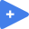

<!-- Generated by tools/export_studio_help.py; edit the reviewed source metadata, then regenerate. -->
# Numeric

[Mathematics functions](index.md) · [All functions](../index.md)

Browse the existing Numeric functions. These entries share the same definitions, types and commands as Programming / Numeric.

Résumé français de l’aide Studio

**Numeric**

Parcourir les fonctions Numeric existantes. Ces entrées utilisent les mêmes définitions, types et commandes que Programming / Numeric.

## Browse this palette

This entry opens a palette folder; it is not an executable dataflow function.

[Open the canonical numeric reference](../numeric/index.md).

## Examples

No example for this object is currently declared in the shared index. [Browse the available examples](../../examples/index.md).

## Identity and references

- Catalogue ID: `mathematics.numeric`.

NI links are reference sources for the connector model; Studio support is limited to the profile above. [Reference provenance and notation](../index.md#provenance-and-notation).
