<!-- Generated by tools/export_studio_help.py; edit the reviewed source metadata, then regenerate. -->
# Polynomial

[Mathematics functions](index.md) · [All functions](../index.md)

Polynomial arithmetic, roots, evaluation, special polynomials and rational functions. Coefficients follow ascending powers. Orthogonal &amp; Non-orthogonal and Rational remain subpalettes; PFE and Poly From PFE share the same implementations in both locations.

Résumé français de l’aide Studio

**Polynomial**

Arithmétique, racines, évaluation, polynômes spéciaux et fractions rationnelles. Les coefficients suivent les puissances croissantes. Orthogonal &amp; Non-orthogonal et Rational restent deux sous-palettes ; PFE et Poly From PFE partagent leur implémentation dans les deux accès.

## Browse this palette

This entry opens a palette folder; it is not an executable dataflow function.

| Entry | Purpose |
| --- | --- |
| [Add Poly](../math/polynomial/add.md) | Add Polynomials. Adds coefficients by ascending power, padding the shorter polynomial with zeros. Coefficients are ascending powers. DBL/CDB promotion is explicit; input arrays are immutable. Empty coefficient vectors are errors unless explicitly documented. |
| [Subtract Poly](../math/polynomial/subtract.md) | Subtract Polynomials. P minus Q, aligned by ascending power; operand order is significant. Coefficients are ascending powers. DBL/CDB promotion is explicit; input arrays are immutable. Empty coefficient vectors are errors unless explicitly documented. |
| [Multiply Poly](../math/polynomial/multiply.md) | Multiply Polynomials. Polynomial convolution, not element-wise multiplication. Coefficients are ascending powers. DBL/CDB promotion is explicit; input arrays are immutable. Empty coefficient vectors are errors unless explicitly documented. |
| [Divide Poly](../math/polynomial/divide.md) | Divide Polynomials. P = Q*quotient + remainder; the divisor must be nonzero. Coefficients are ascending powers. DBL/CDB promotion is explicit; input arrays are immutable. Empty coefficient vectors are errors unless explicitly documented. |
| [Poly Composite](../math/polynomial/compose.md) | Polynomials Composition. Computes P(Q(x)), not Q(P(x)), using polynomial Horner evaluation. Coefficients are ascending powers. DBL/CDB promotion is explicit; input arrays are immutable. Empty coefficient vectors are errors unless explicitly documented. |
| [Poly GCD](../math/polynomial/gcd.md) | GCD of P(x) and Q(x). Monic polynomial GCD. Algorithm 0: relative Euclidean division; 1: SVD subresultant with a certified common-factor residual. tolerance is a coefficient residual threshold. Coefficients are ascending powers. DBL/CDB promotion is explicit; input arrays are immutable. Empty coefficient vectors are errors unless explicitly documented. |
| [Poly LCM](../math/polynomial/lcm.md) | LCM of P(x) and Q(x). Monic polynomial LCM from division by the common factor. Zero input gives zero; GCD algorithm and tolerance have the same meaning as Poly GCD. Coefficients are ascending powers. DBL/CDB promotion is explicit; input arrays are immutable. Empty coefficient vectors are errors unless explicitly documented. |
| [nth Derivative](../math/polynomial/derivative.md) | nth Derivative of Polynomial. Derivative coefficients of nonnegative integer order; order zero preserves P, order above degree yields [0]. Coefficients are ascending powers. DBL/CDB promotion is explicit; input arrays are immutable. Empty coefficient vectors are errors unless explicitly documented. |
| [Indef. Integral](../math/polynomial/primitive.md) | Indefinite Integral of Polynomial. Primitive coefficients in ascending power, with integration constant zero. No constant-of-integration terminal is claimed for NI. Coefficients are ascending powers. DBL/CDB promotion is explicit; input arrays are immutable. Empty coefficient vectors are errors unless explicitly documented. |
| [Integral](../math/polynomial/integral.md) | Integral of Polynomial over [a,b]. Exact coefficient integration of a real polynomial over [start,end]; reversed endpoints reverse its sign. Coefficients are ascending powers. DBL/CDB promotion is explicit; input arrays are immutable. Empty coefficient vectors are errors unless explicitly documented. |
| [Poly Roots](../math/polynomial/roots.md) | Polynomial Roots. All complex roots including multiplicities. Removes only exactly zero highest-power coefficients. Refinement acts on the square-free factors; zero polynomial is indeterminate. Coefficients are ascending powers. DBL/CDB promotion is explicit; input arrays are immutable. Empty coefficient vectors are errors unless explicitly documented. |
| [Real Zeros Counter](../math/polynomial/real_zeros.md) | Polynomial Real Zeros Counter. Real roots in the open interval (start,end), including multiplicities, counted by repeated square-free Sturm chains; endpoints are excluded. Coefficients are ascending powers. DBL/CDB promotion is explicit; input arrays are immutable. Empty coefficient vectors are errors unless explicitly documented. |
| [Roots Classification](../math/polynomial/classify_roots.md) | Roots Classification. Partitions roots into real, conjugate-paired and unpaired roots. Real tolerance is absolute imaginary magnitude; pair tolerance is relative conjugacy error. No missing conjugate is invented. Coefficients are ascending powers. DBL/CDB promotion is explicit; input arrays are immutable. Empty coefficient vectors are errors unless explicitly documented. |
| [Sort Complex Numbers](../math/polynomial/sort_complex.md) | Sort Complex Numbers. Stable complex sort. order 0 ascending, 1 descending. method 0 real/imaginary, 1 magnitude/real/imaginary, 2 magnitude/phase in [-pi,pi]. Indices refer to the original array. Coefficients are ascending powers. DBL/CDB promotion is explicit; input arrays are immutable. Empty coefficient vectors are errors unless explicitly documented. |
| [Unique Numbers and Multiplicity](../math/polynomial/unique.md) | Unique Numbers and Multiplicity. Exact equality groups, deterministically ordered by real then imaginary part; multiplicities sum to the input length. No implicit approximate grouping. Coefficients are ascending powers. DBL/CDB promotion is explicit; input arrays are immutable. Empty coefficient vectors are errors unless explicitly documented. |
| [Create Poly](../math/polynomial/from_roots.md) | Create Polynomial From Roots. Monic product of (x-root), preserving repeated roots and the statically resolved real/complex representation. Empty roots yield [1]. Coefficients are ascending powers. DBL/CDB promotion is explicit; input arrays are immutable. Empty coefficient vectors are errors unless explicitly documented. |
| [Remove Zeros](../math/polynomial/remove_zeros.md) | Remove Zero Coefficients. Removes only trailing high-power coefficients. threshold_type 0 absolute; 1 relative to the maximum coefficient magnitude. Always retains the first coefficient, including an all-small input. Coefficients are ascending powers. DBL/CDB promotion is explicit; input arrays are immutable. Empty coefficient vectors are errors unless explicitly documented. |
| [Order of Poly](../math/polynomial/order.md) | Order of Polynomial. Effective degree after exact trailing zero removal. GS explicit zero-polynomial sentinel: -1. Empty coefficients are an error, not a zero polynomial. Coefficients are ascending powers. DBL/CDB promotion is explicit; input arrays are immutable. Empty coefficient vectors are errors unless explicitly documented. |
| [Polynomial Plot](../math/polynomial/plot.md) | Polynomial Plot. Produces reusable XY data. A wired X selects Samples; otherwise Range uses inclusive start/end and samples&gt;=2. Wiring X together with range options is a configuration conflict, never silently ignored. Coefficients are ascending powers. DBL/CDB promotion is explicit; input arrays are immutable. Empty coefficient vectors are errors unless explicitly documented. |
| [Lin. Evaluation](../math/polynomial/linear_evaluate.md) | Linear Evaluation. Y=a*X+b, preserving actual rank 1 or 2. Real and complex numeric arrays are admitted; this does not perform regression. Coefficients are ascending powers. DBL/CDB promotion is explicit; input arrays are immutable. Empty coefficient vectors are errors unless explicitly documented. |
| [Poly Evaluation](../math/polynomial/evaluate.md) | Polynomial Evaluation. Element-wise polynomial Horner evaluation on a scalar, rank-1 or rank-2 array; preserves the point shape, distinct from matrix evaluation. Coefficients are ascending powers. DBL/CDB promotion is explicit; input arrays are immutable. Empty coefficient vectors are errors unless explicitly documented. |
| [Evaluate Polynomial with Matrix](../math/polynomial/matrix_evaluate.md) | Evaluate Polynomial with Matrix. Matrix Horner evaluation P(A), square A, constant coefficient times identity; reuses the existing matrix multiplication kernel. Coefficients are ascending powers. DBL/CDB promotion is explicit; input arrays are immutable. Empty coefficient vectors are errors unless explicitly documented. |
| [PFE](../math/polynomial/pfe.md) | Partial Fraction Expansion. Partial fractions with unique complex poles, a residue matrix (rows=poles, columns=increasing denominator power), multiplicity and direct polynomial. option 0 cancels certified common factors; 1 preserves them. Coefficients are ascending powers. DBL/CDB promotion is explicit; input arrays are immutable. Empty coefficient vectors are errors unless explicitly documented. |
| [Poly From PFE](../math/polynomial/from_pfe.md) | Create Polynomial From PFE. Inverse PFE, with explicit repeated-pole powers. Empty multiplicity follows NI nonzero residue counts only when unambiguous; otherwise requires explicit multiplicities. option 0 cancels certified common factors; 1 preserves them. Coefficients are ascending powers. DBL/CDB promotion is explicit; input arrays are immutable. Empty coefficient vectors are errors unless explicitly documented. |
| [Poly Eigenvalue](../math/polynomial/eigenvalues.md) | Polynomial Eigenvalues and Vectors. Polynomial eigenproblem with coefficient matrices in ascending order. GS Array shape [coefficient,row,column]. Uses the existing generalized eigensolver without inverting the leading coefficient. output_option 0 values, 1 values and vectors. One coefficient matrix uses its ordinary eigensystem, as documented by NI. Coefficients are ascending powers. DBL/CDB promotion is explicit; input arrays are immutable. Empty coefficient vectors are errors unless explicitly documented. |
| [Orthogonal &amp; Non-orthogonal](polynomial/orthogonal.md) | Browse the Orthogonal &amp; Non-orthogonal palette. |
| [Rational](polynomial/rational.md) | Browse the Rational palette. |

## Examples

No example for this object is currently declared in the shared index. [Browse the available examples](../../examples/index.md).

## Identity and references

- Catalogue ID: `mathematics.polynomial`.

NI links are reference sources for the connector model; Studio support is limited to the profile above. [Reference provenance and notation](../index.md#provenance-and-notation).
