<!-- Generated by tools/export_studio_help.py; edit the reviewed source metadata, then regenerate. -->
# Orthogonal &amp; Non-orthogonal

[Mathematics functions](../index.md) · [All functions](../../index.md)

Browse the Orthogonal &amp; Non-orthogonal palette.

## Browse this palette

This entry opens a palette folder; it is not an executable dataflow function.

| Entry | Purpose |
| --- | --- |
| [Create Orthogonal Polynomial](../../math/polynomial/orthogonal.md) | Create Orthogonal Polynomial. Ascending monomial coefficients. type 0 Chebyshev I, 1 Chebyshev II, 2 Legendre, 3 Laguerre, 4 physicists Hermite, 5 associated Laguerre, 6 Gegenbauer; alpha is used by families 5/6. Gegenbauer alpha must be nonzero. Coefficients are ascending powers. DBL/CDB promotion is explicit; input arrays are immutable. Empty coefficient vectors are errors unless explicitly documented. |
| [Bessel](../../math/polynomial/bessel.md) | Bessel Polynomial. Ordinary Bessel polynomial y_n(x), y0=1, y1=1+x; not a Bessel J/Y/I/K function and not the reversed polynomial. Coefficients are ascending powers. DBL/CDB promotion is explicit; input arrays are immutable. Empty coefficient vectors are errors unless explicitly documented. |
| [Chebyshev](../../math/polynomial/chebyshev.md) | Chebyshev Polynomial. Chebyshev first-kind T_n(x), by polynomial recurrence including real x outside [-1,1]. Coefficients are ascending powers. DBL/CDB promotion is explicit; input arrays are immutable. Empty coefficient vectors are errors unless explicitly documented. |
| [Legendre](../../math/polynomial/legendre.md) | Legendre Polynomial. Associated Legendre, n&gt;=m&gt;=0 and real x in [-1,1]. type 0 standard, 1 Schmidt semi-normalized, 2 unit-normalized on [-1,1]. GS uses the explicit Condon-Shortley phase (-1)^m. The NI 2020 help identifies these three normalization choices but does not certify their factors or phase. Coefficients are ascending powers. DBL/CDB promotion is explicit; input arrays are immutable. Empty coefficient vectors are errors unless explicitly documented. |

## Examples

No example for this object is currently declared in the shared index. [Browse the available examples](../../../examples/index.md).

## Identity and references

- Catalogue ID: `mathematics.polynomial.orthogonal`.
- Parent palette: [Polynomial](../polynomial.md).

NI links are reference sources for the connector model; Studio support is limited to the profile above. [Reference provenance and notation](../../index.md#provenance-and-notation).
