<!-- Generated by tools/export_studio_help.py; edit the reviewed source metadata, then regenerate. -->
# Probability &amp; Statistics

[Mathematics functions](index.md) · [All functions](../index.md)

Reserved Mathematics folder for Probabiliy &amp; Statistic. No functions have been added to this folder yet.

Résumé français de l’aide Studio

**Probability &amp; Statistics**

Dossier Mathematics réservé à Probabiliy &amp; Statistic. Aucune fonction n’a encore été ajoutée dans ce dossier.

## Browse this palette

This entry opens a palette folder; it is not an executable dataflow function.

| Entry | Purpose |
| --- | --- |
| [Mean](../math/statistics/mean.md) | Arithmetic componentwise Mean; RMS uses sqrt(mean(abs(z)^2)) and returns DBL. Finite observations; empty is NaN with an explicit GS warning. |
| [Measures of Mean](../math/statistics/measures_of_mean.md) | Trim removes floor(n*percent/100) observations at each tail (GS). Positive domain for geometric/harmonic (GS). percent is inactive in other modes. Type 0 Arithmetic, 1 Geometric, 2 Harmonic, 3 Trimmed (Percent per tail), 4 Median. |
| [Std Deviation and Variance](../math/statistics/std_variance.md) | Sample0 divides variance by n-1; Population1 by n. GS corrected skewness/kurtosis uses NIST G1/G2 (not NI-certified); kurtosis is Pearson normal3. Weighting 0 Sample (n-1), 1 Population (n). |
| [Skewness and Kurtosis](../math/statistics/skewness_kurtosis.md) | Sample0 divides variance by n-1; Population1 by n. GS corrected skewness/kurtosis uses NIST G1/G2 (not NI-certified); kurtosis is Pearson normal3. GS Sample uses adjusted G1/G2, Population uses central moments; Pearson kurtosis has normal=3. |
| [Measures of Spread](../math/statistics/measures_of_spread.md) | Spread0 uses sample standard deviation (GS); quartiles use type7 (GS); absolute deviations are about the arithmetic mean. Type 0 sample standard deviation, 1 range, 2 mean absolute deviation, 3 IQR. |
| [Percentiles](../math/statistics/percentiles.md) | Percent in[0,100], GS type7 interpolation h=(n-1)*p/100; no NI interpolation equivalence claimed. GS type-7 linear interpolation, percent scale 0..100, one shared sort per percentile vector. |
| [RMS](../math/statistics/rms.md) | Arithmetic componentwise Mean; RMS uses sqrt(mean(abs(z)^2)) and returns DBL. Finite observations; empty is NaN with an explicit GS warning. |
| [MSE](../math/statistics/mse.md) | Mean squared paired error SSE/n; equal nonempty lengths, no truncation, broadcasting or implicit complex norm. |
| [Moment about Mean](../math/statistics/moment.md) | Central population moment, not raw moment; nonnegative integer order. Order0=1, order1=0 for nonempty input. |
| [Covariance Matrix](../math/statistics/covariance_matrix.md) | Observations are rows, variables columns (NI). Sample divisor n-1 is an explicit GS choice; no extra Weighting/error port. |
| [Mode](../math/statistics/mode.md) | intervals&lt;=0 exact frequencies; &gt;0 histogram bin centers. Constant stays constant. No mode=NaN/[] without error; GS ties choose smallest/ascending modes. |
| [Median](../math/statistics/median.md) | Median of a sorted copy, preserving shared input; empty gives NaN and GS warning. |
| [Histogram](../math/statistics/histogram.md) | Uniform bins, final maximum included. Constant centers=c with first bin count is GS. Graph XY record is a GS adaptation; I32 counts are preserved separately. |
| [General Histogram](../math/statistics/general_histogram.md) | Nonempty explicit bins override all uniform parameters. GS rejects overlapping bins, preserves noncontiguous order; outside total includes gaps. Graph XY carrier is GS. Nonempty bins override uniform-grid inputs as documented by NI. GS refuses overlapping accepted bin ranges; outside.total includes gaps. |
| [Correlation Coefficient (Pearson)](../math/statistics/pearson.md) | Paired finite observations; constant sequence undefined. Spearman uses average ranks; Kendall tau-b is explicit GS because NI normalization is unpublished. No invented error output. |
| [Correlation Coefficient (Spearman)](../math/statistics/spearman.md) | Paired finite observations; constant sequence undefined. Spearman uses average ranks; Kendall tau-b is explicit GS because NI normalization is unpublished. No invented error output. |
| [Correlation Coefficient (Kendall Tau)](../math/statistics/kendall.md) | Paired finite observations; constant sequence undefined. Spearman uses average ranks; Kendall tau-b is explicit GS because NI normalization is unpublished. No invented error output. |
| [Probability](probability_statistics/probability.md) | Browse the Probability palette. |
| [Hypothesis Test](probability_statistics/hypothesis_test.md) | Browse the Hypothesis Test palette. |
| [ANOVA](probability_statistics/anova.md) | Browse the ANOVA palette. |
| [Statistics](../math/statistics/statistics_express.md) | GS typed adaptation of NI dynamic signals; only the FIRST waveform is measured. Selected measure IDs persist, default mean; exact source timestamp retained. No UI-triggered calculation. Select output IDs in Configure Statistics. The first waveform/channel is used. GS uses population moments here; time outputs retain the exact Timestamp origin. |
| [Histogram (Express) (Express)](../math/statistics/histogram_express.md) | Separate stateful Express node, reusing Histogram/General Histogram counting. Explicit GS configuration ports auto_range/bins/cumulative/normalization; NI Enable/Reset/error behavior preserved. Graph XY output is GS. Express node distinct from the ordinary Histogram VI. GS range defaults [-3,3), 10 bins; cumulative/Reset/Enable use per-instance transactional state. Normalization 0 counts, 1 probability over accepted samples, 2 density. Waveform arrays use the first signal, an explicit GS adaptation. |

## Examples

No example for this object is currently declared in the shared index. [Browse the available examples](../../examples/index.md).

## Identity and references

- Catalogue ID: `mathematics.probability_statistics`.

NI links are reference sources for the connector model; Studio support is limited to the profile above. [Reference provenance and notation](../index.md#provenance-and-notation).
