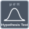

<!-- Generated by tools/export_studio_help.py; edit the reviewed source metadata, then regenerate. -->
# Hypothesis Test

[Mathematics functions](../index.md) · [All functions](../../index.md)

Browse the Hypothesis Test palette.

## Browse this palette

This entry opens a palette folder; it is not an executable dataflow function.

| Entry | Purpose |
| --- | --- |
| [T Test](../../math/statistics/hypothesis/t_test.md) | p-value is independent of alpha; reject iff p&lt;=alpha. Alternative0 two-sided,+1 greater,-1 less. Exact CI/info records preserve declared fields. |
| [Z Test](../../math/statistics/hypothesis/z_test.md) | p-value is independent of alpha; reject iff p&lt;=alpha. Alternative0 two-sided,+1 greater,-1 less. Exact CI/info records preserve declared fields. |
| [Correlation Test](../../math/statistics/hypothesis/correlation_test.md) | Correlation alternatives follow NI reversed mapping: -1 positive,+1 negative,0 two-sided. Rank-test methods and ties are GS explicit, not an automatic Pearson substitution. Type 0 Pearson, 1 Spearman, 2 Kendall tau-b. Alternative -1 greater, 0 different, +1 less; other hypothesis functions use -1 less/+1 greater. |
| [Sign Test](../../math/statistics/hypothesis/sign_test.md) | Paired differences or a reference location remain distinct signatures. GS exact sign/rank distributions with explicit zero/tie policies; alternatives0 two-sided,+1 greater,-1 less. |
| [Wilcoxon Signed Rank Test](../../math/statistics/hypothesis/wilcoxon.md) | Paired differences or a reference location remain distinct signatures. GS exact sign/rank distributions with explicit zero/tie policies; alternatives0 two-sided,+1 greater,-1 less. |
| [Rank Transformation](../../math/statistics/hypothesis/rank_transformation.md) | Average ranks in original observation order, GS base1; tie sum=sum(t^3-t). No invented test, p-value or error port. |
| [Contingency Table](../../math/statistics/hypothesis/contingency_table.md) | Finite nonnegative I32 counts, GS Pearson chi-square without Yates; no silent Fisher substitution or extra fields. |

## Examples

No example for this object is currently declared in the shared index. [Browse the available examples](../../../examples/index.md).

## Identity and references

- Catalogue ID: `mathematics.probability_statistics.hypothesis_test`.
- Parent palette: [Probability &amp; Statistics](../probability_statistics.md).

NI links are reference sources for the connector model; Studio support is limited to the profile above. [Reference provenance and notation](../../index.md#provenance-and-notation).
