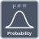

<!-- Generated by tools/export_studio_help.py; edit the reviewed source metadata, then regenerate. -->
# Probability

[Mathematics functions](../index.md) · [All functions](../../index.md)

Browse the Probability palette.

## Browse this palette

This entry opens a palette folder; it is not an executable dataflow function.

| Entry | Purpose |
| --- | --- |
| [Continuous CDF](../../math/statistics/probability/continuous_cdf.md) | Exact per-law NI connector types with explicit GS normalized IDs. Gamma uses shape=c,scale=b; Weibull uses scale=a,shape=b despite contradictory NI descriptions. Extreme Value is GS minimum orientation. Random state is per native instance/node; deterministic GS seed policy is not NI sequence identity. |
| [Continuous Inverse CDF](../../math/statistics/probability/continuous_inverse_cdf.md) | Exact per-law NI connector types with explicit GS normalized IDs. Gamma uses shape=c,scale=b; Weibull uses scale=a,shape=b despite contradictory NI descriptions. Extreme Value is GS minimum orientation. Random state is per native instance/node; deterministic GS seed policy is not NI sequence identity. |
| [Continuous PDF](../../math/statistics/probability/continuous_pdf.md) | Exact per-law NI connector types with explicit GS normalized IDs. Gamma uses shape=c,scale=b; Weibull uses scale=a,shape=b despite contradictory NI descriptions. Extreme Value is GS minimum orientation. Random state is per native instance/node; deterministic GS seed policy is not NI sequence identity. |
| [Continuous Random](../../math/statistics/probability/continuous_random.md) | Exact per-law NI connector types with explicit GS normalized IDs. Gamma uses shape=c,scale=b; Weibull uses scale=a,shape=b despite contradictory NI descriptions. Extreme Value is GS minimum orientation. Random state is per native instance/node; deterministic GS seed policy is not NI sequence identity.  GS RNG uses per-node mt19937_64: seed -1 picks instance entropy, nonnegative seeds are deterministic, Reset replays the seed, a changed seed reseeds; seed&lt;-1 is refused. No NI bit-sequence equivalence is claimed. |
| [Continuous Moments](../../math/statistics/probability/continuous_moments.md) | Exact per-law NI connector types with explicit GS normalized IDs. Gamma uses shape=c,scale=b; Weibull uses scale=a,shape=b despite contradictory NI descriptions. Extreme Value is GS minimum orientation. Random state is per native instance/node; deterministic GS seed policy is not NI sequence identity. |
| [Discrete CDF](../../math/statistics/probability/discrete_cdf.md) | Exact per-law NI connector types with explicit GS normalized IDs. Gamma uses shape=c,scale=b; Weibull uses scale=a,shape=b despite contradictory NI descriptions. Extreme Value is GS minimum orientation. Random state is per native instance/node; deterministic GS seed policy is not NI sequence identity. |
| [Discrete Inverse CDF](../../math/statistics/probability/discrete_inverse_cdf.md) | Exact per-law NI connector types with explicit GS normalized IDs. Gamma uses shape=c,scale=b; Weibull uses scale=a,shape=b despite contradictory NI descriptions. Extreme Value is GS minimum orientation. Random state is per native instance/node; deterministic GS seed policy is not NI sequence identity. |
| [Discrete PF](../../math/statistics/probability/discrete_pf.md) | Exact per-law NI connector types with explicit GS normalized IDs. Gamma uses shape=c,scale=b; Weibull uses scale=a,shape=b despite contradictory NI descriptions. Extreme Value is GS minimum orientation. Random state is per native instance/node; deterministic GS seed policy is not NI sequence identity. |
| [Discrete Random](../../math/statistics/probability/discrete_random.md) | Exact per-law NI connector types with explicit GS normalized IDs. Gamma uses shape=c,scale=b; Weibull uses scale=a,shape=b despite contradictory NI descriptions. Extreme Value is GS minimum orientation. Random state is per native instance/node; deterministic GS seed policy is not NI sequence identity.  GS RNG uses per-node mt19937_64: seed -1 picks instance entropy, nonnegative seeds are deterministic, Reset replays the seed, a changed seed reseeds; seed&lt;-1 is refused. No NI bit-sequence equivalence is claimed. |
| [Discrete Moments](../../math/statistics/probability/discrete_moments.md) | Exact per-law NI connector types with explicit GS normalized IDs. Gamma uses shape=c,scale=b; Weibull uses scale=a,shape=b despite contradictory NI descriptions. Extreme Value is GS minimum orientation. Random state is per native instance/node; deterministic GS seed policy is not NI sequence identity. |

## Examples

No example for this object is currently declared in the shared index. [Browse the available examples](../../../examples/index.md).

## Identity and references

- Catalogue ID: `mathematics.probability_statistics.probability`.
- Parent palette: [Probability &amp; Statistics](../probability_statistics.md).

NI links are reference sources for the connector model; Studio support is limited to the profile above. [Reference provenance and notation](../../index.md#provenance-and-notation).
