<!-- Generated by tools/export_studio_help.py; edit the reviewed source metadata, then regenerate. -->
# Script &amp; Formula

[Mathematics functions](index.md) · [All functions](../index.md)

Mathematical text expressions and assignments. Browse 1D &amp; 2D Evaluation; prepared scalar expressions and prepared assignment programs are distinct versioned FROG values.

Résumé français de l’aide Studio

**Script &amp; Formula**

Expressions et affectations mathématiques textuelles. Le dossier1D &amp; 2D Evaluation contient les évaluateurs ; expressions scalaires préparées et programmes d’affectations préparés sont des valeurs FROG distinctes et versionnées.

## Browse this palette

This entry opens a palette folder; it is not an executable dataflow function.

| Entry | Purpose |
| --- | --- |
| [1D &amp; 2D Evaluation](script_formula/evaluation_1d_2d.md) | 19 supplied operations, in exact01–08,10–20 order. The00resource is this folder only. Eval y=f(x), number09in the reference screenshot, has no supplied icon and is not added. Mathematical expressions, prepared programs, scalar/arrayevaluation, uniform/adaptive curves and2Dgrids have distinct contracts. |

## Examples

No example for this object is currently declared in the shared index. [Browse the available examples](../../examples/index.md).

## Identity and references

- Catalogue ID: `mathematics.script_formula`.

NI links are reference sources for the connector model; Studio support is limited to the profile above. [Reference provenance and notation](../index.md#provenance-and-notation).
