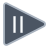

<!-- Generated by tools/export_studio_help.py; edit the reviewed source metadata, then regenerate. -->
# Absolute Value

[Numeric functions](index.md) · [All functions](../index.md)

Returns the magnitude of the numeric input without its sign.

Résumé français de l’aide Studio

**Valeur absolue**

Renvoie la grandeur de l'entree numerique sans son signe. [Types] Scalaire numérique, tableau ou cluster récursivement numérique ; la sortie conserve la structure. Les non-signés sont refusés ; une feuille complexe donne le type réel correspondant pour son module. Studio: Ce profil d’édition ne modélise pas les largeurs de virgule fixe configurables de NI, les unités ni le remplacement par des VI propres aux matrices.

## Studio authoring profile

Contract status: **partial**. The connector below describes Studio authoring; execution availability is stated separately.

Numeric scalar, array or recursively numeric cluster; result preserves aggregate structure. Unsigned inputs are rejected; a complex leaf produces the corresponding real magnitude type.

Numeric scalar, array or recursively numeric cluster; result preserves aggregate structure. Unsigned inputs are rejected; a complex leaf produces the corresponding real magnitude type. Studio: NI configurable fixed-point widths, units and matrix-specific VI replacement are not modeled by this authoring profile.

## IN — inputs

| Displayed terminal / internal ID | Accepted / resolved type | Studio connection | Unwired input default | Meaning |
| --- | --- | --- | --- | --- |
| x `in` | `T:numeric_tree` | Required | Not specified | — |

A default is shown only for an input with an explicitly documented value. Preview/default *types* do not imply unwired operand values. If helper and binding flags differ, both are labelled.

## OUT — outputs

| Displayed terminal / internal ID | Accepted / resolved type | Studio connection | Unwired input default | Meaning |
| --- | --- | --- | --- | --- |
| abs(x) `result` | `T:any` | Recommended (help); Required (binding) | — | — |

A default is shown only for an input with an explicitly documented value. Preview/default *types* do not imply unwired operand values. If helper and binding flags differ, both are labelled.

## Types and connection rules

Numeric scalar, array or recursively numeric cluster; result preserves aggregate structure. Unsigned inputs are rejected; a complex leaf produces the corresponding real magnitude type.

- Type resolution: `custom_resolver`; result expression: `resolve:frog.studio.polymorphic.type-resolution@1`.
- Implicit coercion: permitted by this profile.
- Arrays: accepted; lifting policy: `none`.

**Input count:** 1; this contract does not enable variadic inputs.

fixed unary

## Execution and limits

**Public FROG / target Runtime:** not declared available by this authoring contract.

No portable Runtime provider is declared.

**Authoring/target contract limits:**

- NI reference verified for authoring types; this does not establish runtime support on the active target.
- NI configurable fixed-point widths, units and matrix-specific VI replacement are not modeled by this authoring profile.

**Private Studio Run/Highlight:** the local function evaluator dispatches this catalogue identity. Inputs and output types must be resolved; unsupported value operations or representations fail explicitly. This local dispatch is separate from the public target Runtime declaration above.

Connector type defaults and persistence aliases

| Direction | ID | Preview/default type | Connection policy | Cardinality | Legacy port IDs |
| --- | --- | --- | --- | --- | --- |
| INPUT | `in` | `f64` | `any_explicit` | `single` | `a`, `value` |
| OUTPUT | `result` | `f64` | `exact` | `single` | — |

## Identity and references

- Catalogue ID: `numeric.absolute_value`.
- Profile: `frog.studio.polymorphic.numeric.absolute_value.v1`.
- Definition: `frog.core.abs`.
- [NI API reference](https://www.ni.com/docs/en-US/bundle/labview-api-ref/page/functions/absolute-value.html).

NI links are reference sources for the connector model; Studio support is limited to the profile above. [Reference provenance and notation](../index.md#provenance-and-notation).
