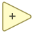

<!-- Generated by tools/export_studio_help.py; edit the reviewed source metadata, then regenerate. -->
# Add

[Numeric functions](index.md) · [All functions](../index.md)

Adds the two numeric inputs and returns their sum.

Résumé français de l’aide Studio

**Additionner**

Additionne les deux entrees numeriques et renvoie leur somme. [Types] x,y numériques -&gt; scalaire/tableau/cluster promu ; extension scalaire et variantes Waveform/Timestamp chez NI. Studio: La fonction publique frog.core.add conserve son contrat fixé pour les scalaires et tableaux numériques, ainsi que la règle stricte imposant des tableaux de même forme ; cette revue ne redéfinit pas cette règle.

## Studio authoring profile

Contract status: **defined**. The connector below describes Studio authoring; execution availability is stated separately.

Adds connected operands in canonical port order with a canonical left fold after coercion to the resolved result leaf type.

Numeric x,y -&gt; promoted scalar/array/cluster; scalar lifting and waveform/timestamp overloads exist in NI. Studio: Public frog.core.add retains its pinned numeric scalar/array contract and strict same-array-shape rule; this review does not redefine that law.

## IN — inputs

| Displayed terminal / internal ID | Accepted / resolved type | Studio connection | Unwired input default | Meaning |
| --- | --- | --- | --- | --- |
| x `a` | `T:numeric\|array<T:numeric,same_shape>` | Required | Not specified | — |
| y `b` | `T:numeric\|array<T:numeric,same_shape>` | Required | Not specified | — |

A default is shown only for an input with an explicitly documented value. Preview/default *types* do not imply unwired operand values. If helper and binding flags differ, both are labelled.

## OUT — outputs

| Displayed terminal / internal ID | Accepted / resolved type | Studio connection | Unwired input default | Meaning |
| --- | --- | --- | --- | --- |
| x + y `result` | `resolve:frog.core.add.type-resolution@1` | Recommended (help); Required (binding) | — | — |

A default is shown only for an input with an explicitly documented value. Preview/default *types* do not imply unwired operand values. If helper and binding flags differ, both are labelled.

Additional input IDs: `input_N`, starting at 3.

When expanded beyond two operands, Studio displays x1, x2, …, xN and the corresponding result expression. The persisted input IDs and canonical operand order stay unchanged.

## Types and connection rules

frog.core.add.type-resolution@1; promote all numeric leaves to one common type

- Type resolution: `custom_resolver`; result expression: `resolve:frog.core.add.type-resolution@1`.
- Implicit coercion: permitted by this profile.
- Arrays: accepted; lifting policy: `element_wise_same_shape_with_scalar_lift`.
- Shape rule: `identical_structural_shape`.
- Scalar lifting: yes.
- Broadcasting: no.

element-wise identical structural shape with scalar lift; no broadcasting

**Expandable inputs:** 2 to 16. Reduction: `canonical_left_fold`.

Port order: `a` → `b` → `input_N_ascending`.

## Execution and limits

**Public FROG / target Runtime:** declared available within the scope below.

Scope: `numeric_scalar_only`.

Implementation: `frog.core.add`.

Scalar execution is available; authorable array lifting is rejected until an array Runtime value provider exists.

**Authoring/target contract limits:**

- Runtime array execution is unavailable.

**Private Studio Run/Highlight:** the local function evaluator dispatches this catalogue identity. Inputs and output types must be resolved; unsupported value operations or representations fail explicitly. This local dispatch is separate from the public target Runtime declaration above.

Local arithmetic includes F32/F64 and supported integer leaves, scalar lifting and matching-shape Arrays. It preserves the resolved aggregate shape and narrows each step of the canonical arithmetic fold. Complex and extended-precision leaf arithmetic is not implemented by this evaluator. Array execution here does not establish a public target Array provider.

Connector type defaults and persistence aliases

| Direction | ID | Preview/default type | Connection policy | Cardinality | Legacy port IDs |
| --- | --- | --- | --- | --- | --- |
| INPUT | `a` | `f64` | `numeric_scalar_or_array_implicit` | `single` | — |
| INPUT | `b` | `f64` | `numeric_scalar_or_array_implicit` | `single` | — |
| OUTPUT | `result` | `f64` | `exact` | `single` | — |

## Identity and references

- Catalogue ID: `numeric.add`.
- Profile: `frog.core.add.v1`.
- Definition: `frog.core.add`.
- [NI API reference](https://www.ni.com/docs/en-US/bundle/labview-nxg-nodes-api-ref/page/add.html).
- [Published FROG specification](https://github.com/Graiphic/FROG/blob/main/Libraries/Core.md#101-frogcoreadd).

NI links are reference sources for the connector model; Studio support is limited to the profile above. [Reference provenance and notation](../index.md#provenance-and-notation).
