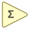

<!-- Generated by tools/export_studio_help.py; edit the reviewed source metadata, then regenerate. -->
# Add Array Elements

[Numeric functions](index.md) · [All functions](../index.md)

Reduces a numeric array by adding all defined elements.

Résumé français de l’aide Studio

**Additionner les elements du tableau**

Reduit un tableau numerique en additionnant tous ses elements definis. [Types] Un tableau numérique nD se réduit au type et à la structure d'un élément, pas à DBL fixe. Le point fixe n'est pas accepté.

## Studio authoring profile

Contract status: **partial**. The connector below describes Studio authoring; execution availability is stated separately.

An n-D numeric array reduces to the type and structure of one element, not a fixed DBL. Fixed-point is not accepted.

An n-D numeric array reduces to the type and structure of one element, not a fixed DBL. Fixed-point is not accepted.

## IN — inputs

| Displayed terminal / internal ID | Accepted / resolved type | Studio connection | Unwired input default | Meaning |
| --- | --- | --- | --- | --- |
| numeric array `value` | `array<T:numeric,rank>=1>` | Required | Not specified | — |

A default is shown only for an input with an explicitly documented value. Preview/default *types* do not imply unwired operand values. If helper and binding flags differ, both are labelled.

## OUT — outputs

| Displayed terminal / internal ID | Accepted / resolved type | Studio connection | Unwired input default | Meaning |
| --- | --- | --- | --- | --- |
| sum of array elements `result` | `T:any` | Recommended (help); Required (binding) | — | — |

A default is shown only for an input with an explicitly documented value. Preview/default *types* do not imply unwired operand values. If helper and binding flags differ, both are labelled.

## Types and connection rules

An n-D numeric array reduces to the type and structure of one element, not a fixed DBL. Fixed-point is not accepted.

- Type resolution: `custom_resolver`; result expression: `resolve:frog.studio.polymorphic.type-resolution@1`.
- Implicit coercion: permitted by this profile.
- Arrays: accepted; lifting policy: `reduction`.

**Input count:** 1; this contract does not enable variadic inputs.

not_variadic

## Execution and limits

**Public FROG / target Runtime:** not declared available by this authoring contract.

**Authoring/target contract limits:**

- NI reference verified for authoring types; this does not establish runtime support on the active target.

**Private Studio Run/Highlight:** the local function evaluator dispatches this catalogue identity. Inputs and output types must be resolved; unsupported value operations or representations fail explicitly. This local dispatch is separate from the public target Runtime declaration above.

Connector type defaults and persistence aliases

| Direction | ID | Preview/default type | Connection policy | Cardinality | Legacy port IDs |
| --- | --- | --- | --- | --- | --- |
| INPUT | `value` | `array:f64` | `numeric_array_implicit` | `single` | — |
| OUTPUT | `result` | `f64` | `exact` | `single` | — |

## Identity and references

- Catalogue ID: `numeric.add_array_elements`.
- Profile: `frog.studio.polymorphic.numeric.add_array_elements.v1`.
- Definition: `frog.studio.numeric.add_array_elements`.
- [NI API reference](https://www.ni.com/docs/en-US/bundle/labview-api-ref/page/functions/add-array-elements.html).

NI links are reference sources for the connector model; Studio support is limited to the profile above. [Reference provenance and notation](../index.md#provenance-and-notation).
