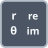

<!-- Generated by tools/export_studio_help.py; edit the reviewed source metadata, then regenerate. -->
# Polar To Re/Im

[Numeric functions](../index.md) · [All functions](../../index.md)

Converts magnitude and phase to real and imaginary components.

Résumé français de l’aide Studio

**Polaire en Reel/Im**

Convertit la magnitude et la phase en composantes reelle et imaginaire. [Types] Real r, theta -&gt; Real x, y. Structure numérique tableau/cluster conservée, conversion des feuilles réelles/complexes. Studio: Profil de câblage uniquement : les variantes Waveform, unités physiques et formats de virgule fixe configurables ne sont pas modélisés. L’exécution nécessite toujours un fournisseur sur la cible.

## Studio authoring profile

Contract status: **partial**. The connector below describes Studio authoring; execution availability is stated separately.

Real r, theta -&gt; Real x, y. Numeric array/cluster structure is preserved, with real/complex leaf conversion.

Real r, theta -&gt; Real x, y. Numeric array/cluster structure is preserved, with real/complex leaf conversion. Studio: Studio authoring supports the declared numeric scalar/array/cluster types; NI waveform, physical-unit and configurable fixed-point layout overloads are not modeled. Runtime execution still requires a target provider.

## IN — inputs

| Displayed terminal / internal ID | Accepted / resolved type | Studio connection | Unwired input default | Meaning |
| --- | --- | --- | --- | --- |
| r `r` | `T:numeric_tree` | Required | Not specified | — |
| theta `theta` | `T:numeric_tree` | Required | Not specified | — |

A default is shown only for an input with an explicitly documented value. Preview/default *types* do not imply unwired operand values. If helper and binding flags differ, both are labelled.

## OUT — outputs

| Displayed terminal / internal ID | Accepted / resolved type | Studio connection | Unwired input default | Meaning |
| --- | --- | --- | --- | --- |
| r * cos(theta) `re` | `T:numeric_tree` | Recommended (help); Required (binding) | — | — |
| r * sin(theta) `im` | `T:numeric_tree` | Recommended (help); Required (binding) | — | — |

A default is shown only for an input with an explicitly documented value. Preview/default *types* do not imply unwired operand values. If helper and binding flags differ, both are labelled.

## Types and connection rules

Real r, theta -&gt; Real x, y. Numeric array/cluster structure is preserved, with real/complex leaf conversion.

- Type resolution: `custom_resolver`; result expression: `resolve:frog.studio.polymorphic.type-resolution@1`.
- Implicit coercion: not enabled by this resolver; individual port policies remain explicit.
- Arrays: accepted; lifting policy: `element_wise_same_shape_with_scalar_lift`.
- Shape rule: `compatible_rank_and_schema; scalar_lift`.
- Scalar lifting: yes.

**Input count:** 2; this contract does not enable variadic inputs.

## Execution and limits

**Public FROG / target Runtime:** not declared available by this authoring contract.

**Authoring/target contract limits:**

- NI reference verified for authoring types; this does not establish runtime support on the active target.
- Studio authoring supports the declared numeric scalar/array/cluster types; NI waveform, physical-unit and configurable fixed-point layout overloads are not modeled. Runtime execution still requires a target provider.

Connector type defaults and persistence aliases

| Direction | ID | Preview/default type | Connection policy | Cardinality | Legacy port IDs |
| --- | --- | --- | --- | --- | --- |
| INPUT | `r` | `f64` | `any_explicit` | `single` | — |
| INPUT | `theta` | `f64` | `any_explicit` | `single` | — |
| OUTPUT | `re` | `f64` | `any_explicit` | `single` | — |
| OUTPUT | `im` | `f64` | `any_explicit` | `single` | — |

## Examples

No example for this object is currently declared in the shared index. [Browse the available examples](../../../examples/index.md).

## Identity and references

- Catalogue ID: `numeric.complex.polar_to_real_imaginary`.
- Parent palette: [Complex](../complex.md).
- Profile: `frog.studio.polymorphic.numeric.complex.polar_to_real_imaginary.v1`.
- Definition: `frog.studio.numeric.complex.polar_to_real_imaginary`.
- [NI API reference](https://www.ni.com/docs/en-US/bundle/labview-nxg-nodes-api-ref/page/polar-to-real-and-imaginary.html).

NI links are reference sources for the connector model; Studio support is limited to the profile above. [Reference provenance and notation](../../index.md#provenance-and-notation).
