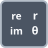

<!-- Generated by tools/export_studio_help.py; edit the reviewed source metadata, then regenerate. -->
# Re/Im To Polar

[Numeric functions](../index.md) · [All functions](../../index.md)

Converts real and imaginary components to magnitude and phase.

Résumé français de l’aide Studio

**Reel/Im en polaire**

Convertit les composantes reelle et imaginaire en magnitude et phase. [Types] Real x, y -&gt; Real r, theta. Structure numérique tableau/cluster conservée, conversion des feuilles réelles/complexes. Studio: Profil de câblage uniquement : les variantes Waveform, unités physiques et formats de virgule fixe configurables ne sont pas modélisés. L’exécution nécessite toujours un fournisseur sur la cible.

## Studio authoring profile

Contract status: **partial**. The connector below describes Studio authoring; execution availability is stated separately.

Real x, y -&gt; Real r, theta. Numeric array/cluster structure is preserved, with real/complex leaf conversion.

Real x, y -&gt; Real r, theta. Numeric array/cluster structure is preserved, with real/complex leaf conversion. Studio: Studio authoring supports the declared numeric scalar/array/cluster types; NI waveform, physical-unit and configurable fixed-point layout overloads are not modeled. Runtime execution still requires a target provider.

## IN — inputs

| Displayed terminal / internal ID | Accepted / resolved type | Studio connection | Unwired input default | Meaning |
| --- | --- | --- | --- | --- |
| x `re` | `T:numeric_tree` | Required | Not specified | — |
| y `im` | `T:numeric_tree` | Required | Not specified | — |

A default is shown only for an input with an explicitly documented value. Preview/default *types* do not imply unwired operand values. If helper and binding flags differ, both are labelled.

## OUT — outputs

| Displayed terminal / internal ID | Accepted / resolved type | Studio connection | Unwired input default | Meaning |
| --- | --- | --- | --- | --- |
| sqrt(x^2 + y^2) `r` | `T:numeric_tree` | Recommended (help); Required (binding) | — | — |
| atan2(y,x) `theta` | `T:numeric_tree` | Recommended (help); Required (binding) | — | — |

A default is shown only for an input with an explicitly documented value. Preview/default *types* do not imply unwired operand values. If helper and binding flags differ, both are labelled.

## Types and connection rules

Real x, y -&gt; Real r, theta. Numeric array/cluster structure is preserved, with real/complex leaf conversion.

- Type resolution: `custom_resolver`; result expression: `resolve:frog.studio.polymorphic.type-resolution@1`.
- Implicit coercion: not enabled by this resolver; individual port policies remain explicit.
- Arrays: accepted; lifting policy: `element_wise_same_shape_with_scalar_lift`.
- Shape rule: `compatible_rank_and_schema; scalar_lift`.
- Scalar lifting: yes.

**Input count:** 2; this contract does not enable variadic inputs.

## Execution and limits

**Public FROG / target Runtime:** not declared available by this authoring contract.

**Authoring/target contract limits:**

- NI reference verified for authoring types; this does not establish runtime support on the active target.
- Studio authoring supports the declared numeric scalar/array/cluster types; NI waveform, physical-unit and configurable fixed-point layout overloads are not modeled. Runtime execution still requires a target provider.

Connector type defaults and persistence aliases

| Direction | ID | Preview/default type | Connection policy | Cardinality | Legacy port IDs |
| --- | --- | --- | --- | --- | --- |
| INPUT | `re` | `f64` | `any_explicit` | `single` | — |
| INPUT | `im` | `f64` | `any_explicit` | `single` | — |
| OUTPUT | `r` | `f64` | `any_explicit` | `single` | — |
| OUTPUT | `theta` | `f64` | `any_explicit` | `single` | — |

## Identity and references

- Catalogue ID: `numeric.complex.real_imaginary_to_polar`.
- Parent palette: [Complex](../complex.md).
- Profile: `frog.studio.polymorphic.numeric.complex.real_imaginary_to_polar.v1`.
- Definition: `frog.studio.numeric.complex.real_imaginary_to_polar`.
- [NI API reference](https://www.ni.com/docs/en-US/bundle/labview-nxg-nodes-api-ref/page/real-and-imaginary-to-polar.html).

NI links are reference sources for the connector model; Studio support is limited to the profile above. [Reference provenance and notation](../../index.md#provenance-and-notation).
