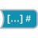

<!-- Generated by tools/export_studio_help.py; edit the reviewed source metadata, then regenerate. -->
# Boolean Array To Number

[Numeric functions](../index.md) · [All functions](../../index.md)

Packs Boolean array values into a numeric bit pattern.

Résumé français de l’aide Studio

**Tableau booleen vers nombre**

Regroupe les valeurs d'un tableau booleen dans un motif numerique. [Types] Tableau booléen 1D -&gt; représentation entière configurée (U32 par défaut LabVIEW), poids faible en premier.

## Studio authoring profile

Contract status: **partial**. The connector below describes Studio authoring; execution availability is stated separately.

1D Boolean array -&gt; configured integer representation (LabVIEW default U32); first element is least significant.

1D Boolean array -&gt; configured integer representation (LabVIEW default U32); first element is least significant.

## IN — inputs

| Displayed terminal / internal ID | Accepted / resolved type | Studio connection | Unwired input default | Meaning |
| --- | --- | --- | --- | --- |
| Boolean array `value` | `array<bool,rank=1>` | Required | Not specified | — |

A default is shown only for an input with an explicitly documented value. Preview/default *types* do not imply unwired operand values. If helper and binding flags differ, both are labelled.

## OUT — outputs

| Displayed terminal / internal ID | Accepted / resolved type | Studio connection | Unwired input default | Meaning |
| --- | --- | --- | --- | --- |
| number `result` | `T:any` | Recommended (help); Required (binding) | — | — |

A default is shown only for an input with an explicitly documented value. Preview/default *types* do not imply unwired operand values. If helper and binding flags differ, both are labelled.

## Types and connection rules

1D Boolean array -&gt; configured integer representation (LabVIEW default U32); first element is least significant.

- Type resolution: `custom_resolver`; result expression: `resolve:frog.studio.polymorphic.type-resolution@1`.
- Implicit coercion: not enabled by this resolver; individual port policies remain explicit.
- Arrays: accepted; lifting policy: `array_to_scalar_conversion`.
- Accepted rank: `1`.

**Input count:** 1; this contract does not enable variadic inputs.

fixed unary

## Execution and limits

**Public FROG / target Runtime:** not declared available by this authoring contract.

No portable Runtime conversion provider is declared.

**Authoring/target contract limits:**

- NI reference verified for authoring types; this does not establish runtime support on the active target.

Connector type defaults and persistence aliases

| Direction | ID | Preview/default type | Connection policy | Cardinality | Legacy port IDs |
| --- | --- | --- | --- | --- | --- |
| INPUT | `value` | `array:bool` | `exact` | `single` | — |
| OUTPUT | `result` | `u32` | `exact` | `single` | — |

## Identity and references

- Catalogue ID: `numeric.conversion.boolean_array_to_number`.
- Parent palette: [Conversion](../conversion.md).
- Profile: `frog.studio.polymorphic.numeric.conversion.boolean_array_to_number.v1`.
- Definition: `frog.studio.numeric.conversion.boolean_array_to_number`.
- [NI API reference](https://www.ni.com/docs/en-US/bundle/labview-nxg-nodes-api-ref/page/boolean-array-to-number.html).

NI links are reference sources for the connector model; Studio support is limited to the profile above. [Reference provenance and notation](../../index.md#provenance-and-notation).
