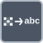

<!-- Generated by tools/export_studio_help.py; edit the reviewed source metadata, then regenerate. -->
# Byte Array To String

[Numeric functions](../index.md) · [All functions](../../index.md)

Builds a string from an array of bytes.

Résumé français de l’aide Studio

**Tableau d'octets vers chaine**

Construit une chaine a partir d'un tableau d'octets. [Types] Tableau U8 1D + encodage optionnel -&gt; String scalaire (et erreur NXG). Studio: L’alias de Studio limité à la valeur n’expose pas les terminaux NI d’encodage et d’erreur.

## Studio authoring profile

Contract status: **partial**. The connector below describes Studio authoring; execution availability is stated separately.

Requests explicit conversion of a rank-one byte array to a string.

1D U8 array + optional encoding -&gt; scalar String (and error in NXG). Studio: Studio value-only alias does not expose NI encoding/error terminals.

## IN — inputs

| Displayed terminal / internal ID | Accepted / resolved type | Studio connection | Unwired input default | Meaning |
| --- | --- | --- | --- | --- |
| unsigned byte array `value` | `array<u8,rank=1>` | Required | Not specified | — |

A default is shown only for an input with an explicitly documented value. Preview/default *types* do not imply unwired operand values. If helper and binding flags differ, both are labelled.

## OUT — outputs

| Displayed terminal / internal ID | Accepted / resolved type | Studio connection | Unwired input default | Meaning |
| --- | --- | --- | --- | --- |
| string `result` | `string` | Recommended (help); Required (binding) | — | — |

A default is shown only for an input with an explicitly documented value. Preview/default *types* do not imply unwired operand values. If helper and binding flags differ, both are labelled.

## Types and connection rules

fixed explicit result string

- Type resolution: `explicit_conversion`; result expression: `string`.
- Implicit coercion: not enabled by this resolver; individual port policies remain explicit.
- Arrays: accepted; lifting policy: `array_to_scalar_conversion`.
- Accepted rank: `1`.

rank-one byte array only

**Input count:** 1; this contract does not enable variadic inputs.

fixed unary in the current binding catalog

## Execution and limits

**Public FROG / target Runtime:** not declared available by this authoring contract.

No portable Runtime formatting or parsing provider is declared.

**Authoring/target contract limits:**

- Locale, formatting options, encoding, invalid-input behavior and status reporting are not defined.
- No machine-readable FROG function manifest or Runtime provider exists.

Connector type defaults and persistence aliases

| Direction | ID | Preview/default type | Connection policy | Cardinality | Legacy port IDs |
| --- | --- | --- | --- | --- | --- |
| INPUT | `value` | `array:u8` | `exact` | `single` | — |
| OUTPUT | `result` | `string` | `exact` | `single` | — |

## Identity and references

- Catalogue ID: `numeric.conversion.byte_array_to_string`.
- Parent palette: [Conversion](../conversion.md).
- Profile: `numeric.text-conversion.partial`.
- Definition: `frog.studio.numeric.conversion.byte_array_to_string`.
- [NI API reference](https://www.ni.com/docs/en-US/bundle/labview-nxg-nodes-api-ref/page/byte-array-to-string.html).
- [NI API reference](https://www.ni.com/docs/en-US/bundle/labview-nxg-nodes-api-ref/page/conversion-nodes.html).

NI links are reference sources for the connector model; Studio support is limited to the profile above. [Reference provenance and notation](../../index.md#provenance-and-notation).
