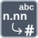

<!-- Generated by tools/export_studio_help.py; edit the reviewed source metadata, then regenerate. -->
# Floating String To Number

[Numeric functions](../index.md) · [All functions](../../index.md)

Parses a floating-point string into a numeric value.

Résumé français de l’aide Studio

**Chaine flottante vers nombre**

Analyse une chaine flottante pour produire une valeur numerique. [Types] String ou tableau/cluster récursivement String devient la même structure à feuilles numériques (DBL par défaut). Chez NI, l'entrée valeur par défaut choisit la représentation ; les offsets restent scalaires. Studio: Studio expose actuellement uniquement la valeur d’entrée et le résultat, sans les terminaux NI de valeur par défaut, de position initiale et de position après le nombre.

## Studio authoring profile

Contract status: **partial**. The connector below describes Studio authoring; execution availability is stated separately.

String or recursively String array/cluster becomes the same structure with numeric leaves (default DBL). In NI the default-value input selects numeric representation; offset and offset-past-number remain scalar.

String or recursively String array/cluster becomes the same structure with numeric leaves (default DBL). In NI the default-value input selects numeric representation; offset and offset-past-number remain scalar. Studio: Studio currently exposes only the value input/result, without the NI default-value, offset and offset-past-number terminals.

## IN — inputs

| Displayed terminal / internal ID | Accepted / resolved type | Studio connection | Unwired input default | Meaning |
| --- | --- | --- | --- | --- |
| numeric string `value` | `T:string_tree` | Required | Not specified | — |

A default is shown only for an input with an explicitly documented value. Preview/default *types* do not imply unwired operand values. If helper and binding flags differ, both are labelled.

## OUT — outputs

| Displayed terminal / internal ID | Accepted / resolved type | Studio connection | Unwired input default | Meaning |
| --- | --- | --- | --- | --- |
| number `result` | `T:any` | Recommended (help); Required (binding) | — | — |

A default is shown only for an input with an explicitly documented value. Preview/default *types* do not imply unwired operand values. If helper and binding flags differ, both are labelled.

## Types and connection rules

String or recursively String array/cluster becomes the same structure with numeric leaves (default DBL). In NI the default-value input selects numeric representation; offset and offset-past-number remain scalar.

- Type resolution: `custom_resolver`; result expression: `resolve:frog.studio.polymorphic.type-resolution@1`.
- Implicit coercion: not enabled by this resolver; individual port policies remain explicit.
- Arrays: accepted; lifting policy: `none`.

**Input count:** 1; this contract does not enable variadic inputs.

fixed unary in the current binding catalog

## Execution and limits

**Public FROG / target Runtime:** not declared available by this authoring contract.

No portable Runtime formatting or parsing provider is declared.

**Authoring/target contract limits:**

- NI reference verified for authoring types; this does not establish runtime support on the active target.
- Studio currently exposes only the value input/result, without the NI default-value, offset and offset-past-number terminals.

Connector type defaults and persistence aliases

| Direction | ID | Preview/default type | Connection policy | Cardinality | Legacy port IDs |
| --- | --- | --- | --- | --- | --- |
| INPUT | `value` | `string` | `any_explicit` | `single` | — |
| OUTPUT | `result` | `f64` | `exact` | `single` | — |

## Identity and references

- Catalogue ID: `numeric.conversion.floating_string_to_number`.
- Parent palette: [Conversion](../conversion.md).
- Profile: `frog.studio.polymorphic.numeric.conversion.floating_string_to_number.v1`.
- Definition: `frog.studio.numeric.conversion.floating_string_to_number`.
- [NI API reference](https://www.ni.com/docs/en-US/bundle/labview-api-ref/page/functions/fract-exp-string-to-number.html).

NI links are reference sources for the connector model; Studio support is limited to the profile above. [Reference provenance and notation](../../index.md#provenance-and-notation).
