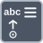

<!-- Generated by tools/export_studio_help.py; edit the reviewed source metadata, then regenerate. -->
# Format Into String

[Numeric functions](../index.md) · [All functions](../../index.md)

Formats one or more values into a string.

## Product execution profiles

The shared index declares native examples for this object; see [the examples below](format_into_string.md#examples) and [document profiles and evidence boundaries](../../../reference/studio-draft-examples.md). Older binding/help statements retained below can lag those product profiles. They do not establish or deny the separately measured native profiles. An example declaration alone is not an execution result or admission of every overload.

Résumé français de l’aide Studio

**Formater en chaine**

Texte historique de l’aide conservé ci-dessous. Des exemples natifs distincts sont déclarés pour cet objet ; consultez les profils et preuves datés, sans déduire une compatibilité universelle de ce texte.

Formate une ou plusieurs valeurs dans une chaine.

## Studio authoring profile

Contract status: **partial**. The connector below describes Studio authoring; execution availability is stated separately.

## IN — inputs

| Displayed terminal / internal ID | Accepted / resolved type | Studio connection | Unwired input default | Meaning |
| --- | --- | --- | --- | --- |
| value `value` | `T:any` | Required | Not specified | — |

A default is shown only for an input with an explicitly documented value. Preview/default *types* do not imply unwired operand values. If helper and binding flags differ, both are labelled.

## OUT — outputs

| Displayed terminal / internal ID | Accepted / resolved type | Studio connection | Unwired input default | Meaning |
| --- | --- | --- | --- | --- |
| formatted string `result` | `T:any` | Recommended (help); Required (binding) | — | — |

A default is shown only for an input with an explicitly documented value. Preview/default *types* do not imply unwired operand values. If helper and binding flags differ, both are labelled.

## Types and Compatibility

The notes below retain the reviewed help's original NI and Studio scopes. An NI overload is not a claim of Studio runtime support; the authoring profile and execution limits remain separate.

Retained binding and help statements

These are source declarations, not the current measured product-execution assessment. Compare historical limitations with the separately dated native profiles above.

Scalar String/Path/Boolean/Enum/Timestamp/numeric arguments + format/initial Strings -&gt; scalar String + error; no array/cluster arguments. Studio: Studio currently exposes a value-only formatting alias.

Notes de types et de compatibilité de l’aide Studio

Les mentions NI et Studio gardent leur portée d’origine. Une variante NI ne constitue pas une déclaration de prise en charge par le runtime Studio ; consultez les profils et limites d’exécution de cette fiche.

Arguments scalaires String/Path/Boolean/Enum/Timestamp/numériques + format/String initiale -&gt; String scalaire + erreur ; sans arguments tableaux/clusters. Studio: Studio expose actuellement un alias de formatage limité à la valeur.

- Type resolution: `custom_resolver`; result expression: `resolve:frog.studio.polymorphic.type-resolution@1`.
- Implicit coercion: not enabled by this resolver; individual port policies remain explicit.
- Arrays: accepted; lifting policy: `none`.

**Input count:** 1; this contract does not enable variadic inputs.

fixed unary in the current binding catalog

## Execution and limits

**Public FROG / target Runtime:** not declared available by this authoring contract.

Scope: `requires_explicit_target_capability`.

Implementation: `frog.studio.numeric.conversion.format_into_string.unary-typed.v1`.

Required provider: `frog.studio.numeric.unary-text.ascii-dot-prefix@1`.

Explicit GS unary text defaults: invariant ASCII dot, precision six, exact source integer width and prefix parsers with the declared I32/U32/DBL result. Uses the compiled Numeric provider and existing String formatter; missing NI locale/prototype/precision connectors and advanced carriers are not claimed. Execution and AOT evidence remain distinct.

Retained authoring-contract limitations

These declarations belong to the binding snapshot. Compare them with the separately admitted native profiles and dated measurements linked above; they are not a current denial of those product profiles.

**Authoring/target contract limits:**

- NI reference verified for authoring types; this does not establish runtime support on the active target.
- Studio currently exposes a value-only formatting alias.

Connector type defaults and persistence aliases

| Direction | ID | Preview/default type | Connection policy | Cardinality | Legacy port IDs |
| --- | --- | --- | --- | --- | --- |
| INPUT | `value` | `f64` | `any_explicit` | `single` | — |
| OUTPUT | `result` | `string` | `exact` | `single` | — |

## Examples

These are real `.frog` documents from the same index used by Studio. Backend names and expected results describe the examples; they are not execution certificates.

- [Format Into String](../../../examples/numeric.conversion.format_into_string.worked.md) — Formater le DBL 12,5 avec la conversion unaire de la palette numérique. Vérifier le point décimal et les six chiffres après le point dans la chaîne 12.500000. (`execution`, `studio-draft`).

## Identity and references

- Catalogue ID: `numeric.conversion.format_into_string`.
- Parent palette: [Conversion](../conversion.md).
- Profile: `frog.studio.polymorphic.numeric.conversion.format_into_string.v1`.
- Definition: `frog.studio.numeric.conversion.format_into_string`.
- [NI API reference](https://www.ni.com/docs/en-US/bundle/labview-nxg-nodes-api-ref/page/format-into-string.html).

NI links are reference sources for the connector model; Studio support is limited to the profile above. [Reference provenance and notation](../../index.md#provenance-and-notation).
