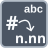

<!-- Generated by tools/export_studio_help.py; edit the reviewed source metadata, then regenerate. -->
# Number To Fractional String

[Numeric functions](../index.md) · [All functions](../../index.md)

Formats a number with a fixed count of fractional digits.

Résumé français de l’aide Studio

**Nombre vers chaine fractionnaire**

Formate un nombre avec un nombre fixe de chiffres fractionnaires. [Types] Un scalaire numérique ou tableau/cluster numérique devient la même structure à feuilles String ; rangs et ordre des champs sont conservés. Largeur/précision sont des paramètres scalaires chez NI. Studio: Studio expose actuellement uniquement la valeur d’entrée, sans les commandes NI de largeur, de précision ou de séparateur décimal.

## Studio authoring profile

Contract status: **partial**. The connector below describes Studio authoring; execution availability is stated separately.

Numeric scalar or recursively numeric array/cluster becomes the same structure with String leaves; ranks and field order remain unchanged. Width/precision are scalar formatting parameters in NI.

Numeric scalar or recursively numeric array/cluster becomes the same structure with String leaves; ranks and field order remain unchanged. Width/precision are scalar formatting parameters in NI. Studio: Studio currently exposes the value input only, not NI width, precision or decimal-separator controls.

## IN — inputs

| Displayed terminal / internal ID | Accepted / resolved type | Studio connection | Unwired input default | Meaning |
| --- | --- | --- | --- | --- |
| number `value` | `T:numeric_tree` | Required | Not specified | — |

A default is shown only for an input with an explicitly documented value. Preview/default *types* do not imply unwired operand values. If helper and binding flags differ, both are labelled.

## OUT — outputs

| Displayed terminal / internal ID | Accepted / resolved type | Studio connection | Unwired input default | Meaning |
| --- | --- | --- | --- | --- |
| fractional string `result` | `T:any` | Recommended (help); Required (binding) | — | — |

A default is shown only for an input with an explicitly documented value. Preview/default *types* do not imply unwired operand values. If helper and binding flags differ, both are labelled.

## Types and connection rules

Numeric scalar or recursively numeric array/cluster becomes the same structure with String leaves; ranks and field order remain unchanged. Width/precision are scalar formatting parameters in NI.

- Type resolution: `custom_resolver`; result expression: `resolve:frog.studio.polymorphic.type-resolution@1`.
- Implicit coercion: not enabled by this resolver; individual port policies remain explicit.
- Arrays: accepted; lifting policy: `none`.

**Input count:** 1; this contract does not enable variadic inputs.

fixed unary in the current binding catalog

## Execution and limits

**Public FROG / target Runtime:** not declared available by this authoring contract.

No portable Runtime formatting or parsing provider is declared.

**Authoring/target contract limits:**

- NI reference verified for authoring types; this does not establish runtime support on the active target.
- Studio currently exposes the value input only, not NI width, precision or decimal-separator controls.

Connector type defaults and persistence aliases

| Direction | ID | Preview/default type | Connection policy | Cardinality | Legacy port IDs |
| --- | --- | --- | --- | --- | --- |
| INPUT | `value` | `f64` | `any_explicit` | `single` | — |
| OUTPUT | `result` | `string` | `exact` | `single` | — |

## Identity and references

- Catalogue ID: `numeric.conversion.number_to_fractional_string`.
- Parent palette: [Conversion](../conversion.md).
- Profile: `frog.studio.polymorphic.numeric.conversion.number_to_fractional_string.v1`.
- Definition: `frog.studio.numeric.conversion.number_to_fractional_string`.
- [NI API reference](https://www.ni.com/docs/en-US/bundle/labview-api-ref/page/functions/number-to-fractional-string.html).

NI links are reference sources for the connector model; Studio support is limited to the profile above. [Reference provenance and notation](../../index.md#provenance-and-notation).
