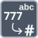

<!-- Generated by tools/export_studio_help.py; edit the reviewed source metadata, then regenerate. -->
# Octal String To Number

[Numeric functions](../index.md) · [All functions](../../index.md)

Parses an octal string into a numeric value.

Résumé français de l’aide Studio

**Chaine octale vers nombre**

Analyse une chaine octale pour produire une valeur numerique.

## Studio authoring profile

Contract status: **partial**. The connector below describes Studio authoring; execution availability is stated separately.

## IN — inputs

| Displayed terminal / internal ID | Accepted / resolved type | Studio connection | Unwired input default | Meaning |
| --- | --- | --- | --- | --- |
| octal string `value` | `T:string_tree` | Required | Not specified | — |

A default is shown only for an input with an explicitly documented value. Preview/default *types* do not imply unwired operand values. If helper and binding flags differ, both are labelled.

## OUT — outputs

| Displayed terminal / internal ID | Accepted / resolved type | Studio connection | Unwired input default | Meaning |
| --- | --- | --- | --- | --- |
| number `result` | `T:any` | Recommended (help); Required (binding) | — | — |

A default is shown only for an input with an explicitly documented value. Preview/default *types* do not imply unwired operand values. If helper and binding flags differ, both are labelled.

## Types and Compatibility

The notes below retain the reviewed help's original NI and Studio scopes. An NI overload is not a claim of Studio runtime support; the authoring profile and execution limits remain separate.

String or recursively String array/cluster becomes the same structure with numeric leaves (default U32). In NI the default-value input selects numeric representation; offset and offset-past-number remain scalar. Studio: Studio currently exposes only the value input/result, without the NI default-value, offset and offset-past-number terminals.

Notes de types et de compatibilité de l’aide Studio

Les mentions NI et Studio gardent leur portée d’origine. Une variante NI ne constitue pas une déclaration de prise en charge par le runtime Studio ; consultez les profils et limites d’exécution de cette fiche.

String ou tableau/cluster récursivement String devient la même structure à feuilles numériques (U32 par défaut). Chez NI, l'entrée valeur par défaut choisit la représentation ; les offsets restent scalaires. Studio: Studio expose actuellement uniquement la valeur d’entrée et le résultat, sans les terminaux NI de valeur par défaut, de position initiale et de position après le nombre.

- Type resolution: `custom_resolver`; result expression: `resolve:frog.studio.polymorphic.type-resolution@1`.
- Implicit coercion: not enabled by this resolver; individual port policies remain explicit.
- Arrays: accepted; lifting policy: `none`.

**Input count:** 1; this contract does not enable variadic inputs.

fixed unary in the current binding catalog

## Execution and limits

**Public FROG / target Runtime:** not declared available by this authoring contract.

Scope: `requires_explicit_target_capability`.

Implementation: `frog.studio.numeric.conversion.octal_string_to_number.unary-typed.v1`.

Required provider: `frog.studio.numeric.unary-text.ascii-dot-prefix@1`.

Explicit GS unary text defaults: invariant ASCII dot, precision six, exact source integer width and prefix parsers with the declared I32/U32/DBL result. Uses the compiled Numeric provider and existing String formatter; missing NI locale/prototype/precision connectors and advanced carriers are not claimed. Execution and AOT evidence remain distinct.

**Authoring/target contract limits:**

- NI reference verified for authoring types; this does not establish runtime support on the active target.
- Studio currently exposes only the value input/result, without the NI default-value, offset and offset-past-number terminals.

Connector type defaults and persistence aliases

| Direction | ID | Preview/default type | Connection policy | Cardinality | Legacy port IDs |
| --- | --- | --- | --- | --- | --- |
| INPUT | `value` | `string` | `any_explicit` | `single` | — |
| OUTPUT | `result` | `u32` | `exact` | `single` | — |

## Examples

No example for this object is currently declared in the shared index. [Browse the available examples](../../../examples/index.md).

## Identity and references

- Catalogue ID: `numeric.conversion.octal_string_to_number`.
- Parent palette: [Conversion](../conversion.md).
- Profile: `frog.studio.polymorphic.numeric.conversion.octal_string_to_number.v1`.
- Definition: `frog.studio.numeric.conversion.octal_string_to_number`.
- [NI API reference](https://www.ni.com/docs/en-US/bundle/labview-api-ref/page/functions/octal-string-to-number.html).

NI links are reference sources for the connector model; Studio support is limited to the profile above. [Reference provenance and notation](../../index.md#provenance-and-notation).
