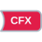

<!-- Generated by tools/export_studio_help.py; edit the reviewed source metadata, then regenerate. -->
# To CFX

[Numeric functions](../index.md) · [All functions](../../index.md)

Converts the input to a complex fixed-point value.

Résumé français de l’aide Studio

**Vers CFX**

Convertit l'entree en valeur complexe a virgule fixe. [Types] Numérique + type/configuration virgule fixe complexe -&gt; CFX et booléen de débordement. Studio: Studio résout uniquement la représentation ; la longueur de mot, la mise à l’échelle, la configuration et la sortie de dépassement de NI ne sont pas encore exposées.

## Studio authoring profile

Contract status: **partial**. The connector below describes Studio authoring; execution availability is stated separately.

Numeric value + complex fixed-point type/configuration -&gt; complex FXP and overflow Boolean.

Numeric value + complex fixed-point type/configuration -&gt; complex FXP and overflow Boolean. Studio: Studio resolves the representation only; NI word-length, scaling, overflow configuration and overflow output are not yet exposed.

## IN — inputs

| Displayed terminal / internal ID | Accepted / resolved type | Studio connection | Unwired input default | Meaning |
| --- | --- | --- | --- | --- |
| number `value` | `T:numeric_convertible_tree` | Required | Not specified | — |

A default is shown only for an input with an explicitly documented value. Preview/default *types* do not imply unwired operand values. If helper and binding flags differ, both are labelled.

## OUT — outputs

| Displayed terminal / internal ID | Accepted / resolved type | Studio connection | Unwired input default | Meaning |
| --- | --- | --- | --- | --- |
| CFX(number) `result` | `T:any` | Required | — | — |

A default is shown only for an input with an explicitly documented value. Preview/default *types* do not imply unwired operand values. If helper and binding flags differ, both are labelled.

## Types and connection rules

Numeric value + complex fixed-point type/configuration -&gt; complex FXP and overflow Boolean.

- Type resolution: `custom_resolver`; result expression: `resolve:frog.studio.polymorphic.type-resolution@1`.
- Implicit coercion: not enabled by this resolver; individual port policies remain explicit.
- Arrays: accepted; lifting policy: `none`.

**Input count:** 1; this contract does not enable variadic inputs.

fixed unary

## Execution and limits

**Public FROG / target Runtime:** not declared available by this authoring contract.

No portable Runtime conversion provider is declared.

**Authoring/target contract limits:**

- NI reference verified for authoring types; this does not establish runtime support on the active target.
- Studio resolves the representation only; NI word-length, scaling, overflow configuration and overflow output are not yet exposed.

**Private Studio Run/Highlight:** the local function evaluator dispatches this catalogue identity. Inputs and output types must be resolved; unsupported value operations or representations fail explicitly. This local dispatch is separate from the public target Runtime declaration above.

Connector type defaults and persistence aliases

| Direction | ID | Preview/default type | Connection policy | Cardinality | Legacy port IDs |
| --- | --- | --- | --- | --- | --- |
| INPUT | `value` | `cfx` | `any_explicit` | `single` | — |
| OUTPUT | `result` | `cfx` | `exact` | `single` | — |

## Examples

No example for this object is currently declared in the shared index. [Browse the available examples](../../../examples/index.md).

## Identity and references

- Catalogue ID: `numeric.conversion.to_cfx`.
- Parent palette: [Conversion](../conversion.md).
- Profile: `frog.studio.polymorphic.numeric.conversion.to_cfx.v1`.
- Definition: `frog.studio.numeric.conversion.to_cfx`.
- [NI API reference](https://www.ni.com/docs/en-US/bundle/labview-nxg-nodes-api-ref/page/to-complex-fixed-point.html).

NI links are reference sources for the connector model; Studio support is limited to the profile above. [Reference provenance and notation](../../index.md#provenance-and-notation).
