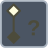

<!-- Generated by tools/export_studio_help.py; edit the reviewed source metadata, then regenerate. -->
# In Range

[Numeric functions](index.md) · [All functions](../index.md)

Tests whether a value lies inside configured lower and upper limits.

Résumé français de l’aide Studio

**Dans la gamme**

Teste si une valeur se trouve entre les limites basse et haute configurees. [Types] x,borne basse,borne haute comparables -&gt; valeur contrainte de type commun ; résultat booléen, structure booléenne en mode comparaison élémentaire. Studio: Profil de câblage uniquement : les variantes Waveform, unités physiques et formats de virgule fixe configurables ne sont pas modélisés. L’exécution nécessite toujours un fournisseur sur la cible.

## Studio authoring profile

Contract status: **partial**. The connector below describes Studio authoring; execution availability is stated separately.

Comparable x,lower,upper -&gt; coerced value of common type; Boolean in-range result, elementwise Boolean structure in Compare Elements mode.

Comparable x,lower,upper -&gt; coerced value of common type; Boolean in-range result, elementwise Boolean structure in Compare Elements mode. Studio: Studio authoring supports the declared numeric scalar/array/cluster types; NI waveform, physical-unit and configurable fixed-point layout overloads are not modeled. Runtime execution still requires a target provider.

## IN — inputs

| Displayed terminal / internal ID | Accepted / resolved type | Studio connection | Unwired input default | Meaning |
| --- | --- | --- | --- | --- |
| upper limit `upper_limit` | `T:numeric_tree` | Required | Not specified | — |
| x `x` | `T:numeric_tree` | Required | Not specified | — |
| lower limit `lower_limit` | `T:numeric_tree` | Required | Not specified | — |

A default is shown only for an input with an explicitly documented value. Preview/default *types* do not imply unwired operand values. If helper and binding flags differ, both are labelled.

## OUT — outputs

| Displayed terminal / internal ID | Accepted / resolved type | Studio connection | Unwired input default | Meaning |
| --- | --- | --- | --- | --- |
| coerced(x) `coerced` | `T:numeric_tree` | Recommended (help); Required (binding) | — | — |
| in range? `in_range` | `T:any` | Recommended (help); Required (binding) | — | — |

A default is shown only for an input with an explicitly documented value. Preview/default *types* do not imply unwired operand values. If helper and binding flags differ, both are labelled.

## Types and connection rules

Comparable x,lower,upper -&gt; coerced value of common type; Boolean in-range result, elementwise Boolean structure in Compare Elements mode.

- Type resolution: `custom_resolver`; result expression: `resolve:frog.studio.polymorphic.type-resolution@1`.
- Implicit coercion: not enabled by this resolver; individual port policies remain explicit.
- Arrays: accepted; lifting policy: `element_wise_same_shape_with_scalar_lift`.
- Shape rule: `compatible_rank_and_schema; scalar_lift`.
- Scalar lifting: yes.

**Input count:** 3; this contract does not enable variadic inputs.

## Execution and limits

**Public FROG / target Runtime:** not declared available by this authoring contract.

**Authoring/target contract limits:**

- NI reference verified for authoring types; this does not establish runtime support on the active target.
- Studio authoring supports the declared numeric scalar/array/cluster types; NI waveform, physical-unit and configurable fixed-point layout overloads are not modeled. Runtime execution still requires a target provider.

**Private Studio Run/Highlight:** the local function evaluator dispatches this catalogue identity. Inputs and output types must be resolved; unsupported value operations or representations fail explicitly. This local dispatch is separate from the public target Runtime declaration above.

Connector type defaults and persistence aliases

| Direction | ID | Preview/default type | Connection policy | Cardinality | Legacy port IDs |
| --- | --- | --- | --- | --- | --- |
| INPUT | `upper_limit` | `f64` | `any_explicit` | `single` | — |
| INPUT | `x` | `f64` | `any_explicit` | `single` | — |
| INPUT | `lower_limit` | `f64` | `any_explicit` | `single` | — |
| OUTPUT | `coerced` | `f64` | `any_explicit` | `single` | — |
| OUTPUT | `in_range` | `bool` | `any_explicit` | `single` | — |

## Examples

No example for this object is currently declared in the shared index. [Browse the available examples](../../examples/index.md).

## Identity and references

- Catalogue ID: `numeric.in_range`.
- Profile: `frog.studio.polymorphic.numeric.in_range.v1`.
- Definition: `frog.studio.numeric.in_range`.
- [NI API reference](https://www.ni.com/docs/en-US/bundle/labview-nxg-nodes-api-ref/page/in-range-and-coerce.html).

NI links are reference sources for the connector model; Studio support is limited to the profile above. [Reference provenance and notation](../index.md#provenance-and-notation).
