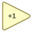

<!-- Generated by tools/export_studio_help.py; edit the reviewed source metadata, then regenerate. -->
# Increment

[Numeric functions](index.md) · [All functions](../index.md)

Adds one to the input value.

## Product execution profiles

The shared index declares native examples for this object; see [the examples below](increment.md#examples) and [document profiles and evidence boundaries](../../reference/studio-draft-examples.md). Older binding/help statements retained below can lag those product profiles. They do not establish or deny the separately measured native profiles. An example declaration alone is not an execution result or admission of every overload.

Résumé français de l’aide Studio

**Incrementer**

Texte historique de l’aide conservé ci-dessous. Des exemples natifs distincts sont déclarés pour cet objet ; consultez les profils et preuves datés, sans déduire une compatibilité universelle de ce texte.

Ajoute un a la valeur d'entree. [Types] x numérique ou enum -&gt; même structure/représentation x+1 ; variantes Timestamp et Waveform chez NI. Studio: Profil de câblage uniquement : les variantes Waveform, unités physiques et formats de virgule fixe configurables ne sont pas modélisés. L’exécution nécessite toujours un fournisseur sur la cible.

## Studio authoring profile

Contract status: **partial**. The connector below describes Studio authoring; execution availability is stated separately.

Retained binding and help description

This is the source declaration, not the current measured product-execution assessment.

Numeric or enum x -&gt; same structure/representation x+1; NI also has timestamp and waveform overloads.

Numeric or enum x -&gt; same structure/representation x+1; NI also has timestamp and waveform overloads. Studio: Studio authoring supports the declared numeric scalar/array/cluster types; NI waveform, physical-unit and configurable fixed-point layout overloads are not modeled. Runtime execution still requires a target provider.

## IN — inputs

| Displayed terminal / internal ID | Accepted / resolved type | Studio connection | Unwired input default | Meaning |
| --- | --- | --- | --- | --- |
| x `in` | `T:numeric_tree` | Required | Not specified | — |

A default is shown only for an input with an explicitly documented value. Preview/default *types* do not imply unwired operand values. If helper and binding flags differ, both are labelled.

## OUT — outputs

| Displayed terminal / internal ID | Accepted / resolved type | Studio connection | Unwired input default | Meaning |
| --- | --- | --- | --- | --- |
| x + 1 `result` | `T:numeric_tree` | Recommended (help); Required (binding) | — | — |

A default is shown only for an input with an explicitly documented value. Preview/default *types* do not imply unwired operand values. If helper and binding flags differ, both are labelled.

## Types and connection rules

Numeric or enum x -&gt; same structure/representation x+1; NI also has timestamp and waveform overloads.

- Type resolution: `custom_resolver`; result expression: `resolve:frog.studio.polymorphic.type-resolution@1`.
- Implicit coercion: not enabled by this resolver; individual port policies remain explicit.
- Arrays: accepted; lifting policy: `none`.
- Shape rule: `per_port_contract`.
- Scalar lifting: no.

**Input count:** 1; this contract does not enable variadic inputs.

## Execution and limits

**Public FROG / target Runtime:** not declared available by this authoring contract.

Retained authoring-contract limitations

These declarations belong to the binding snapshot. Compare them with the separately admitted native profiles and dated measurements linked above; they are not a current denial of those product profiles.

**Authoring/target contract limits:**

- NI reference verified for authoring types; this does not establish runtime support on the active target.
- Studio authoring supports the declared numeric scalar/array/cluster types; NI waveform, physical-unit and configurable fixed-point layout overloads are not modeled. Runtime execution still requires a target provider.

**Private Studio Run/Highlight:** the local function evaluator dispatches this catalogue identity. Inputs and output types must be resolved; unsupported value operations or representations fail explicitly. This local dispatch is separate from the public target Runtime declaration above.

Connector type defaults and persistence aliases

| Direction | ID | Preview/default type | Connection policy | Cardinality | Legacy port IDs |
| --- | --- | --- | --- | --- | --- |
| INPUT | `in` | `f64` | `any_explicit` | `single` | — |
| OUTPUT | `result` | `f64` | `any_explicit` | `single` | — |

## Examples

These are real `.frog` documents from the same index used by Studio. Backend names and expected results describe the examples; they are not execution certificates.

- [Increment — scalar i32](../../examples/numeric.increment.scalar_i32.md) — Numeric or enum x -&gt; same structure/representation x+1; NI also has timestamp and waveform overloads. (`execution`, `studio-draft`).
- [Increment — scalar u32](../../examples/numeric.increment.scalar_u32.md) — Numeric or enum x -&gt; same structure/representation x+1; NI also has timestamp and waveform overloads. (`execution`, `studio-draft`).
- [Increment — scalar i64](../../examples/numeric.increment.scalar_i64.md) — Numeric or enum x -&gt; same structure/representation x+1; NI also has timestamp and waveform overloads. (`execution`, `studio-draft`).
- [Increment — scalar u64](../../examples/numeric.increment.scalar_u64.md) — Numeric or enum x -&gt; same structure/representation x+1; NI also has timestamp and waveform overloads. (`execution`, `studio-draft`).
- [Increment — scalar f64](../../examples/numeric.increment.scalar_f64.md) — Numeric or enum x -&gt; same structure/representation x+1; NI also has timestamp and waveform overloads. (`execution`, `studio-draft`).
- [Flat Sequence : entrée et passages entre trois frames](../../examples/structure.sequence.three_frames.md) — Flat Sequence : entrée et passages entre trois frames (`execution`, `studio-draft`).
- [For : un registre initialisé accumule quatre incréments](../../examples/structure.for.initialized_shift_register.md) — For : un registre initialisé accumule quatre incréments (`execution`, `studio-draft`).
- [For : zéro itération conserve l'initialisation](../../examples/structure.for.zero_iterations.md) — For : zéro itération conserve l'initialisation (`execution`, `studio-draft`).
- [While : Stop if True exécute au moins une itération](../../examples/structure.while.stop_true_one_iteration.md) — While : Stop if True exécute au moins une itération (`execution`, `studio-draft`).
- [While : Continue if True s'arrête sur False](../../examples/structure.while.continue_false_one_iteration.md) — While : Continue if True s'arrête sur False (`execution`, `studio-draft`).
- [While : arrêter au troisième incrément](../../examples/structure.while.three_iterations.md) — While : arrêter au troisième incrément (`execution`, `studio-draft`).
- [Case bool : sélection exacte et tunnels](../../examples/structure.case.bool.true.md) — Case bool : sélection exacte et tunnels (`execution`, `studio-draft`).
- [Case bool : branche alternative](../../examples/structure.case.bool.false.md) — Case bool : branche alternative (`execution`, `studio-draft`).
- [Case i64 : sélection exacte et tunnels](../../examples/structure.case.i64.exact.md) — Case i64 : sélection exacte et tunnels (`execution`, `studio-draft`).
- [Case u64 : sélection exacte et tunnels](../../examples/structure.case.u64.exact.md) — Case u64 : sélection exacte et tunnels (`execution`, `studio-draft`).
- [Case string : sélection exacte et tunnels](../../examples/structure.case.string.exact.md) — Case string : sélection exacte et tunnels (`execution`, `studio-draft`).
- [Case string : branche alternative](../../examples/structure.case.string.default.md) — Case string : branche alternative (`execution`, `studio-draft`).
- [Case enum : sélection exacte et tunnels](../../examples/structure.case.enum.exact.md) — Case enum : sélection exacte et tunnels (`execution`, `studio-draft`).
- [Flat Sequence : traverser trois frames et une frame vide](../../examples/structure.sequence.native.flat_passages.md) — Flat Sequence : traverser trois frames et une frame vide (`execution`, `studio-draft`).
- [Stacked Sequence : conserver et exécuter toutes les frames](../../examples/structure.sequence.native.stacked_passages.md) — Stacked Sequence : conserver et exécuter toutes les frames (`execution`, `studio-draft`).
- [Flat Sequence : une sortie précoce alimente une entrée tardive](../../examples/structure.sequence.native.flat_late_input.md) — Flat Sequence : une sortie précoce alimente une entrée tardive (`execution`, `studio-draft`).
- [Stacked Sequence : diagnostiquer une dépendance circulaire](../../examples/structure.sequence.native.stacked_late_cycle.md) — Stacked Sequence : diagnostiquer une dépendance circulaire (`expected-diagnostic`, `studio-draft`).

## Identity and references

- Catalogue ID: `numeric.increment`.
- Profile: `frog.studio.polymorphic.numeric.increment.v1`.
- Definition: `frog.studio.numeric.increment`.
- [NI API reference](https://www.ni.com/docs/en-US/bundle/labview-nxg-nodes-api-ref/page/increment.html).

NI links are reference sources for the connector model; Studio support is limited to the profile above. [Reference provenance and notation](../index.md#provenance-and-notation).
